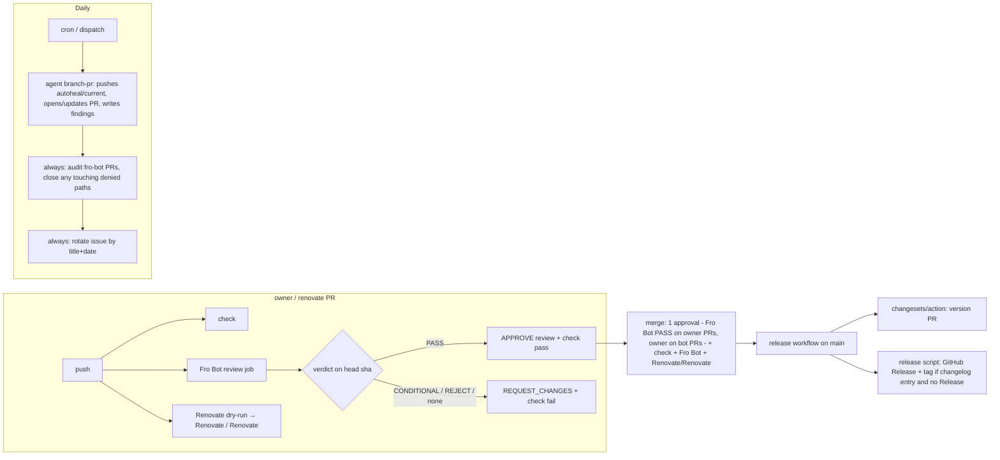

# feat: Repository operations for metacogs

## Overview

Bring metacogs onto the fleet's repository conventions in dependency order: pin the toolchain and actions, add Changesets releases, add Renovate, add Fro Bot review and autoheal, then declare the `main` and tag rulesets once every required check has reported on a real PR. Two runner-side changes fall out: the skill hash stops covering the generated helper, and Bun is pinned.

## Problem Frame

metacogs shipped v0.1.0 with one CI workflow and nothing else: `main` unprotected, all merge methods enabled, floating action tags, no dependency automation, no release tooling, no automated review. The siblings (dev-like, systematic, infra) carry all five pieces. Two repo properties make a copy wrong: a package version bump rewrites both shipped helpers, and automated edits to eval evidence or skill text are epochs, not fixes (see origin: docs/brainstorms/2026-10-23-repo-ops-requirements.md).

## Requirements Trace

| Origin | Covered by |
|---|---|
| R1, R2, R3, R4 settings and rulesets | Unit 7 |
| R5, R6, R7, R8 Renovate and pins | Units 1, 4 |
| R9, R10, R11, R12 releases and changesets | Units 3, 4 |
| R13, R14 Fro Bot review gate | Unit 5 |
| R15–R18 autoheal and rotating issue | Unit 6 |
| R19, R20 CI and hygiene | Units 1, 3 |
| Decision: helper not hashed, `helper_version` tracks package version | Unit 2 |
| Decision: one required approval, automerge kept | Units 5, 7 |

## Scope Boundaries

- No v0.2 scoring work or eval epochs.
- No registry publish, provenance, or scheduled release gating.
- No CodeQL, Scorecard, dependency-review; the secret scan stays the only scan.
- No Copilot setup files, issue templates, `CONTRIBUTING.md`, `CODEOWNERS`.
- Workflow behavior is verified on throwaway PRs, not unit-tested; only the release script's parser and the hash change carry tests.

### Deferred to Separate Tasks

- Back-port the rotating issue and the verdict-gated check to dev-like and systematic: fleet work, separate repos.
- Cut helper duplication and regenerate from one source: future metacogs iteration.
- Fleet-level fix for the Fro Bot check going green on exit 0 without a verdict: fro-bot/agent or sibling repos.

## Context & Research

### Relevant Code and Patterns

- `.github/workflows/ci.yml`: job id `check` is the required-check context; keep it bare.
- `src/generate/bundle-helpers.ts` bakes `package.json#version` into `skills/*/scripts/record.mjs`; `src/generate/check.ts` byte-compares the committed files. `.agents/skills/` is gitignored and not compared.
- `src/runner/workspace.ts` `hashSkillDir` hashes every file under `skills/<m>/`. `src/runner/report.ts` `skill_matches` and `src/runner/cli.ts` dev-regression compare dev-campaign hash to the current tree.
- `src/scan/secrets.ts` scans `.github` but not `.changeset/`, `CHANGELOG.md`, root `SECURITY.md`, `package.json`. The hyphenated `sk-` rule matches `task-…`/`risk-…` identifiers with a digit; the generic rule matches quoted `token: "…16+"`.
- `src/matrix/check.ts`: `matrix.json` edits need `bun run matrix:render` to refresh the README block.
- `tsconfig.json` includes only `src/**`; a release script outside `src/` is not type-checked.
- Fleet sources (current shape = systematic + infra; dev-like is stale on pins): `systematic/.github/workflows/{fro-bot,renovate,update-repo-settings}.yaml`, `systematic/.github/settings.yml` (`rulesets:` block), `infra/.github/workflows/{release,renovate-changesets,fro-bot}.yaml`, `infra/.github/renovate.json5`, bfra-me/.github `scripts/release.ts` and `.changeset/config.json`.
- Owner common settings (`marcusrbrown/.github` `common-settings.yaml`) already set squash-only, `delete_branch_on_merge`, `allow_auto_merge: true`, collaborators (`fro-bot` push), and a classic `main` protection with `strict: true`, `enforce_admins: true`. Extending the file gives R4 for free; the ruleset coexists with the classic protection.

### Verified pins

| Use | Pin |
|---|---|
| `actions/checkout` | `3d3c42e5aac5ba805825da76410c181273ba90b1 # v7.0.1` |
| `oven-sh/setup-bun` | `0c5077e51419868618aeaa5fe8019c62421857d6 # v2.2.0` |
| `actions/create-github-app-token` | `64ab729a6294000f5aa4a4bc0b73d1f32bc45510 # v3.3.0` |
| `changesets/action` | `ae32849d5ba541f9ae29e40e22a623bc13562f51 # v2.1.2` (commit SHA, not the tag object) |
| `fro-bot/agent` | `c1173a2e8b68294594927ff9a1d8be5067cc2932 # v0.125.3` |
| `bfra-me/.github` reusable workflows | `e6a1ab17bb68213940f63de91bd0450acdf9fff4 # v4.43.0` |
| `marcusrbrown/renovate-config` | `#5.2.16` |

### External References

- fro-bot/agent v0.125.3: brokered push with a path allowlist exists only for same-repo PR-comment flows; on `schedule`/`workflow_dispatch` the agent holds the credential and `output-mode` is a prompt contract. Outputs: `delivery-kind`, `invocation-outcome`; no findings channel. For PR review the action maps `PASS` to an APPROVE review and `CONDITIONAL`/`REJECT` to REQUEST_CHANGES, downgrading to COMMENT when execution was not fully observed.
- `changesets/action` v2.1.2 inputs: `version-script`, `publish-script`, `create-github-releases` (default true), `commit-message`, `pr-title`. The publish path runs only when no changesets are pending.
- bfra-me `update-repository-settings` action: rulesets are matched by lowercased name and undeclared ones are deleted; `target` passes through to the Rulesets API. An empty `rulesets:` array is a no-op.
- bfra-me reusable Renovate workflow: `allowedCommands` admits `bun install --ignore-scripts` and `bun run generate` verbatim. Bun on the Renovate runner is unverified.

## Prior-Art Survey

```json
{
  "schema_version": 2,
  "verdict": "build-new-within-scope",
  "scope": "marcusrbrown/metacogs repository: package.json, .github/, src/, docs/, README.md, AGENTS.md, evals/, skills/, git tags, GitHub releases and rulesets",
  "freshness": {
    "vcs_reference": "d88d45533153d22ec6f2a685dd9c7e8bc7cc00c2"
  },
  "budget": {
    "max_search_passes": 3,
    "max_candidate_inspections": 8,
    "exhausted": false
  },
  "candidates": [
    {
      "path_or_symbol": ".github/workflows/ci.yml",
      "description": "Single CI workflow, job `check`, five validation commands on push and pull_request",
      "disposition": "insufficient",
      "insufficiency_reason": "Validation only; creates no tags, releases, changesets, issues or settings"
    },
    {
      "path_or_symbol": "src/generate/bundle-helpers.ts",
      "description": "Regenerates skills/*/scripts/record.mjs with package.json version baked in",
      "disposition": "extend",
      "insufficiency_reason": "Nothing invokes it after a version bump or dependency update"
    },
    {
      "path_or_symbol": "src/scan/secrets.ts",
      "description": "Key, token and email scan over repo paths including .github",
      "disposition": "reuse"
    },
    {
      "path_or_symbol": "src/matrix/check.ts",
      "description": "matrix.json and README block consistency gate",
      "disposition": "reuse"
    },
    {
      "path_or_symbol": "src/runner/workspace.ts hashSkillDir",
      "description": "sha256 over every file under skills/<method>/ including the generated helper",
      "disposition": "extend",
      "insufficiency_reason": "Must exclude scripts/ so releases do not change the skill hash"
    },
    {
      "path_or_symbol": "git tags v0.1.0 and prereg/*",
      "description": "Hand-created tags; v0.1.0 has no GitHub Release",
      "disposition": "insufficient",
      "insufficiency_reason": "No code produces tags or releases"
    }
  ]
}
```

## Key Technical Decisions

- **Skill hash excludes `scripts/`.** The helper is generated and versioned by `helper_version`; hashing it made every release an apparent skill edit. Committed reports keep the hash they recorded; a dev campaign recorded under the old rule cannot be re-projected or count toward a GREEN read, so the next epoch starts with a fresh dev campaign.
- **`helper_version` keeps tracking the package version; the Changesets `version` command runs `bun run generate`.** The version PR then carries the regenerated helpers and passes `generate:check`.
- **Bun pinned once** via `packageManager` in `package.json`; every `setup-bun` step reads it (`bun-version-file: package.json`). Renovate owns the bump and the regen runs under the new Bun in the same PR.
- **Release step is independent of the changesets publish branch.** `changesets/action` skips publish when changesets are pending, so a feature merge racing the version PR would leave the version untagged. The release script runs as its own idempotent step on every push to `main`: Release `v<version>` exists → no-op; changelog has a `## <version>` section → `gh release create` (which creates the tag when absent); otherwise no-op. `create-github-releases: false` on the action.
- **One required approval; automerge stays on.** Standard fleet setup: the owner approves Renovate and autoheal PRs and automerge lands them on green checks. Fro Bot skips bot-authored and `fro-bot`-authored PRs as the siblings do. On owner-authored PRs Fro Bot's `PASS` posts an APPROVE review from a write collaborator, which satisfies the approval; `dismiss_stale_reviews_on_push: true` so every push re-earns it.
- **`Fro Bot` check fails unless the reviewed head carries a PASS.** A post-agent step lists reviews by `fro-bot` with `commit_id == head sha`, parses `^## Verdict:\s*\[?\s*(PASS|CONDITIONAL|REJECT)\s*\]?\s*$` (one token only, so an echoed template does not match), requires that review's `state == APPROVED` (the action downgrades PASS to a COMMENT review when execution was not fully observed), and requires the agent step's outputs `delivery-kind == review` and `invocation-outcome == succeeded` (the agent step carries `id: fro-bot`). Missing, malformed, downgraded or stale → fail.
- **Autoheal runs fleet-identical `output-mode: branch-pr`.** The agent pushes its own branch and opens its PR, as in dev-like and systematic. The wall is the prompt plus a post-run audit step: it lists open `fro-bot` PRs created since run start, closes any whose files touch a denied path, and records the closure in the findings. The action's output-mode contract is advisory on scheduled runs, so the audit is the only deterministic check; accepted as best-effort (owner decision).
- **Allowlist (prompt + audit)**: `src/**` (except `src/runner/**`, `src/record/**`, `src/generate/**` → findings only), `docs/**`, `README.md`, `HYPOTHESES.md`, `matrix.json`, `.changeset/*.md`. Denied: `evals/**`, `skills/**`, `.agents/skills/**`, `.github/**`, `AGENTS.md`, `package.json`, `bun.lock`. Numeric or result claims in README/HYPOTHESES are findings-only by prompt.
- **Rotating issue by title prefix plus date.** Agent writes findings to `$RUNNER_TEMP/findings.md`; an `always()` step validates it (exists, non-empty, carries today's date marker), closes every other open issue authored by `fro-bot` whose title starts with `Fro Bot Autoheal —`, and creates or updates today's `Fro Bot Autoheal — YYYY-MM-DD`. Invalid findings → comment on the open issue (create one if none) and leave it open. Fixed concurrency group so cron and dispatch cannot overlap. No label, so no dependency on the settings file.
- **One open autoheal PR at a time**, branch `autoheal/current`: an open PR is updated in place; the issue links it.
- **No bypass actor**, as in the siblings. If a credential or model outage blocks a repair PR, the owner edits the ruleset in the UI; the daily sync restores the file's version afterwards.
- **Required checks land last** (Unit 7, one PR), after each context has been confirmed on real PR heads via check-run names. A required context that has never reported blocks merge indefinitely.
- **Tag ruleset covers `v*`** only, update and deletion, no creation rule. Untested in the fleet; verified by `workflow_dispatch` before merge.
- **Changelog generator is `@changesets/cli/changelog`** (dep-free; the compact GitHub one adds a dependency and needs a token).
- **renovate-changesets via the bfra-me reusable workflow** with `target-package: metacogs` and a stricter caller `if:` (fork false, actor in `renovate[bot]`, App bot). No `exclude-patterns` for `.github/**` so action-pin bumps still get a changeset.
- **Autoheal changesets**: `.changeset/*.md` is on the allowlist, so fix PRs carry one.

## Origin Deviations

Each is an owner decision made during planning; the origin text it supersedes is named.

- R2 "zero required approvals" → one required approval with the preset's automerge kept (standard sibling setup); Fro Bot's PASS satisfies it on owner PRs, the owner's approval on bot PRs.
- R6 "never fails the drift check" → if Bun is absent on the Renovate runner the PR fails `generate:check` and the owner regenerates before approving.
- R16 allowlist: `AGENTS.md` moved to denied (it is the agent's own instruction file); `src/runner/**`, `src/record/**`, `src/generate/**` are findings-only (scoring logic and helper source); `.changeset/*.md` added so fix PRs carry a changeset.
- R16 "brokered-push allowlist is the enforcement point" → the action does not enforce paths on scheduled runs; the wall is prompt plus post-run audit, fleet-identical and best-effort.
- R3 tag ruleset: `v*` only; `prereg/*` tags are not protected (no git-history enforcement for prereg).
- Helper: `hashSkillDir` excludes `scripts/`; `helper_version` tracks the package version; the Changesets version step regenerates.
- R20: `CODEOWNERS` omitted (no sibling has one; approval count makes it inert).

## Open Questions

### Resolved During Planning

- Tag rulesets through the settings sync: supported by pass-through, unproven in the fleet → verified in Unit 7 before merge.
- `Fro Bot` as a blocking check with 0 approvals: superseded; the owner chose one required approval with the preset's automerge kept, the standard sibling setup.
- Does Fro Bot's APPROVE satisfy the approval rule on owner PRs: expected yes (`fro-bot` has push access); confirmed on the first owner PR after Unit 7.
- Bun on the Renovate runner: unverified; low impact because only Bun itself can change the bundle. Verified by the first Renovate PR in Unit 4.

### Deferred to Implementation

- Exact `gh` invocations and bash vs Bun for the guard, audit and rotation steps: pick the shorter one that passes `scan:secrets`.
- Whether `strict: true` from the classic protection plus the ruleset double-requires "up to date": observe on the first PR after Unit 7; relax in `settings.yml` if it blocks.
- `dedup-window` for the review job: default suppresses a re-review within 10 min of a prior run on the same PR; set to `0` if a force-push + fix inside the window leaves the check stale.
- Renovate commit-back vs `dismiss_stale_reviews_on_push`: if the changeset commit drops the owner's approval and stalls automerge, approve after the commit-back or exempt it; observed on the first Renovate PR.

## High-Level Technical Design

> *Directional guidance for review, not implementation specification.*



## Implementation Units

- [x] **Unit 1: Pin toolchain and actions**

**Goal:** Deterministic bundle and SHA-pinned actions before any automation lands.

**Requirements:** R8, R19; Bun pin decision.

**Dependencies:** None.

**Files:**
- Modify: `package.json` (`packageManager: bun@<current>`, `version: 0.1.0`)
- Modify: `.github/workflows/ci.yml` (SHA pins; `setup-bun` with `bun-version-file: package.json`)
- Modify: `skills/counterfactual/scripts/record.mjs`, `skills/synthesis/scripts/record.mjs` (regenerated for `0.1.0`)

**Approach:** Keep workflow `name: CI` and job id `check`. Regenerate helpers after the version change so `generate:check` passes in the same commit.

**Patterns to follow:** infra `release.yaml` setup-bun pin; verified pins table above.

**Test scenarios:**
- Test expectation: none — configuration only; `generate:check` passing is the verification.

**Verification:** CI green on the PR; `bun run generate:check` exits 0; helpers contain `"0.1.0"`.

- [x] **Unit 2: Skill hash excludes the generated helper**

**Goal:** Releases and regens never change the recorded skill hash.

**Requirements:** Owner decision during planning (see Origin deviations).

**Dependencies:** None.

**Files:**
- Modify: `src/runner/workspace.ts` (`hashSkillDir` skips `scripts/`)
- Test: `src/runner/workspace.test.ts`
- Modify: `evals/runner/README.md` (one sentence: the hash covers method text, not the generated helper)

**Approach:** Exclude the `scripts/` subtree from the file list; `copySkillDir` is unchanged (the helper still ships). Committed reports are not re-keyed.

**Test scenarios:**
- Happy path: two skill dirs differing only in `scripts/record.mjs` hash equal.
- Happy path: a one-byte change to `SKILL.md` changes the hash.
- Edge case: a skill dir with no `scripts/` hashes the same as one with an empty `scripts/`.
- Integration: `bun test` suite still passes (committed-report tests do not compare the current tree hash).

**Verification:** Tests pass. A dev campaign recorded before this change cannot be re-projected or count toward a GREEN read; the next epoch starts with a fresh dev campaign. Trade-off recorded: a green read no longer binds the helper bytes that ran, only the method text; `helper_version` in each record identifies the helper.

- [x] **Unit 3: Changesets and the release script**

**Goal:** Merging the version PR produces a `v*` tag and a GitHub Release; nothing publishes.

**Requirements:** R9, R10, R12, R20.

**Dependencies:** Unit 1.

**Files:**
- Create: `.changeset/config.json`, `.changeset/README.md`
- Create: `src/release/release.ts`, `src/release/changelog.ts`
- Test: `src/release/changelog.test.ts`, `src/release/release.test.ts`
- Create: `.github/workflows/release.yaml`
- Create: `SECURITY.md` (root), `.github/PULL_REQUEST_TEMPLATE.md`
- Modify: `package.json` scripts (`version`: `changeset version && bun run generate`; `release`: `bun src/release/release.ts`), devDependency `@changesets/cli`

**Approach:**
- Config per bfra-me: `privatePackages: {version: true, tag: true}`, `changelog: @changesets/cli/changelog`, `commit: false`, `baseBranch: main`.
- Release workflow: `push: [main]` + `workflow_dispatch`; concurrency per ref, no cancel; App token; git user from the App bot id; checkout `fetch-depth: 0`, `persist-credentials: false`; a release step (`bun run release`, `GH_TOKEN` = App token, `if: github.ref == 'refs/heads/main'`) that runs BEFORE `changesets/action` so it sees the pristine push SHA; then `changesets/action` with `version-script`, `create-github-releases: false`, `commit-message: chore(changesets): version packages`. The Release targets the first-parent commit that introduced the current `package.json` version, not HEAD, so a later push cannot tag a feature commit with an older version's notes.
- Release script (zero deps): read `package.json` version; if `gh release view v<version>` succeeds → no-op; if the changelog has no `## <version>` section → no-op with a notice; else extract the section (`^## <version>$` to the next `^## `) and `gh release create v<version> --target <sha> --title v<version> --notes-file …` (creates the tag when absent). Exit non-zero only on API failure.
- The owner creates the `v0.1.0` Release by hand once; the script's first run on `main` is a no-op because there is no `CHANGELOG.md` yet, and later runs skip `0.1.0` because the Release exists.
- `SECURITY.md`: private vulnerability reporting, single maintainer, no SLA; no email literal. PR template: `## What` / `## Why` plus a checklist line "no edits under `evals/**` or skill text under `skills/**`".
- Add `src/release` to the tsconfig include if not already covered (it is under `src/`).

**Patterns to follow:** bfra-me `scripts/release.ts` flow; infra `release.yaml` step order; dev-like PR template.

**Test scenarios:**
- Happy path: changelog with `## 0.1.1` and `## 0.1.0` → extract returns only the 0.1.1 body.
- Edge case: version section is the last in the file → body runs to EOF.
- Edge case: version with prerelease `-` → prerelease flag set.
- Error path: no matching section → `null`, caller skips without error.
- Happy path (release decision, mocked gh): Release exists → no-op; no Release + section → create; no Release + no section → no-op with notice.
- Error path: `gh release create` fails → non-zero exit naming the tag.

**Verification:** Tests pass; `bun run scan:secrets` passes with the new `.github` files; a `workflow_dispatch` of `release.yaml` on `main` is a no-op with a clear log line.

- [ ] **Unit 4: Renovate and renovate-changesets**

**Goal:** Dependency and action-pin PRs arrive with a regenerated helper and a changeset.

**Requirements:** R5, R6, R7, R8, R11.

**Dependencies:** Units 1, 3.

**Files:**
- Create: `.github/renovate.json5`
- Create: `.github/workflows/renovate.yaml`
- Create: `.github/workflows/renovate-changesets.yaml`

**Approach:**
- `renovate.json5`: `extends: ['github>marcusrbrown/renovate-config#5.2.16']`; `ignorePaths: ['**/node_modules/**', '**/bower_components/**', 'evals/**']`; `postUpgradeTasks: {commands: ['bun install --ignore-scripts', 'bun run generate'], executionMode: 'branch'}`; `gitIgnoredAuthors` includes the App bot's noreply address pattern so the changeset commit-back does not stop rebases; keep the preset's automerge (owner decision). Only commands admitted by the reusable workflow's allowlist.
- `renovate.yaml`: systematic's shape with `workflow_run.workflows: [CI]`; job `renovate` with `name: Renovate`; secrets `APPLICATION_ID`, `APPLICATION_PRIVATE_KEY`.
- If Bun is absent on the Renovate runner, the regen cannot run there: the PR fails `generate:check` and the owner runs `bun run generate` on the branch before approving. Recorded as an origin deviation from the "never fails the drift check" wording.
- `renovate-changesets.yaml`: calls `bfra-me/.github/.github/workflows/renovate-changeset.yaml@<pin>` with `target-package: metacogs`; caller `if:` requires `head.repo.fork == false` and actor in `renovate[bot]` or the App bot login.

**Patterns to follow:** infra `renovate.json5` (preset pin, postUpgradeTasks), systematic `renovate.yaml`.

**Test scenarios:**
- Test expectation: none — configuration; behavior verified on the first Renovate PR.

**Verification:** `Renovate / Renovate` reports on a PR head; the first Renovate PR carries a `.changeset/*.md` for `metacogs`, CI passes on the commit-back, Renovate still rebases after it, and the owner's approval survives the commit-back (if `dismiss_stale_reviews_on_push` drops it, note it for Unit 7).

- [ ] **Unit 5: Fro Bot PR review with a verdict gate**

**Goal:** Every reviewable PR gets one consolidated review; the `Fro Bot` check passes only on PASS at the reviewed head.

**Requirements:** R13, R14; one-approver decision.

**Dependencies:** Unit 1.

**Files:**
- Create: `.github/workflows/fro-bot.yaml` (review job; autoheal job added in Unit 6)

**Approach:**
- Triggers: `pull_request` (`opened, synchronize, reopened, ready_for_review`), comment events as in systematic, `schedule` and `workflow_dispatch` reserved for Unit 6. Workflow `permissions: contents: read`.
- Job `name: Fro Bot`; `if:` not a fork, not draft, author login not ending in `[bot]` and not `fro-bot` (fleet convention; skipped counts as passing for the required check).
- Concurrency group `fro-bot-review-${{ github.event.pull_request.number }}`, `cancel-in-progress: true`; comment-triggered runs use a different group. Job `timeout-minutes` above the action's timeout.
- Checkout PR head with `persist-credentials: false`, `token: FRO_BOT_PAT`; `setup-bun` via `package.json`; `fro-bot/agent` with `id: fro-bot`, `auth-json`, `github-token`, `opencode-config`, `model: vars.FRO_BOT_MODEL`, `dedup-window: 0`, and the fleet review prompt (headings `## Verdict: …`, blocking, non-blocking, missing tests, risk; PR text is untrusted).
- Gate step: fetch reviews by `fro-bot` for the PR, pick the latest with `commit_id == head sha`, parse the single-token verdict; on PASS require `state == APPROVED`; require `steps.fro-bot.outputs.delivery-kind == review` and `invocation-outcome == succeeded`; exit 0 only then. On PASS, dismiss the bot's earlier CHANGES_REQUESTED reviews on this PR. Needs `pull-requests: write` for the dismissal.
- Secret-scan safe: unquoted `${{ secrets.X }}` values; no `task-`/`risk-` identifiers with digits.

**Patterns to follow:** systematic `fro-bot.yaml` review job and its deterministic approval-rule post-step; infra's job split.

**Test scenarios:**
- Test expectation: none — workflow; verified on throwaway PRs: owner PR with a deliberate CONDITIONAL (check red, changes requested), fix push (check green, APPROVE present, stale request dismissed), Renovate PR (skipped check, owner approval triggers automerge), `fro-bot`-authored PR (skipped), echoed template in body (fails).

**Verification:** The five throwaway scenarios behave as listed; `bun run scan:secrets` passes.

- [ ] **Unit 6: Fro Bot autoheal with path guard and rotating issue**

**Goal:** Daily run that fixes only allowed paths through one PR and leaves exactly one dated issue open.

**Requirements:** R15, R16, R17, R18.

**Dependencies:** Unit 5.

**Files:**
- Modify: `.github/workflows/fro-bot.yaml` (autoheal job)
- Create: `.github/scripts/autoheal-audit.sh`, `.github/scripts/autoheal-rotate.sh` (bash + `gh`; `.github/` is a denied path so the run cannot edit its own guards; scanned by `scan:secrets`)

**Approach:**
- Job `name: Fro Bot (autoheal)`; `if: schedule || workflow_dispatch`; fixed concurrency group `fro-bot-autoheal`; `timeout-minutes: 90`.
- Freeze `AUTOHEAL_DATE` and run start time once. Checkout `main` with `FRO_BOT_PAT`, `persist-credentials: false`, plus the fleet's authenticated-push extraheader step; `output-mode: branch-pr`; prompt names the allowlist, forbids numeric/result edits, requires the CI command set and `bun run matrix:render` after `matrix.json` edits, requires reusing the open `autoheal/current` PR if one exists, and writes findings to `$RUNNER_TEMP/findings.md` with a date marker and a `## Fix` / `## Findings only` split; `.changeset/*.md` with a patch entry for any code fix.
- Audit step (`always()`): list open PRs by `fro-bot` created since run start; for each, `gh pr view --json files`; close any touching a denied path and append the closure to findings.
- Rotation step (`always()`): validate findings; close other open issues by `fro-bot` titled `Fro Bot Autoheal — *`; create or update today's issue, linking the open PR; invalid findings → comment on the open issue or create one, leave it open. Guard the workflow against its own `issues` events.
- Enable the cron only after one successful `workflow_dispatch`.

**Patterns to follow:** systematic/infra scheduled `branch-pr` job; infra `fro-bot-storage` daily identity freeze and push extraheader; dev-like `always()` failure comment.

**Test scenarios:**
- Test expectation: none — workflow and shell; verified by dispatch.

**Verification:** A `workflow_dispatch` run with no findings rotates the issue with an empty body; a run prompted to touch `evals/` gets its PR closed by the audit and the denial recorded; a second dispatch the same day updates, not duplicates.

- [ ] **Unit 7: Settings-as-code with rulesets**

**Goal:** `main` is squash-only, linear, one approval, required checks `check`, `Fro Bot`, `Renovate / Renovate`; `v*` tags immutable.

**Requirements:** R1, R2, R3, R4.

**Dependencies:** Units 4 and 5 merged; `check`, `Fro Bot` and `Renovate / Renovate` confirmed as check-run names on real PR heads (`gh api repos/marcusrbrown/metacogs/commits/<sha>/check-runs`).

**Files:**
- Create: `.github/settings.yml`
- Create: `.github/workflows/update-repo-settings.yaml`

**Approach:**
- `_extends: .github:common-settings.yaml`; `repository` block.
- `rulesets:` `main` (branch, `~DEFAULT_BRANCH`, `bypass_actors: []`): `deletion`, `non_fast_forward`, `required_linear_history`, `pull_request` (`required_approving_review_count: 1`, `dismiss_stale_reviews_on_push: true`, `require_last_push_approval: true`, `allowed_merge_methods: [squash]`), `required_status_checks` (`strict_required_status_checks_policy: false`, items `{context: check, integration_id: 15368}`, `{context: Fro Bot, integration_id: 15368}`, `{context: Renovate / Renovate, integration_id: 15368}`).
- Tag ruleset `release-tags`: `target: tag`, include `refs/tags/v*`; rules `update`, `deletion`.
- Workflow: systematic's `update-repo-settings.yaml` as-is.
- One PR. Before merging, `workflow_dispatch` the settings workflow from the branch is not possible (it reads `main`), so merge, then read back `gh api repos/marcusrbrown/metacogs/rulesets` and confirm both rulesets and the three contexts.

**Patterns to follow:** systematic `settings.yml` `rulesets:` block; dev-like/systematic `update-repo-settings.yaml`.

**Test scenarios:**
- Test expectation: none — configuration; verified against live rulesets.

**Verification:** `gh api repos/marcusrbrown/metacogs/rulesets` shows both rulesets with the three contexts; the merge menu offers only squash; an owner PR without Fro Bot's PASS cannot merge; a Renovate PR merges by automerge after the owner approves.

## System-Wide Impact

- **Interaction graph:** CI `check` → required; Fro Bot review → APPROVE/REQUEST_CHANGES + check; Renovate dry-run → check; release workflow → version PR + tag/Release; autoheal → PR + issue; settings sync → rulesets daily.
- **Error propagation:** Fro Bot infra failure fails the check (visible, re-runnable); release script failure after tag creation exits non-zero and the rerun takes the Release-only branch; autoheal failure before findings leaves yesterday's issue open and comments on it.
- **State lifecycle risks:** required checks declared before producers exist block all merges (mitigated by Unit 7 ordering); settings sync deletes undeclared rulesets (file is authoritative) and restores UI edits daily; bot PRs carry a skipped `Fro Bot` and wait for the owner's approval before automerge.
- **API surface parity:** `hashSkillDir` change affects `skill.sha256` in future manifests and reports; committed reports are not re-keyed.
- **Unchanged invariants:** prereg content contract, read marker, held-out custody, allowlist report projections, CI command set.

## Risks & Dependencies

| Risk | Mitigation |
|---|---|
| Bun absent on the Renovate runner | Low impact (only Bun changes the bundle); verify on the first Renovate PR; fall back to `bun install` only |
| Tag ruleset through the settings sync unproven | Verify via `workflow_dispatch` before adding required checks |
| `strict: true` classic protection doubles the up-to-date requirement | Observe; relax in `settings.yml` |
| Secret scan false positives in `.github/**` | Unquoted expressions; avoid `task-`/`risk-` identifiers with digits; run `scan:secrets` per file |
| Agent pushes outside the allowlist on a scheduled run | Prompt wall + post-run audit closes offending PRs; accepted as best-effort like the siblings |
| Release run fails silently | A red Release workflow run is the signal; no alert workflow (siblings' release-alert not adopted) |

## Documentation / Operational Notes

- `README.md`: one paragraph on releases (Changesets, version PR, tag + Release) and on automation boundaries (what autoheal may touch).
- `evals/runner/README.md`: skill hash covers method text only.
- Owner once: create the `v0.1.0` GitHub Release by hand; enable private vulnerability reporting.
- Sequencing across PRs: Units 1–3 (PR A) → Unit 4 (PR B, verify a Renovate PR) → Units 5–6 (PR C, verify review and one dispatch) → Unit 7 (PR D) → enable the autoheal cron.

## Sources & References

- Origin: [docs/brainstorms/2026-10-23-repo-ops-requirements.md](docs/brainstorms/2026-10-23-repo-ops-requirements.md)
- Related code: `src/generate/bundle-helpers.ts`, `src/runner/workspace.ts`, `src/scan/secrets.ts`, `src/matrix/check.ts`, `.github/workflows/ci.yml`
- Fleet: marcusrbrown/systematic, marcusrbrown/infra, marcusrbrown/dev-like, bfra-me/.github v4.43.0, fro-bot/agent v0.125.3, marcusrbrown/renovate-config 5.2.16
