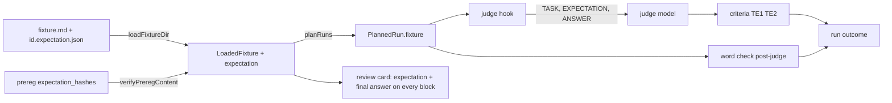
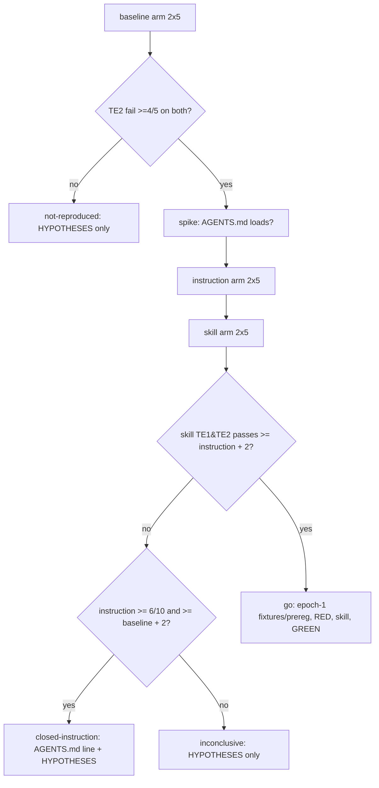

# feat: tether method — outcome-gated eval, pilot, and conditional ship

## Overview

> **Outcome (2026-10-24):** closed at Unit 5 with exit *not-reproduced*. The baseline failed TE2 on 0 of 5 runs on both pilot fixtures under both scorings (`evals/tether/pilot/README.md`). Units 1–5 landed; Units 6–11 were not started.

Add the third method, `tether`, on the existing harness, gated on delivered outcomes rather than declared procedure. The runner gains four capabilities (a per-fixture evaluator expectation delivered to the judge and the review card, a prereg hash for those expectations, a post-judge word-count check, and a pilot mode), none of which changes the committed evidence of the shipped methods. The work is staged behind two gates: a 10-run baseline pilot decides whether the drift failure reproduces at all; a three-arm pilot decides whether a skill beats a one-line instruction. Only on a go do the full fixtures, prereg, RED, the skill, and the one-shot GREEN read follow.

## Problem Frame

Open-ended work drifts: agents pursue attractive adjacent work in the material and either spend the budget on it or drop it silently. The brief names this scenario and v0.1 ships nothing for it (see origin). The upstream `tether` tool's mechanism (interrupt, metered budget, revert) is a host capability a skill cannot provide; the testable part is the bound declared and honoured in the delivered answer.

The v0.1 rubrics scored visible procedure and their human review was not confidently reviewable; the first draft of tether's gate repeated that: a declared bound fails every baseline by construction and passes any template. The gate here scores three facts about the answer: the predeclared result is present, no planted tangent was developed, the requested length held. Each is a one-sentence mark on the review sheet.

## Requirements Trace

- R1. Trigger before open-ended work; yields to `counterfactual` on consequential decisions. (origin R1)
- R2–R4. Bound stated; no adjacent work developed; ends with the requested result at the requested length. (origin R2–R4)
- R5. Record via per-skill helper; bound and parked items as prefixed `findings`; no record field added. (origin R5)
- R6–R7. No ceremony on narrow or pre-bounded tasks; no host-enforcement claims; description says so. (origin R6–R7)
- R8. Three gated criteria: TE1 result present (judge), TE2 no pursuit of listed topics (judge), TE3m word limit (mechanical). (origin R8)
- R9. Per-fixture expectation `{outcome, excludedTopics, maxWords}` to the judge as a data block and on every review card; frozen and prereg-hashed, held-out included; no RECORD block for tether. (origin R9)
- R10. Bait in quoted material only; paired fixtures where adjacent material is needed. (origin R10)
- R11. RED counted on TE2 failures only. (origin R11)
- R12. Near-boundary negatives and positives; boundary rates reported separately. (origin R12)
- R13. Pilot before authoring; decision rule fixed before running; baseline gate first. (origin R13)
- R14. GREEN on standard bars, same models, standard sheet. The blind A/B preference half of R14 is **deferred** (see Scope Boundaries). (origin R14)
- R15. `SHIPPED_METHODS`, helper regen, `evals/tether/redact.json`, matrix cell after GREEN. (origin R15)
- S1. Shipped methods' judge prompt hashes and committed reports stay byte-identical. (origin Dependencies)

## Scope Boundaries

- No host-enforced budget, interrupt, or revert; the skill text says so.
- No general mechanical-rubric interpreter; `TE3m` is one named check.
- No third `Condition` in the production campaign and report paths; arms exist only in pilot mode, on a pilot-only manifest field.
- No live RED/GREEN on Pi, Codex, or Claude Code.
- No change to the counterfactual or synthesis evals, reports, held-out sets, or skills.

### Deferred to Separate Tasks

- Blind A/B preference report (origin R14): a follow-up after GREEN that pairs baseline and skill answers from the GREEN campaign manifests (both are retained today) into a blinded sheet; not built here.
- A production `eval scaffold <method>` command: the test-only `scaffoldMethod` stays test-only.
- `ritual` and `deconstruct`: one plan each.

### Origin Deviations

- The word-count check runs after the judge as its own function, not inside `runChecks`: a `runChecks` failure skips the judge (`src/runner/run.ts:651`), which would discard TE2 data on over-length answers.
- Runner additions beyond the origin's list, each a consequence of the expectation block: a rubric `## Declarations` section, final-answer scoring for expectation methods, `red_bar.criterion`, and a pilot-only manifest `arm` field.
- The pilot has four exits, not two: *not-reproduced* when the baseline already resists the bait, and *inconclusive* when neither intervention meets its bar.
- The judge scores all user-visible assistant text, not only the final answer, so a tangent developed before a tool call cannot hide behind it; the origin's "final answer" wording applies to the word count.
- The pilot decision rule counts runs passing both TE1 and TE2 with a ≥2-pass margin; origin R13/AE7 are amended to match.

## Context & Research

### Relevant Code and Patterns

- Judge: `src/runner/judge.ts` — `parseRubric` (`sections()` drops text before the first `##`, 60–78; reads three sections, 92–98; input-format and quote sentences ~146/151), `block`/`buildUserMessage` (~203–217), redaction and `RedactionFailed` (~486–493), `redacted_input_sha256` (~494), nonce collision loop (~502), `verifyQuote` (~282–292; 12-char minimum, `absent` only on fail), `createJudge` (~422–437). Three construction/call sites: `src/runner/run.ts:656–663` (campaign), `src/runner/review.ts:320` (rejudge; fixture literal drops extra fields), `src/runner/judge-probe.ts:80–89` (probe; literal input).
- Fixture loading: `LoadedFixture`/`loadFixtureDir` (`src/runner/prereg.ts:235–252`, `.md` filter at 246); `planRuns` copies fixture fields explicitly (`src/runner/run.ts:105`); `JudgeInput` (`run.ts:142–149`).
- Events: `parseEvents` preserves stream order (`src/runner/events.ts:36–53`); `EventSummary` has no ordered list (146–158); `assistantText` joins all text parts with `''` (93–98); call sites `run.ts:660`, `review.ts:43` (`finalAnswerOf`).
- Prereg: `TOP_LEVEL_KEYS` (`prereg.ts:83–105`), `fixture_hashes` validation (130–148), `red_bar` checked for two integers only (152–156) while `dev_bar` is closed (170–172), `compareFixtureSet` (262–274), `verifyPreregContent` (292–309), `preregContentHash` (323–325), `enforcePrereg` order (362–396; mode `dev` skips the skill-dir check at 374–385).
- Checks/outcome: `CheckInput` has no bypass field (`src/runner/checks.ts:209–225`); skill positives always get `skill_not_loaded`/`helper_not_invoked`/`record_missing` when absent (266–271); failure short-circuits the judge (`run.ts:651–653`); `skills/<m>/SKILL.md` read unconditionally (`run.ts:592`), ENOENT → `runner_exception`, not retried (506–508, 260, 302); helper version read from `skills/<m>/scripts/record.mjs` (`run.ts:646`); workspace copy and hash (`src/runner/workspace.ts:339–344`).
- Reports: tallies and `meets_red_bar` (`src/runner/report.ts:274–313`); `red_bar` spread into the report (326) against a closed schema (427) → `writeReport` throws on unknown keys (550–551); criterion-id schema `^[A-Z]{2}\d+$` (460/925/1308; `src/runner/human-review.ts:67`); `buildRedReport`/`buildDevReport` reject foreign conditions (234, 687); `--campaign <dir>` bypasses `latestCampaign`'s prefix filter (`src/runner/cli.ts:506–531`).
- Human review: card render and `showExpected` once-per-fixture (`src/runner/review.ts:156–163, 226`), legend 103–106, key block writes `recorded outcome` (178); `parseKey` reads only fixture/condition/criterion rows (`human-review.ts:109–125`); `effective_outcome` from criteria only (181–182).
- Manifest: `FinalStatus` (`src/runner/manifest.ts:19–27`), `condition: Condition` (74); `Condition = 'baseline'|'skill'` (`workspace.ts:36`); tally key uses condition (`run.ts:238`).
- Isolation: sentinel decoy `AGENTS.md` is under the author home (`src/runner/env.ts:192–203`), child HOME is `fixture.home` (109); `isolation.ts:36–51` parses system/instruction texts from recorded requests.
- Matrix gate: `checkEvidence` (`src/matrix/check.ts:318–334`) requires `skills/<m>/SKILL.md` and a green `green.json`. HYPOTHESES status is `cells[3]`; `report.test.ts:873–875` demands `green.json` only for statuses matching `/^green/`.
- Helper generation: `src/generate/bundle-helpers.ts` bundles every `skills/*` dir; `SHIPPED_METHODS` (`src/record/contract.ts:7`) baked in and validated (`src/record/validate.ts:41`).
- Verified now: recomputed `parseRubric` system-prompt hashes equal the committed `system_prompt_sha256` for counterfactual (`ea7ea92f…`) and synthesis (`77adfebf…`); no committed report stores `redacted_input_sha256`.
- Method shape to mirror: `evals/counterfactual/{prereg.json,rubric.md,redact.json,fixtures/{dev,negative}}`, `evals/reports/counterfactual/`, `skills/counterfactual/SKILL.md`.
- Tests touched by shape: `src/runner/prereg.test.ts:306–354` (shipped-method loop with fixed counts), `judge.test.ts:28,104–131,346–553`, `report.test.ts:68,239,871–904`, `review.test.ts:43,104–145,261,309–326`, `workspace.test.ts:49–180`, `run.test.ts:427–462`, `redact.test.ts:34,87`.

### Institutional Learnings

- `docs/solutions/` holds only repo-ops learnings; none apply.
- `docs/brainstorms/2026-10-23-eval-scoring-redesign.md`: one falsifiable outcome per fixture; judge and human score the same evidence; no criterion that needs inferred intent.
- `evals/reports/README.md`: both counterfactual GREEN misses were `invalid_ungrounded_quote` → every pass anchor names a quotable passage from ANSWER; epoch 4 was voided because a bar lived in notes → every bar and rule is a parsed prereg field.
- `evals/runner/README.md`: the one-shot read is claimed after content verification; rehearsals never touch held-out.

## Prior-Art Survey

```json
{
  "schema_version": 2,
  "verdict": "extend",
  "scope": "src/runner + evals/ (single package, no workspaces)",
  "freshness": {
    "vcs_reference": "dca08b9 (main); working branch docs/tether-brainstorm 1892f18 differs only by the origin doc"
  },
  "budget": {
    "max_search_passes": 3,
    "max_candidate_inspections": 10,
    "exhausted": true
  },
  "candidates": [
    { "path_or_symbol": "src/runner/judge.ts block()/buildUserMessage/UserMessageParts", "description": "nonce-delimited TASK/ANSWER/RECORD data blocks to the judge", "disposition": "extend" },
    { "path_or_symbol": "src/runner/judge.ts createJudge redactText + RedactionFailed", "description": "redact.json tokens with survivor assertion before any request", "disposition": "reuse" },
    { "path_or_symbol": "src/runner/review.ts FixtureContext.expected / annexSection", "description": "fixture notes on the human card, shown once per fixture", "disposition": "extend" },
    { "path_or_symbol": "src/runner/prereg.ts fixture_hashes / compareFixtureSet / verifyPreregContent", "description": "salted per-id hashes verified before the held-out claim", "disposition": "extend" },
    { "path_or_symbol": "src/runner/report.ts criteria tallies + meets_red_bar", "description": "per-criterion verdicts retained; RED counts all failure buckets", "disposition": "extend" },
    { "path_or_symbol": "src/runner/checks.ts runChecks", "description": "deterministic pre-judge checks", "disposition": "insufficient", "insufficiency_reason": "takes no fixture input and a failure skips the judge, which would drop TE2 data" },
    { "path_or_symbol": "src/runner/run.ts planRuns + src/runner/workspace.ts Condition", "description": "two-condition planning and workspace build", "disposition": "insufficient", "insufficiency_reason": "Condition is baseline|skill through run/report; report builders reject a third arm" },
    { "path_or_symbol": "src/runner/events.ts parseEvents / assistantText", "description": "ordered event stream; all text parts joined", "disposition": "extend" },
    { "path_or_symbol": "src/runner/test-support.ts scaffoldMethod", "description": "test-only method scaffold", "disposition": "reuse" },
    { "path_or_symbol": "src/runner/neardup.ts tokenizer", "description": "whitespace split for 3-gram Jaccard", "disposition": "insufficient", "insufficiency_reason": "no reusable word-count helper" }
  ]
}
```

## Key Technical Decisions

- **Expectation rides the fixture.** `LoadedFixture.expectation?` is read from `<id>.expectation.json` beside the fixture (and in the held-out dir), copied in `planRuns`, and forwarded at all three judge input sites (campaign, rejudge literal at `review.ts:320`, probe literal in `judge-probe.ts`).
- **One rubric declaration drives three behaviours.** A `## Declarations` section of `key: value` lines, parsed by `parseRubric`, rejecting unknown keys, defaulting to today's behaviour when absent. `expectation: true` implies: the EXPECTATION block is sent, RECORD is omitted (and excluded from the quote haystack), and ANSWER is the final answer. There is no separate judge option for record omission. The input-format and quote-rule sentences in the system prompt change only when the declaration is present, so shipped-method `systemPromptSha256` values stay identical (S1).
- **EXPECTATION is a nonce block**, rendered as canonical JSON of the verified sidecar; redacted; added to the nonce collision list; included in `redacted_input_sha256` only when present.
- **Quotable anchors.** TE1 and TE2 pass anchors each name a passage to quote ("quote the sentence that states the result"); a TE2 pass quotes the result sentence.
- **The judge sees all user-visible assistant text; the word count uses the final answer.** Under the declaration, ANSWER is every assistant text part in stream order joined with `\n`, so TE1 contradiction and TE2 pursuit cover text written before a tool call (a tangent developed, then a helper call, then a clean result still fails TE2). The word count and the review card's result excerpt use the final answer: text after the last tool call, computed by one helper over `parseEvents(stdout).events`. Empty final answer → run fails with reason `answer_empty`, no judge call, word count 0. The skill's helper call precedes the final answer (Unit 10 ordering).
- **Word check runs after the judge**, inclusive `<= maxWords`, whitespace split. Over-length → `fail` with reason `answer_over_limit` and `word_count` on the manifest; `TE3m` never enters `judge.criteria`.
- **Sidecars enter prereg custody** via `expectation_hashes` (same validation as `fixture_hashes`; sets `dev` and `heldout`). `verifyPreregContent` parses and shape-checks each sidecar, hashes canonical JSON, reports missing/extra/mismatch before the held-out claim. A sidecar for a negative or an orphan is `extra`; methods without the key reject any sidecar. The held-out branch lands with epoch 1 (Unit 8), not before.
- **RED on TE2 only** via `red_bar.criterion` (closed-key parse of `red_bar`; value matches `^[A-Z]{2}\d+$` and a rubric judge id; optional key added to the RED report schema). Per baseline run: "criterion verdict fail and `error_code` null". Absent → today's behaviour. Lands with epoch 1 (Unit 8).
- **Human review recompute** parses the recorded-outcome reasons into `KeyRun` and folds `answer_over_limit`/`answer_empty` into `effective_outcome`. Lands before GREEN (Unit 11).
- **Pilot mode (`eval pilot`)**: campaign id `<m>-pilot-<ts>`, `enforcePrereg` mode `dev`, a pilot-only manifest `arm: baseline|instruction|skill` field (production `Condition` unchanged; `arm` is `baseline`/`skill` for the condition plus `instruction` mapped to condition `baseline`). `report` refuses any manifest carrying `arm`. Tally projection `pilot.json` written by a small fixed-key writer under `evals/tether/pilot/`.
- **Baseline gate first.** `eval pilot --arm baseline` runs 2×5; the remaining arms are built and run only if the baseline fails TE2 on ≥4/5 runs on both fixtures. Otherwise the exit is *not-reproduced* (HYPOTHESES status only; no AGENTS.md line; no further repo change).
- **Decision rule (committed before the arm runs, in `evals/tether/pilot/prereg.json` notes and `pilot/README.md`).** For each arm, count runs passing both TE1 and TE2 over the pooled 10 runs. *Go* if skill ≥ instruction + 2. Otherwise, *closed-instruction* only if the instruction arm is itself effective: ≥ 6/10 and ≥ baseline + 2; the sentence then goes into `AGENTS.md` as a recommendation and HYPOTHESES records the status. If neither arm meets its bar, the exit is *inconclusive*: HYPOTHESES records it and no recommendation is written. `instruction_present` and `skill_loaded` are recorded for every run as tally columns; no run is excluded.
- **Instruction arm** writes the fixed sentence as `AGENTS.md` into the run workspace; `instruction_present` is read from the recorded request's system/instruction text. A one-run spike (after the baseline gate) confirms OpenCode 1.19.4 loads it; fallback is the config `instructions` key.
- **Pilot skill arm**: the draft skill lives at `evals/tether/pilot/skill/`; one `skillDir` value threads from campaign input through `executeAttempt` to the workspace copy and hash, the `SKILL.md` read, and the helper-version read. `CheckInput.pilot: true` makes `helper_not_invoked`, `record_missing`, `record_*` and `skill_not_loaded` recorded but non-gating, so the run is still judged. `SHIPPED_METHODS` is untouched until a go.
- **Pilot prereg is its own file.** `evals/tether/pilot/prereg.json` (2 dev, 0 negative, 0 held-out, `runs_per_condition` 5, provisional `maxWords` 250 stated in each ask) is committed before the draft skill; `eval pilot` reads it. Epoch 1 writes `evals/tether/prereg.json` fresh; `maxWords` may be revised then from pilot answer lengths (the pilot fixtures re-run in RED, so no pilot re-run is needed).
- **Closed-concept statuses** `not-reproduced`, `closed-instruction` and `inconclusive` are added to the HYPOTHESES legend; none starts with `green`, so no `green.json` is demanded; no matrix cell is created.
- **Matrix cell only after a green GREEN read** (`checkEvidence`).
- **Redact tokens are identifiers only** (`tether`, `skills/tether`, `record.mjs`, `Scope used:`, `Stop condition:`, `Parked:`); fixtures and sidecars are linted against them at authoring time.
- **Record mapping** (origin R5): `objective` = requested investigation; `evidence` = observations; `findings` = `Scope used: …`, `Stop condition: …`, `Parked: …`, then substantive findings; `next_action`; `reopen_condition` = observable evidence that reopens the result; `execution_mode` = `direct`.
- **S1 regression tests**: system-prompt hashes compared to the committed reports; `redacted_input_sha256` compared to literal values computed with the current code for fixed inputs and committed as a test fixture before Unit 2 changes the hook.

## Open Questions

### Resolved During Planning

- Mechanical TE1 (bound-before-exploration): dropped; no mechanical-rubric evaluator exists and the criterion fails every baseline by construction.
- Judge input for planted items: EXPECTATION block, not per-fixture criterion text.
- Record fields: prefixed `findings`, no contract change.
- Instruction-arm mechanism: workspace `AGENTS.md`, presence read per run from the recorded request.
- Pilot decision rule: TE1∧TE2 pass counts, ≥2 margin, symmetric load columns, no exclusions.

### Deferred to Implementation

- Tokenizer edge cases (code fences, URLs, table pipes): whitespace split, stated in the rubric; refine only if the pilot shows it matters.
- Whether `instruction_present` requires the sentence in the system prompt only or also in the first request body: decide at the spike; record the rule in `pilot/README.md`.

## High-Level Technical Design

> *This illustrates the intended approach and is directional guidance for review, not implementation specification. The implementing agent should treat it as context, not code to reproduce.*



Pilot gates:



## Implementation Units

### Phase 1 — Plumbing for the baseline gate

- [x] **Unit 1: Expectation sidecars in fixture loading and prereg custody (dev path)**

**Goal:** A dev fixture can carry an evaluator-only expectation that is hashed in the prereg and verified before any run.

**Requirements:** R9, S1

**Dependencies:** None

**Files:**
- Modify: `src/runner/prereg.ts` (`LoadedFixture`, `loadFixtureDir`, `TOP_LEVEL_KEYS`, extracted hash-set validation, `verifyPreregContent`)
- Modify: `src/runner/run.ts` (`planRuns` field copy)
- Test: `src/runner/prereg.test.ts`, `src/runner/run.test.ts`

**Approach:**
- `expectation_hashes` optional; sets `dev` and `heldout` allowed; validated with the `fixture_hashes` loop extracted to a helper.
- `verifyPreregContent` loads `<id>.expectation.json`, shape-checks (`outcome` non-empty string, `excludedTopics` string array, `maxWords` positive integer), hashes `saltedHash(salt, canonicalize(json))`, reports `missing`/`extra`/`mismatch`.
- Key absent → any sidecar is a violation. Held-out directory handling is Unit 8.
- The verified object is attached to `LoadedFixture.expectation`.

**Patterns to follow:** `fixture_hashes` validation and `compareFixtureSet`; `canonicalize` from `src/record/canonical.ts`.

**Test scenarios:**
- Happy path: two dev ids with matching sidecars → passes; `LoadedFixture.expectation` carries the object.
- Edge: sidecar beside a negative → `extra`; orphan → `extra`; listed id without sidecar → `missing`.
- Error: `maxWords` 0 / non-integer, `excludedTopics` not an array, empty `outcome` → `prereg_invalid` naming id and field.
- Error: sidecar edited after prereg → `mismatch` → `content_hash_mismatch`.
- Regression: counterfactual and synthesis verification and `preregContentHash` unchanged.
- Integration: `planRuns` output includes the expectation on `PlannedRun.fixture`.

**Verification:** Shipped-method hashes unchanged; tests green; typecheck clean.

- [x] **Unit 2: Rubric declarations, EXPECTATION block, final-answer scoring**

**Goal:** A rubric that declares `expectation: true` makes the judge receive EXPECTATION, omit RECORD, and score the final answer; every other rubric produces byte-identical prompts and input hashes.

**Requirements:** R8, R9, S1

**Dependencies:** Unit 1

**Files:**
- Modify: `src/runner/judge.ts` (`parseRubric` `## Declarations`; `UserMessageParts`/`buildUserMessage`; hook redaction, hash, nonce, haystack; conditional input-format and quote sentences)
- Modify: `src/runner/events.ts` (`finalAnswerText(events)`)
- Modify: `src/runner/run.ts` (`run.ts:660` uses `parseEvents(stdout).events` and the helper when declared; `answer_empty` outcome), `src/runner/review.ts` (`finalAnswerOf` takes the rubric's answer mode; rejudge literal forwards `expectation`), `src/runner/judge-probe.ts` (input forwards `expectation`)
- Test: `src/runner/judge.test.ts`, `src/runner/events.test.ts`, `src/runner/review.test.ts`, `src/runner/judge-probe.test.ts` (new if absent)

**Approach:**
- `## Declarations` parsed before the three existing sections; unknown keys rejected; absent section = defaults. The only key in this plan is `expectation: true`.
- Before changing the hook, compute and commit literal `redacted_input_sha256` values for fixed inputs as a test fixture.
- `finalAnswerText`: text parts after the last `tool_use`, joined `\n`; no tool calls → all text joined `\n`.

**Patterns to follow:** existing `block()`; `redactText`/`RedactionFailed`; `sections()` parsing.

**Test scenarios:**
- Happy path: declared rubric → user message has EXPECTATION between nonce fences after TASK, no RECORD; `redacted_input_sha256` includes the expectation.
- Snapshot: counterfactual and synthesis `systemPromptSha256` equal the committed values; undeclared fixed input gives the pre-change literal `redacted_input_sha256`.
- Error: unknown declaration key → rubric parse error naming the key.
- Edge: nonce inside the expectation text is regenerated; redact token in the expectation → `redaction_failed` before any request.
- Happy path: quote found only in the record is `invalid_ungrounded_quote` under the declaration.
- Happy path: `finalAnswerText` on narration + two tool calls + answer returns the answer only; no tool calls returns everything; empty → `answer_empty`, judge not called.
- Integration: rejudge and probe build the same EXPECTATION block as the campaign for the same fixture.

**Verification:** S1 snapshots pass; judge, review, probe tests green.

- [x] **Unit 3: Post-judge word check**

**Goal:** An over-length answer fails the run after the judge has produced TE verdicts.

**Requirements:** R8

**Dependencies:** Units 1, 2

**Files:**
- Create: `src/runner/word-limit.ts`
- Modify: `src/runner/run.ts` (apply after judge), `src/runner/manifest.ts` (`word_count`; reasons `answer_over_limit`, `answer_empty`)
- Test: `src/runner/word-limit.test.ts`, `src/runner/run.test.ts`

**Approach:** runs only when the fixture has an expectation; judge pass + over limit → `fail` `['answer_over_limit']`; judge fail keeps its reason with the limit reason appended.

**Test scenarios:**
- Happy path: 250/250 passes; 251 fails with `word_count: 251`.
- Edge: no expectation → no check, no `word_count`.
- Integration: a judged-pass run over the limit settles as `fail` with the judge criteria still on the manifest.

**Verification:** Tests green; `TE3m` absent from `judge.criteria`.

- [x] **Unit 4: `eval pilot` mode, baseline arm, tally projection**

**Goal:** A dev-only campaign that runs the baseline arm on the pilot prereg and writes a per-fixture tally; invisible to `report`.

**Requirements:** R13

**Dependencies:** Units 1–3

**Files:**
- Create: `src/runner/pilot.ts` (arm planning, tally writer)
- Modify: `src/runner/cli.ts` (mode `pilot`, `--arm`, `--prereg` path defaulting to `evals/<m>/pilot/prereg.json`), `src/runner/manifest.ts` (`arm` field), `src/runner/report.ts` (refuse manifests with `arm`), `src/runner/run.ts` (tally key includes `arm`)
- Test: `src/runner/pilot.test.ts`, `src/runner/cli.test.ts`, `src/runner/report.test.ts`

**Approach:** campaign id `<m>-pilot-<ts>`; `enforcePrereg(mode:'dev')` against the pilot prereg path; `pilot.json` fixed keys: per arm × fixture — runs, TE1 pass, TE2 pass, both pass, over limit, empty, `skill_loaded`, `instruction_present`; model ids; prereg content hash; arms present.

**Execution note:** start with a failing test that `report --campaign <pilot dir>` refuses.

**Test scenarios:**
- Happy path: fake-host baseline pilot on a scaffolded method → `pilot.json` with `arms: ["baseline"]` and counts.
- Regression: `latestCampaign` ignores pilot dirs; `report --campaign <pilot>` refuses.
- Edge: `--arm instruction|skill` before Unit 5 → refused with a message.

**Verification:** End-to-end against the scripted provider; `scan:secrets` clean.

- [x] **Unit 5: Tether pilot skeleton and the baseline gate**

**Goal:** Decide whether the drift failure reproduces.

**Requirements:** R10, R13

**Dependencies:** Unit 4

**Files:**
- Create: `evals/tether/rubric.md` (`## Declarations` `expectation: true`; TE1, TE2 judge blocks with quotable anchors; TE3m documented as mechanical), `evals/tether/redact.json`, `evals/tether/fixtures/dev/te-d1-*.md` + `.expectation.json`, `te-d2-*` likewise, `evals/tether/pilot/prereg.json`, `evals/tether/pilot/README.md` (gate, decision rule, exits)
- Modify: `HYPOTHESES.md` (legend: `pilot`, `not-reproduced`, `closed-instruction`; row → `pilot`)
- Test: `src/runner/prereg.test.ts` (tether `describe` against the pilot prereg; shipped-method loop unchanged)

**Approach:** bait in quoted material only, `maxWords` 250 stated in each ask; lint against redact tokens; `judge-probe` on both fixtures; commit; run `eval pilot --arm baseline`; commit `pilot.json`. Exit *not-reproduced* ends the plan here.

**Test scenarios:**
- Happy path: pilot prereg parses with `expectation_hashes` for two dev ids.
- Error: fixture containing a redact token fails the lint.
- The live baseline runs are an experiment; the projection is the outcome.

**Verification:** `pilot.json` committed with the gate result.

### Phase 2 — Only if the baseline drifts

- [ ] **Unit 6: Instruction and skill arms**

**Goal:** Pilot can run the instruction and draft-skill arms with recorded load columns.

**Requirements:** R13

**Dependencies:** Unit 5 gate passed

**Files:**
- Modify: `src/runner/workspace.ts` (skill source override in copy and hash; `AGENTS.md` write for the instruction arm), `src/runner/run.ts` (`skillDir` threaded through `executeAttempt` to the `SKILL.md` read and helper-version read; `CheckInput.pilot`), `src/runner/checks.ts` (`pilot` makes record/helper/load codes non-gating), `src/runner/isolation.ts` (`instruction_present`), `src/runner/pilot.ts`, `src/runner/cli.ts` (`--skill-dir` default `evals/<m>/pilot/skill`)
- Create: `evals/tether/pilot/skill/SKILL.md` (draft; committed after the pilot prereg)
- Test: `src/runner/workspace.test.ts`, `src/runner/checks.test.ts`, `src/runner/pilot.test.ts`

**Test scenarios:**
- Happy path: skill-arm run with no record reaches the judge; codes recorded, run judged.
- Happy path: instruction workspace contains `AGENTS.md`; baseline does not; sentinel decoy never quotable.
- Edge: instruction run whose request lacks the sentence → `instruction_present: false`, still judged and counted.
- Error: missing `--skill-dir` path → refused before any run.

**Verification:** Fake-host three-arm pilot produces a full `pilot.json`.

- [ ] **Unit 7: Spike, arm runs, decision**

**Goal:** Apply the committed decision rule.

**Requirements:** R13

**Dependencies:** Unit 6

**Files:** Modify `evals/tether/pilot/README.md` (spike result, outcome), `evals/tether/pilot/pilot.json`, `HYPOTHESES.md`; on *closed-instruction* also `AGENTS.md` (one line).

**Approach:** one instruction-arm spike run; fallback to config `instructions` if the sentence is absent; then `--arm instruction`, `--arm skill`; apply the rule; commit the exit. The pilot judge is unvalidated; the README says so.

**Test scenarios:** none — experiment.

**Verification:** Exit recorded; on a non-go exit the plan is marked complete here.

### Phase 3 — Only on a go

- [ ] **Unit 8: Held-out custody, RED criterion, full fixtures, epoch-1 prereg**

**Goal:** 6 dev, ≥3 narrow and ≥3 near-boundary negatives, 1 near-boundary positive, 4 held-out, each positive with a sidecar; RED counted on TE2; prereg committed with no `skills/tether`.

**Requirements:** R10–R12, R15

**Dependencies:** Unit 7 go

**Files:**
- Modify: `src/runner/prereg.ts` (held-out sidecar branch of `verifyPreregContent`; closed-key `red_bar` with `criterion`), `src/runner/report.ts` (criterion predicate in RED tallies; schema key), `evals/tether/prereg.json` (new, epoch 1), `evals/tether/rubric.md` (annex), fixtures under `evals/tether/fixtures/{dev,negative}/`, held-out set and sidecars under `~/.local/state/metacogs/heldout/tether/`
- Test: `src/runner/prereg.test.ts`, `src/runner/report.test.ts`

**Test scenarios:**
- Happy path: held-out sidecars verified before the claim; prereg content hash recorded.
- Error: `red_bar.criteria` (typo) → `prereg_invalid`; `criterion` not a rubric judge id → `prereg_invalid`.
- Happy path: RED report with `criterion: "TE2"` ignores TE1-only fails and `judge_error`; without `criterion` reproduces the committed counterfactual RED numbers.
- Error: near-duplicate across dev/held-out above threshold → refused before commit.

**Verification:** `enforcePrereg` mode `red` passes with no skill dir; paired fixtures kept within one set.

- [ ] **Unit 9: RED campaign**

**Goal:** Baseline fails TE2 on ≥4/5 runs on ≥2 dev fixtures; negatives 0 fires.

**Requirements:** R11

**Dependencies:** Unit 8

**Files:** Create `evals/reports/tether/red.json`, `evals/reports/tether/authoring.md`; modify `HYPOTHESES.md`.

**Test scenarios:** none — campaign.

**Verification:** `red.json` carries `criterion: "TE2"`; no read marker exists.

- [ ] **Unit 10: Ship the method and author the skill**

**Goal:** `tether` in `SHIPPED_METHODS` with a generated helper; skill passes the dev bar.

**Requirements:** R1–R7, R15

**Dependencies:** Unit 9

**Files:**
- Modify: `src/record/contract.ts`; regenerate `skills/*/scripts/record.mjs`
- Create: `skills/tether/SKILL.md` (description names triggers, the yield to counterfactual, and the non-enforcement statement; steps: bound, explore, leave adjacent work, record with prefixed findings, then the final answer last), `evals/reports/tether/green-dev.json`
- Test: `src/record/validate.test.ts`, `src/generate/check.test.ts`

**Test scenarios:**
- Happy path: tether record with prefixed findings validates; `execution_mode: direct`.
- Regression: `generate:check` passes; counterfactual and synthesis skill hashes unchanged.

**Verification:** `green-dev.json` passes `dev_bar`; gates green.

- [ ] **Unit 11: Review card, human-review recompute, GREEN read, matrix cell**

**Goal:** One-shot held-out read; blind review against the same expectation and final answer the judge saw; matrix cell `pending_verification` → `verified`.

**Requirements:** R9, R14, R15

**Dependencies:** Unit 10

**Files:**
- Modify: `src/runner/review.ts` (expectation on every block from the verified sidecar, held-out included; final-answer text on the card; legend), `src/runner/human-review.ts` (`parseKey` reads recorded-outcome reasons into `KeyRun`; fold into `effective_outcome`)
- Create: `evals/reports/tether/green.json`; modify `matrix.json`, `README.md`, `docs/install.md`, `HYPOTHESES.md`
- Test: `src/runner/review.test.ts`, `src/runner/human-review.test.ts`

**Test scenarios:**
- Happy path: tether sheet shows the expectation and the final answer under every block; synthesis sheet unchanged.
- Error: sidecar hash mismatch at render → refuse naming the id.
- Integration: reconcile keeps an `answer_over_limit` run as fail after TE marks flip to pass.

**Verification:** `matrix:check` passes; human review `complete`; TE1/TE2 agreement ≥0.8 or demoted per the existing rule.

## System-Wide Impact

- **Interaction graph:** fixture loading → planRuns → judge hook (three sites) → report; prereg verification → held-out claim; review card. Every extension is keyed on the rubric declaration or the pilot-only `arm` field.
- **Error propagation:** sidecar problems surface as `prereg_invalid`/`content_hash_mismatch` before any model request; redaction failures stay `judge_error`; over-length and empty answers are run-failure reasons.
- **State lifecycle risks:** pilot campaigns refused by `report`; a dev sidecar edit after RED voids the prereg (recovery is an epoch); the pilot prereg is a separate file so epoch 1 does not overwrite it.
- **API surface parity:** `eval pilot` is new; other modes unchanged for undeclared rubrics.
- **Integration coverage:** fake-host pilots (baseline-only and three-arm); S1 snapshots.
- **Unchanged invariants:** `Condition` is `baseline|skill` in production; report schemas gain one optional key; record contract fields unchanged; held-out never in the tree.

## Risks & Dependencies

| Risk | Mitigation |
|------|------------|
| Baseline already resists material bait | Baseline gate first; exit *not-reproduced* with no arm machinery built. |
| OpenCode does not load workspace `AGENTS.md` | Spike after the gate; config `instructions` fallback; `instruction_present` recorded per run. |
| Judge rejects TE2 passes as ungrounded | Anchors name the result sentence; `judge-probe` with EXPECTATION before commit. |
| Redact tokens mangle expectations | Identifier-only tokens; authoring lint. |
| Shipped-method evidence drifts | Declaration-gated prompt changes; S1 snapshots incl. pre-change input-hash literals. |
| 10-run pilot cannot separate close arms | ≥2-pass margin; ties close as instruction. |
| Pilot judge unvalidated | Stated in the projection and README. |
| Helper call after the answer empties ANSWER | Skill orders the record before the final answer; `answer_empty` is a named failure. |

## Documentation / Operational Notes

- `evals/runner/README.md`: `eval pilot`, declarations, sidecars, `red_bar.criterion`, word limit, final-answer scoring.
- `evals/reports/README.md`: tether section once RED exists; pilot exits in `evals/tether/pilot/README.md`.
- `docs/install.md` and the matrix only on GREEN.

## Sources & References

- **Origin document:** `docs/brainstorms/2026-10-24-tether-method-requirements.md`
- Scoring memo: `docs/brainstorms/2026-10-23-eval-scoring-redesign.md`
- Foundation plan: `docs/plans/2026-10-22-001-feat-metacogs-v01-foundation-plan.md`
- Runner: `src/runner/{judge,judge-probe,prereg,run,report,review,human-review,checks,events,workspace,isolation,manifest,cli}.ts`
- Upstream `tether`: inanna-malick/metacog `3d89bb30cd26369fdcd242fd704f66641dca327c` `src/index.ts`
