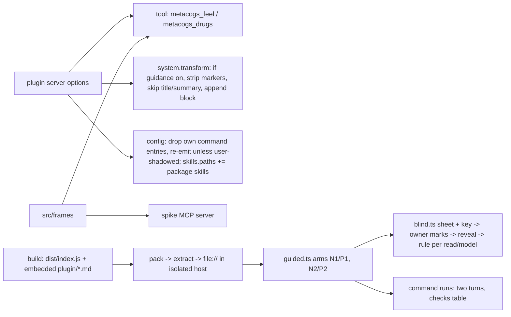
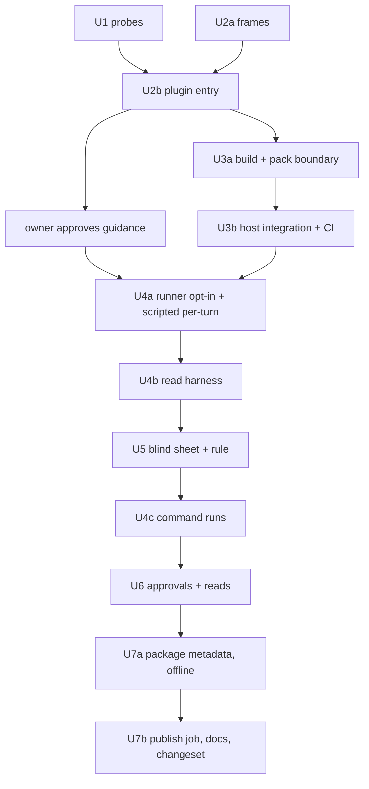

# feat: metacogs as an OpenCode plugin

## Overview

This plan builds the `metacogs` OpenCode plugin and the harness that runs the two guided reads:
- the plugin: native `feel` and `drugs` tools, session-start guidance with an opt-out, `/feel` and `/drugs`, and the bundled method skills;
- the harness: blind sheet, stated rule, and checks tables.

The package stays `private` until the owner decides what ships. Publishing, docs and the changeset land in the final unit (see origin: `docs/brainstorms/2026-10-25-opencode-plugin-requirements.md`).

## As Built

Where the implementation differs from the units below:
- `/feel` and `/drugs` are skills under `plugin/skills/`, registered through `skills.paths`, not hand-written commands. OpenCode exposes skills as slash commands, so `src/plugin/commands.ts` and `plugin/commands/` were removed, and the command-run mode drives the skills.
- The guidance was rewritten after both reads around observable triggers, with no discouraging wording (origin R8). Both reads measured the first text.
- The guided reads drop `p1`. The spike's frozen `prompts.md` is unchanged.
- `--guidance on|off` and `--nudge` switches were added for diagnostic runs that never reach a blind sheet.
- The main-request detector recognizes every model family's host prompt (`de3ad26`).
- The reads ran and informed the ship decision, which was not gated on them. Hands-on probes at engineered stuck points followed. Results are in `evals/spikes/feel-drugs/README.md`.

## Problem Frame

The spike showed the tools get called when the model is told to use them, and that the skill form gets read and ignored. Nothing has yet tested guidance at session start telling the model when to use them unprompted. Systematic proves the plugin shape on OpenCode. metacogs needs that shape, and a fair way to see whether the guidance helps.

## Requirements Trace

| Origin | Units |
|---|---|
| R5 (verbatim frames) | U2a, U2b |
| R1, R7, R9 (plugin, guidance, opt-out) | U2b, U3b |
| R8 (guidance text, owner-approved) | U2b (placeholder), U6 (approval) |
| R10 (commands) | U2b, U3b, U4c (command runs) |
| R11 (bundled skills) | U2b, U3b |
| R4, R6 (allowlist, no I/O) | U3a |
| R13–R15 (guided reads, blind rule) | U4a, U4b, U5, U6 |
| R12 (promotion path) | U5 (rule and harness reusable per concept), U7b (docs) |
| R2, R3, R16, R17 (host range, publishing, README, surfaces) | U7a, U7b |
| AE1–AE7 | U3b (AE1, AE3, AE5), U3a (AE4), U4c and U6 (AE2), U4b (AE7), U5 (AE6) |

## Scope Boundaries

These come from the origin: other hosts and MCP distribution, the other nine concepts as tools, a scored eval, per-tool switches, telemetry, and changes to the shipped method skills or their evidence.

### Deferred to Separate Tasks

- Ports to Claude Code, Pi and Gemini, after OpenCode ships.
- Tool-vs-skill reads for other frame-like concepts.

## Context & Research

### Relevant Code and Patterns

- `src/spike/feel-drugs/server.ts`: the verbatim upstream strings, `feelText`, `drugsText`, `FEEL_FRAME`, `DRUGS_FRAME` and `UPSTREAM`. They are pinned by digests in `server.test.ts`. The file imports the MCP SDK and zod 3, so the plugin cannot import it as-is.
- `src/spike/feel-drugs/driver.ts`:
  - `armSetup`, `runOnce`, `classifyStatus`, `checkFrozen` and `parsePrompts` are hard-wired to arms A/B/C, `prompts.md`, and the `metacog_` prefix. The plugin's tools are named `feel` and `drugs`, so the harness checks tool names by explicit lists and never by prefix.
  - `RunRecord` is at schema v1.
- `src/runner/workspace.ts`:
  - `buildConfig` merges `configExtra` last, so it can carry a `plugin` entry.
  - `expectedSkills` derives only from `condition` and `skillSource`.
  - `helperBashRules` allows only `.agents/skills/<m>/scripts/record.mjs`.
- `src/runner/isolation.ts`:
  - `checkDebugConfig` with `HOST_DEFAULTS`, which requires `plugin: []` and `command: {}`.
  - `available_skills_exact`.
  - `offeredTools`, which returns names only.
  - `systemTexts`.
- `src/runner/env.ts` sets `OPENCODE_DISABLE_DEFAULT_PLUGINS=1`. Its effect on a user `plugin` entry is unverified.
- `src/runner/scripted-provider.ts` records each request, and the title request has `hasTools: false`. Its `SCRIPTED_USAGE` is fixed, so it cannot measure cache reads.
- `src/runner/review.ts` and `src/runner/human-review.ts` hold the blind pattern: a sheet plus a separate key with shared block ids, followed by a reconcile step.
- `src/generate/bundle-helpers.ts` shows the `Bun.build` usage. `src/generate/check.ts` shows the in-memory drift check.
- `.github/workflows/release.yaml` runs one job: `bun run release`, which creates the GitHub Release, then `changesets/action`, with no publish step and no `id-token`.
- `src/scan/secrets.ts` keeps an explicit target list.
- Systematic, the precedent, at HEAD `86b667d4`:
  - `src/index.ts`: single default export; `__dirname` resolves the package root.
  - `src/lib/bootstrap.ts`: marker block, stripped and then appended to `system[0]`; `INTERNAL_AGENT_SIGNATURES` (three strings); a safe compute.
  - `src/lib/config-handler.ts`: commands wrapped as `<command-instruction>` and `<user-request>$ARGUMENTS</user-request>`; a description marker so its own entries refresh and user entries win; `registerSkillsPaths` with a stale-path scrub.
  - `tests/integration/opencode.test.ts` with `fixtures/receipt-workflow-host.ts`: `packTarballOnce`, `extractPackagedPlugin`, `linkRuntimeDependency`, a `file://` entry, and a probe plugin.
  - `.github/workflows/release.yaml`: `verify` then a credential-free `build` (digested `dist/`) then `publish` holding `id-token: write` and `contents: read`, Node 24, npm 11.5.1 or later, `--ignore-scripts`, publishing through semantic-release with `publishConfig.provenance`.
- dev-like, the Changesets precedent, at HEAD `69f9d78`: one `release.yaml` job running `changesets/action` with `publish:` and `prepublishOnly`, `setup-node` with `registry-url`, a pinned `npm@11.18.0`, and `id-token: write`. It is verified on two releases. `docs/solutions/best-practices/bun-changesets-oidc-release-pipeline-2026-07-11.md` covers the bootstrap order, the 30–60 minute propagation window, and the `<pkg>@<version>` tag shape under `workspaces: ["."]`.

### Institutional Learnings

- `docs/solutions/best-practices/changesets-release-script-before-action-targets-introducing-commit-2026-10-24.md`: the GitHub-Release script runs before `changesets/action` and targets the commit that introduced the version. The publish job must not reorder or replace it.
- `docs/solutions/integration-issues/renovate-changesets-single-package-root-needs-workspaces-dot-2026-10-24.md`: `workspaces: ["."]` stays.
- `docs/solutions/integration-issues/scheduled-fro-bot-agent-git-push-credential-2026-10-24.md`: autoheal credentials stay scoped, and path rules are separate from credentials.

### External References

These describe OpenCode `v1.19.4` from source (`anomalyco/opencode`):
- `plugin/shared.ts` and `plugin/index.ts`: a default-export object with `server(input, options)`; `["metacogs", {…}]` options are passed through.
- `packages/plugin/src/tool.ts` and `tool/registry.ts`: args are a Zod 4 raw shape, re-exported as `tool.schema`. The schema the model sees comes from `z.toJSONSchema`. The workspace pins zod 4.1.8.
- `session/llm/request.ts`: `experimental.chat.system.transform` fires once per LLM request, including title and subagent requests. Compaction is unverified.
- `core/src/v1/config/{command,skills,plugin}.ts`: `command.<name> = {template, description}` and `skills.paths`.
- `core/src/v1/config/permission.ts`: the permission keys are `glob`, `grep`, `list`, `read`, `edit`, `bash`, `task`, `todowrite`, `question`, `webfetch`, `websearch`, `lsp` and `skill`.
- `opencode run --command <name>` exists. `--continue` and `-s` continue a session.

npm trusted publishing (docs.npmjs.com/trusted-publishers, `npm trust`):
- It needs npm 11.5.1 or later, Node 22.14 or later, and `id-token: write`.
- Provenance is generated automatically.
- The package must exist before a trusted publisher can be configured.

Changesets: `private` must be removed. `privatePackages` does not make a package publishable.

## Prior-Art Survey

```json
{
  "schema_version": 2,
  "verdict": "extend",
  "scope": "src/, evals/, docs/, .github/ of marcusrbrown/metacogs",
  "freshness": { "vcs_reference": "ce654807f4aaf69dc467f94be3ff4ef995b13957" },
  "budget": { "max_search_passes": 3, "max_candidate_inspections": 10, "exhausted": false },
  "candidates": [
    { "path_or_symbol": "src/spike/feel-drugs/server.ts (FEEL_*/DRUGS_* constants, feelText, drugsText, UPSTREAM)", "description": "Verbatim upstream descriptions, field strings and return templates pinned by digests", "disposition": "extend" },
    { "path_or_symbol": "src/spike/feel-drugs/driver.ts (armSetup, runOnce, classifyStatus, checkFrozen, parsePrompts)", "description": "Arm config, per-run isolation, status classification, prompt freeze", "disposition": "extend" },
    { "path_or_symbol": "src/runner/workspace.ts (createRunWorkspace, buildConfig, configExtra, skillSource)", "description": "Isolated workspace and config builder", "disposition": "extend" },
    { "path_or_symbol": "src/runner/isolation.ts (checkIsolation, checkDebugConfig, HOST_DEFAULTS, offeredTools, systemTexts)", "description": "Request-body instruments and effective-config equality check", "disposition": "extend" },
    { "path_or_symbol": "src/generate/bundle-helpers.ts, src/generate/check.ts", "description": "Bun.build bundling with in-memory drift check, hard-wired to the record helper", "disposition": "extend" },
    { "path_or_symbol": "src/runner/review.ts, src/runner/human-review.ts", "description": "Blind sheet plus separate key with shared ids and reconcile, tied to judged manifests", "disposition": "extend" },
    { "path_or_symbol": "src/spike/feel-drugs/sheet.ts", "description": "Read sheet showing arms, offered tools and tool calls", "disposition": "insufficient", "insufficiency_reason": "Exposes arms, tools and calls per run, so it cannot be blind; only fenced, redactPaths and loadRuns carry over" },
    { "path_or_symbol": "src/release/release.ts, .github/workflows/release.yaml", "description": "GitHub Release from CHANGELOG plus changesets version PR; no npm publish, no id-token", "disposition": "extend" },
    { "path_or_symbol": "src/matrix/check.ts", "description": "Method-by-host matrix with closed keys", "disposition": "insufficient", "insufficiency_reason": "No slot for a delivery surface; closed top-level keys and evidence_ref patterns" },
    { "path_or_symbol": "src/runner/events.ts, src/runner/scripted-provider.ts", "description": "Event parsing and the $0 scripted provider with per-request recording", "disposition": "reuse" }
  ]
}
```

## Key Technical Decisions

- **Shared frames module, one zod.** The pure upstream strings and the `feelText` and `drugsText` builders move to `src/frames/feel-drugs.ts`. `feel` has three required fields and an optional `since_last`. The repo uses one zod major, 4. Zod 3 and its pin are dropped, and `@modelcontextprotocol/sdk` moves to a version that accepts zod 4. The spike server builds its shapes over the shared strings with zod 4, a devDependency matching the SDK's 4.1.8. The plugin builds its shapes with the runtime SDK's `tool.schema`. The string digests keep guarding the verbatim copy. The served MCP JSON schema may change shape: the spike's committed records stay as evidence and are not re-run. The upstream MIT notice ships as `ATTRIBUTIONS.md`. *Rejected:* duplicated strings, which drift. *Also rejected:* keeping zod 3 for spike schema fidelity. This is a greenfield repo with no downstream users.
- **No file I/O in tool, guidance or command code.**
  - `plugin/guidance.md` and `plugin/commands/*.md` are embedded at build time as raw text (`loader: { '.md': 'text' }`, plus a `[loader]` entry in the existing `bunfig.toml`, plus a `*.md` module declaration under `src/`). By default Bun 1.4.4 renders `.md` imports to HTML.
  - The embedded copy is what runs. `plugin/` also ships in `files`, so the package contains the command files that R10 names.
  - The `config` hook only computes the bundled `skills/` path from the module location.
  - The only I/O in the package is each skill's `record.mjs`, unchanged from v0.1.
  - *Rejected:* reading the files at runtime, which would break R6.
- **Built at publish, not committed.**
  - `bun run build` emits `dist/index.js`, which is gitignored. It makes its own `Bun.build` call, and `src/generate/bundle-helpers.ts` is unchanged.
  - The integration fixture builds before it packs, so tests never load a stale bundle.
  - No consumer lifecycle scripts exist (`preinstall`, `install`, `postinstall`, `prepare`). `prepublishOnly` (build plus tests) runs only on the publisher's side, as in dev-like.
  - *Rejected:* a committed `dist/`, which drifts like a generated file. Systematic does not commit it either.
- **Host range declared, not enforced.**
  - The tested pin lives once, as `OPENCODE_PIN`. A test asserts that `package.json`, the README and `matrix.json` match it.
  - The plugin never refuses to load.
  - Each hook and `server()` is wrapped, so a failure returns partial hooks and logs once.
  - *Rejected:* a runtime version gate, which would breach R7.
- **Guidance block.**
  - The block sits between `<METACOGS_GUIDANCE>` markers. When guidance is on, existing blocks are stripped from every system entry and one block is appended to `system[0]`.
  - When guidance is off, the hook returns without touching `system`. Under a double load (a global and a project entry), any enabled instance adds the block.
  - It is skipped when the joined system text matches a host title or summary signature. The constant holds Systematic's list, checked by U1.
  - The text is byte-identical across requests. It is worded "if `feel` is available…".
- **Option.** `["metacogs", {"guidance": false}]` turns the block off. Only a strict boolean is honoured. Any other value leaves the block on and logs once.
- **Commands.**
  - Entries whose description starts with the prefix `(metacogs) ` are dropped and then re-emitted. A key that already exists without the prefix is left alone, and the plugin logs once that the user's command shadows it.
  - Bodies wrap `<args>$ARGUMENTS</args>` and state the empty-arguments branch. They contain no `` !`cmd` `` or `@file` text.
  - This is Systematic's `mergeSystematicEntries`, with prefix matching.
- **Skills.** The `config` hook pushes the package's `skills/` dir into `skills.paths`. U1 found that a stale path does not survive a fresh config load, so there is no scrubbing. Precedence against a same-named `.agents/skills` copy is not stable (U1): the docs say to remove the copy install when using the plugin.
- **Guided harness.**
  - `src/spike/feel-drugs/guided.ts` holds the arms N1, P1, N2 and P2, the expected-tool tables, a per-arm expected-config object that wraps the runner's isolation checks, and the two-turn command mode.
  - It has its own `GuidedRecord` type. That type covers:
    - arms N1, P1, N2 and P2;
    - statuses, including `tools_missing` and `tools_extra`;
    - the read, guidance sha, command, turns and tarball sha.

    The spike's `Arm`, `RunStatus` and `RunRecord` stay closed.
  - It does not import `src/runner/spike/isolation.ts`.
  - Shared runner files change only by opt-in fields. Existing callers' configs and isolation verdicts stay identical.
  - `classifyStatus` and `checkFrozen` in the spike driver gain parameters that default to today's behaviour: an expected tool set and prefix, and a file and hash key. They are imported, not copied.
  - `fenced` in `sheet.ts` is exported, and `redactPaths` gains package and plugin-cache path patterns.
- **Arms.**
  - Read 1: N1 (nothing) and P1 (plugin). Every built-in tool is denied, except that P1 keeps `skill`, limited to the two plugin skills.
  - Read 2: N2 and P2 under OpenCode's default tools, with a fresh baseline (see origin R14). The expected skill list includes the built-in `customize-opencode`. The expected tool table is per provider, because OpenCode offers `apply_patch` to GPT models and `edit`/`write` to Anthropic models. Read 2 inherits none of read 1's denials.
  - A run fails as `tools_missing` or `tools_extra` (new statuses) unless the offered names, property names and `required` lists match a literal table built from `src/frames`.
- **Scripted provider and main-request detection.**
  - The scripted provider selects its script by turn as well as by round. Rounds are counted after the last user message, and each turn has its own steps.
  - Main requests are identified independently of whether tools are present, so a zero-tool N1 request is not taken for a title request.
  - Isolation for an arm declared tool-free needs a recorded main request, not a request with tools.
  - The first tests fail on current code.
- **Blind sheet and rule.**
  - A random X/Y side is drawn per cell and recorded in the state root.
  - The sheet shows answers only, with both runs per side. Each answer is the assistant text after the last tool call, with paths redacted (`node_modules` and the plugin cache included). One hidden control cell per read sets two nothing runs against two nothing runs.
  - The sheet removes identifying metadata: arm, offered tools, call events and paths. Answer text is shown as written, so an answer that names a tool can unblind its cell. The owner notes such cells.
  - `blind.ts` has its own X/Y/same parser. `human-review.ts`'s `Verdict` is pass/fail, so it is not widened.
  - `reveal` refuses until every cell is marked. It then counts wins, losses and `same` per read and per model, and reports the origin R15 rule. It lists eligible cells per model, and tool firings separately from skill loads, so a win carried only by skills is visible.
- **Publishing (U7b, after the owner decides).** This follows dev-like's single release job.
  - `release.ts` runs first and creates the `v<version>` tag and Release.
  - `changesets/action` follows, with `publish-script` (the v2 action's input) running build, tests and `changeset publish --no-git-tag`. Changesets skips versions already on the registry. `v<version>` stays the only tag, and the action creates no Releases.
  - The publish script runs only when the Release for this version exists, because `release.ts` exits 0 when the CHANGELOG has no section for it.
  - The job holds `id-token: write` and runs in a `release` environment restricted to `main`. npm is pinned at or above 11.5.1.
  - The trusted publisher is pinned to owner `marcusrbrown`, repo `marcusrbrown/metacogs`, workflow `release.yaml` and environment `release`. `repository.url` matches the repo exactly.
  - The package is built from the workflow's `main` HEAD. The `v<version>` tag points at the commit that introduced the version. The version number binds the two, and a delayed retry can publish later commits under that version.
  - *Rejected:* a split build and publish with a digest. It only protects against compromised code already inside the release workflow. Reviewed changes, main-only publishing and a frozen lockfile cover that for this repo.

## Open Questions

### Resolved During Planning

- The SDK is a runtime dependency, `@opencode-ai/plugin@1.19.4`, and the plugin's shapes come from `tool.schema` (owner).
- Zod: the repo uses zod 4 only, and zod 3 is dropped (owner).
- The publish shape is dev-like's single Changesets job, with `v<version>` as the only tag (owner).
- Spike driver reuse: the two helpers are parameterized and keep their defaults (owner).
- Read 2 baseline: fresh, under default tools (owner).
- Rule role: it scores each read and informs the decision. It does not decide (owner).
- Command-run shape: two turns, checks only (owner).
- Matrix: add one top-level `plugin` key to the closed-key check (`host`, `status`, `evidence_ref` pointing at the spike README read section). There is no renderer change.
- AGENTS.md generated-files list: no change, because `dist/` is not committed.

### Settled by U1 (6743a3d)

The one-line answers are in the spike README under "Plugin host probes". Plan consequences:
- Plugin arms' expected config allows a non-empty `plugin` array and `plugin_origins`, in addition to the hook-added `command` and `skills.paths` keys.
- The compaction request (`You are a context summarization agent`) is in `INTERNAL_SIGNATURES`.
- One spec listed in two layers loads once, so a real double load needs two distinct specs.
- Each plugin-loading fixture seeds the host's config-dir `npm install` once and runs with `npm_config_offline=true`.
- `$ARGUMENTS` with several words arrives JSON-quoted. The command bodies say to drop surrounding quotes.
- The probe suite runs only when `METACOGS_HOST_PROBES=1` is set (owner), on host pin bumps.
- The guidance text in `b8dc202` is owner-approved for read 1.

The original questions, kept for reference:
- `$ARGUMENTS` substitution. *Expected:* the raw string. If it is empty when no argument is given, the template's empty branch applies.
- Hook-added keys in `debug config`. *If shown:* the expected-config object allows exactly `command.{feel,drugs}` and one `skills.paths` entry. *If omitted:* it allows their absence.
- Skill-name precedence. *The winner is documented.* If the copy-install wins, the docs say to remove the copy.
- Title and summary signatures on 1.19.4. *If they differ from Systematic's,* the constant is updated.
- Built-in tools left after the deny set. *Expected:* none for N1. Any tool not gated by permission is listed in the expected table.
- `OPENCODE_DISABLE_DEFAULT_PLUGINS` and `file://` plugins. *If it blocks config plugins,* the plugin arms unset it for that run only.
- Dedupe of one spec across config layers, and the tool-name winner under a double load.
- Whether `permission.skill: deny` or per-agent skill lists hide the plugin's skills. The answer is documented.
- Session replay after uninstall. The probe shows only how the host serializes the old tool history. Whether a real provider accepts it stays unverified, so the docs say to start a new session after removing the plugin. Tool and argument names are treated as a replay contract.
- Whether a stale `skills.paths` entry survives a fresh config load. *If it does,* a scrub is added to U2b.

Also deferred to implementation:
- The exact guidance wording, drafted in U2b and approved by the owner before U4a starts.
- The two coding prompts, drafted for owner approval in U6.
- The prefix-cache effect, reported from live usage in U6 and not gated. U3 only tests byte-identical system text.

## Output Structure

```text
plugin/
  guidance.md
  commands/feel.md
  commands/drugs.md
ATTRIBUTIONS.md
src/frames/feel-drugs.ts (+ test)
src/md.d.ts
src/plugin/index.ts, guidance.ts, commands.ts, config.ts, options.ts (+ tests)
src/plugin/build.ts
src/plugin/fixture.ts
src/plugin/integration.test.ts, package.test.ts, probe.test.ts
src/spike/feel-drugs/guided.ts, blind.ts (+ tests)
evals/spikes/feel-drugs/coding-prompts.md
```

## High-Level Technical Design

> *This illustrates the intended approach and is directional guidance for review, not implementation specification. The implementing agent should treat it as context, not code to reproduce.*





## Implementation Units

- [ ] **U1: Host probes**

**Goal:** Settle the unverified host behaviour before any code depends on it.
**Requirements:** R7, R9–R11, R13, R14.
**Dependencies:** None. Runs alongside U2a.
**Files:**
- Create `src/plugin/probe.test.ts`, with a throwaway probe plugin in the test's temp dir.
- Modify `evals/spikes/feel-drugs/README.md` to add a probe findings section.
**Approach:** Use the pinned host through `opencodeArgv` and the scripted provider, at $0, to check each Deferred to Implementation item against its expected branch. Update U2b–U4 before they start if an answer differs.
**Test scenarios:**
- Integration: a probe `config` hook adds `command.feel` and `skills.paths`. The command and skill are then listed. Assert the `debug config` branch.
- Integration: `--command feel hello` substitutes `hello`. `--command feel` with no message takes the empty branch.
- Integration: the same skill name in `skills.paths` and `.agents/skills` loads one copy. Assert the documented winner.
- Integration: a run without `--title` records a title request carrying the expected signature.
- Integration: the deny set leaves the expected offered set for N1.
- Integration: a `file://` plugin loads under `OPENCODE_DISABLE_DEFAULT_PLUGINS=1`, or the fallback is asserted.
- Integration: the same plugin listed in two config layers. Assert the tool and block behaviour.
- Integration: `permission.skill: deny` hides the plugin's skills, or it does not. Assert which.
- Integration: a resumed session whose history holds `feel` calls, with the plugin removed. Assert how the host serializes it. Provider acceptance is not tested at $0.
- Integration: a stale `skills.paths` entry from a previous config does or does not survive a fresh load. Assert which.
- Every probe plugin loaded by `file://` as a `{server}` object carries an explicit `id`.
**Verification:** Every Deferred to Implementation item has an asserted answer, and the plan is updated where an answer changes a decision.

- [ ] **U2a: Shared frames**

**Goal:** Move the verbatim upstream strings into a module both hosts use.
**Requirements:** R5.
**Dependencies:** None.
**Files:**
- Create `src/frames/feel-drugs.ts` and `src/frames/feel-drugs.test.ts`.
- Modify `src/spike/feel-drugs/server.ts` and `src/spike/feel-drugs/server.test.ts` (imports, and zod 4).
- Modify `package.json` and `bun.lock`: drop zod 3, move `@modelcontextprotocol/sdk` to a version that accepts zod 4, and add zod 4 as a devDependency matching 4.1.8.
- Create `ATTRIBUTIONS.md`.
**Approach:** The strings move unchanged, and the server switches to zod 4. Where the served tool JSON changes shape, the schema assertions are updated to zod 4's output, while the string digests stay unchanged. The spike skill copy at `evals/spikes/feel-drugs/skill/metacog-frames/SKILL.md` stays as intentional spike evidence.
**Test scenarios:**
- Happy path: the existing string digests and frame-text assertions pass unchanged.
- Happy path: the served `metacog_feel` and `metacog_drugs` tools keep their names, field names, descriptions and `required` lists.
- Happy path: the frames module exports `feel` with three required fields and optional `since_last`, and `drugs` with three required fields.
**Verification:** The spike server serves the same strings and fields, there is no zod 3 in `bun.lock`, and typecheck is clean.

- [ ] **U2b: Plugin entry**

**Goal:** Tools, guidance block, option, commands and skills registration.
**Requirements:** R1, R5, R7–R11; AE1, AE2, AE5.
**Dependencies:** U1, U2a. `@opencode-ai/plugin@1.19.4` is approved as a runtime dependency.
**Files:**
- Create `src/plugin/index.ts`, `src/plugin/guidance.ts`, `src/plugin/commands.ts`, `src/plugin/config.ts` and `src/plugin/options.ts`, each with a test.
- Create `src/md.d.ts`.
- Create `plugin/guidance.md` (placeholder until U6), `plugin/commands/feel.md` and `plugin/commands/drugs.md`.
- Modify `bunfig.toml` (`.md` text loader), `package.json` (`@opencode-ai/plugin@1.19.4` runtime dependency, `main`, `exports`; stays `private`), and `bun.lock`.
**Approach:**
- Follow the Key Technical Decisions.
- There is a single default export, `{ id: "metacogs", server }`. OpenCode needs the explicit `id` when it loads an object plugin from a path or `file://`.
- The agent drafts `plugin/guidance.md` here. The owner approves the text before U4a starts.
**Execution note:** Implement test-first.
**Patterns to follow:** Systematic `src/index.ts`, `src/lib/bootstrap.ts` and `src/lib/config-handler.ts`.
**Test scenarios:**
- Happy path: the tool map has exactly `feel` and `drugs`. The descriptions and field descriptions equal the frames constants, and `execute` returns `feelText` or `drugsText`.
- Happy path: a main-request transform appends exactly one marked block to `system[0]`. Two consecutive transforms still leave one.
- Edge case: a title or summary signature gets no block. An empty `system` gets the block pushed.
- Edge case: `{guidance:false}` returns without touching `system`, so a block added by another enabled instance survives. `{guidance:"no"}` keeps the block and logs once.
- Happy path: an empty config gains `feel` and `drugs` with the `(metacogs) ` prefix, and their bodies wrap `<args>$ARGUMENTS</args>`.
- Edge case: a user `command.feel` with no prefix is untouched and one shadow log is emitted. A stale prefixed entry, or a prefixed entry for a removed command, is dropped.
- Happy path: `skills.paths` gains the package dir once across two config loads.
- Error path: a throw inside a hook body is caught, the host input is left unmodified, and it logs once.
- Happy path: the embedded guidance is raw markdown, starts with its heading, and contains no `<p>`.
- Happy path: the default export carries `id` set to `metacogs`.
**Verification:** Unit tests pass and typecheck is clean.

- [ ] **U3a: Build and package boundary (offline)**

**Goal:** A reproducible build and a package that contains only what ships.
**Requirements:** R4, R6; AE4.
**Dependencies:** U2b.
**Files:**
- Create `src/plugin/build.ts` and `src/plugin/package.test.ts`.
- Modify `package.json` (`files`: `dist`, `skills`, `plugin`, `ATTRIBUTIONS.md`, `LICENSE`, `README.md`; `build`; `prepublishOnly`).
- Modify `.gitignore` (`dist/`) and `src/scan/secrets.ts` (add `plugin`).
**Approach:** The checks run on the built bundle. The import check parses the bundle's import specifiers, including `node:` forms, and allows `@opencode-ai/plugin` as the only external.
**Patterns to follow:** dev-like `tests/cli-install.test.mjs` for byte-comparing a packed tree against its source.
**Test scenarios:**
- Happy path: `npm pack --dry-run --json` lists only allowlisted paths, with `LICENSE`, `ATTRIBUTIONS.md` and `plugin/` present and `evals/` and `src/` absent.
- Happy path: the bundle imports no `fs`, `child_process`, `net`, `http`, `https` or `dgram`, with or without the `node:` prefix. Any other external fails.
- Happy path: `package.json` has no `preinstall`, `install`, `postinstall` or `prepare`.
- Happy path: the packed `skills/` tree matches the source byte for byte, `record.mjs` included.
**Verification:** All offline tests pass, and `generate:check`, `matrix:check` and `scan:secrets` are green.

- [ ] **U3b: Host integration and CI**

**Goal:** The packed plugin loads in an isolated pinned host and satisfies AE1, AE3 and AE5.
**Requirements:** R7, R9–R11; AE1, AE3, AE5.
**Dependencies:** U3a.
**Files:**
- Create `src/plugin/fixture.ts` (build, pack once, extract, link the runtime dependency, return a `file://` URL; reuses `sha256` and `copySkillDir` from `workspace.ts`) and `src/plugin/integration.test.ts`.
- Modify `.github/workflows/ci.yml` so the suite runs inside the required `check` job and fails when the host is unavailable.
**Approach:** Tests load the packed plugin next to a probe plugin, and assert on recorded requests through `systemTexts` and `offeredTools`. This unit makes no runner changes.
**Patterns to follow:** Systematic `fixtures/receipt-workflow-host.ts` and `tests/integration/opencode.test.ts`.
**Test scenarios:**
- Integration: the main request offers `feel` (`somewhere`, `quality`, `sigil`, optional `since_last`) and `drugs` (`substance`, `method`, `displaces`). The system text ends with exactly one block (AE1).
- Integration: the title request carries no block, and with `{guidance:false}` the tools and commands are present without a block (AE5).
- Integration: a scripted `drugs` call returns `drugsText` (AE2 mechanics).
- Integration: `synthesis` is listed and loads with no `.agents/skills` copy. A separate permission config that allows bash, with the rule on the realpath, runs its `record.mjs` from the extracted package (AE3).
- Integration: a separate permission config that allows `task` shows a subagent request carrying the block once.
- Integration: a user `command.feel` in project config wins over the plugin's.
- Integration: system text is byte-identical across two main requests.
- Manual check, documented in the README: with Systematic loaded alongside at a pinned version, both blocks appear once each, no command keys collide, and Systematic's managed skill rules are noted.
**Verification:** The suite passes on the pinned host inside the required check.

- [ ] **U4a: Runner opt-in and scripted per-turn rounds**

**Goal:** Let the harness express plugin arms without changing existing callers.
**Requirements:** R13, R14.
**Dependencies:** U3b.
**Files:**
- Modify `src/runner/workspace.ts` (optional plugin entry, explicit `expectedSkills`) and its test.
- Modify `src/runner/isolation.ts` (an expected-config object, defaulting to today's behaviour) and its test.
- Modify `src/runner/scripted-provider.ts` (turn-aware script selection, main-request detection independent of tools) and its test.
**Approach:** Opt-in fields only. `HOST_DEFAULTS`, `helperBashRules` and existing title detection are unchanged for existing callers.
**Execution note:** The per-turn and zero-tool tests are written first and fail on current code.
**Test scenarios:**
- Happy path: existing callers' generated configs and isolation verdicts are byte-identical.
- Happy path: an expected-config object with two plugin skills and a plugin entry passes for a plugin workspace with no `.agents/skills` copy.
- Happy path: in a continued session, turn 2 runs its own script from step 0, so turn 1 can call `feel` and turn 2 can call `drugs`.
- Happy path: a main request with no tools is answered from the main script, not as a title request.
- Happy path: isolation for an arm declared tool-free passes with a recorded main request and no tools.
**Verification:** All runner and spike tests pass unchanged.

- [ ] **U4b: Read harness**

**Goal:** Run reads 1 and 2 against the packed plugin, with exact tool checks.
**Requirements:** R13, R14; AE7.
**Dependencies:** U4a.
**Files:**
- Create `src/spike/feel-drugs/guided.ts` and `src/spike/feel-drugs/guided.test.ts`.
- Create `evals/spikes/feel-drugs/coding-prompts.md`, drafted here and frozen in U6.
- Modify `src/spike/feel-drugs/prompts.test.ts` (coding-prompt case) and `package.json` (`spike:guided`).
- Modify `src/spike/feel-drugs/driver.ts` (default-preserving parameters on `classifyStatus` and `checkFrozen`) and `driver.test.ts` (one case per new parameter).
**Approach:** Follow the Key Technical Decisions on arms, record fields and the frozen-file check. The coding prompts use their own banned list. Live mode refuses unless the prompt and guidance hashes match the README. A `--cells` filter runs one cell per model first, and those runs stay in the read.
**Execution note:** Implement test-first against the scripted provider.
**Test scenarios:**
- Happy path: P1 offers exactly the two tools plus `skill`, with properties and `required` matching the frames table, and the run is `completed`.
- Error path: an extra built-in tool gives `tools_extra`, and a missing field gives `tools_missing`.
- Edge case: N1 records a main request, offers no metacogs tool, and passes under its expected-config object. N1 offering `feel` fails.
- Happy path: a scripted P1 call to `feel` is counted and its input recorded.
- Happy path: a P2 call on a coding prompt is flagged as unwanted (AE7).
- Happy path: P2's expected table differs by provider (`apply_patch` for GPT, `edit`/`write` for Anthropic), and a scripted P2 run on each provider passes.
- Error path: live mode against a fixture README with a mismatched hash refuses.
- Edge case: with the new parameters at their defaults, the spike driver's existing tests pass unchanged.
**Verification:** Scripted runs produce records for every arm.

- [ ] **U5: Blind sheet, key and rule**

**Goal:** A blind, answers-only read and the rule computation.
**Requirements:** R15, R12; AE6.
**Dependencies:** U4b.
**Files:**
- Create `src/spike/feel-drugs/blind.ts` and `src/spike/feel-drugs/blind.test.ts`.
- Modify `package.json` (`spike:blind`, `spike:reveal`).
- Modify `src/spike/feel-drugs/sheet.ts` (export `fenced`; `redactPaths` covers package and plugin-cache paths) and `sheet.test.ts`.
**Approach:** Follow the Key Technical Decisions. The committed output is the revealed sheet without paths, plus a README summary.
**Test scenarios:**
- Happy path: the sheet's metadata has no arm ids, offered tools, call events or plugin paths, and the recorded sides match the key.
- Happy path: each answer shown is the text after the last tool call, so pre-call narration is excluded.
- Happy path: the control cell shows two nothing runs per side.
- Happy path: `reveal` lists eligible cells per model, and tool firings separately from skill loads.
- Edge case: a cell where the plugin arm never fired is excluded from the rule and still listed in the checks.
- Happy path: hand-built marks give `met` at wins minus losses of 3 or more with no model at −3 or worse. A model at −3 gives `not met` even when the total is +4.
- Edge case: `same` counts as neither a win nor a loss, and the control cell is reported but not counted.
- Error path: `reveal` with one unmarked cell refuses and names that cell.
- Happy path: an answer containing a `node_modules` path is redacted.
**Verification:** A scripted campaign goes through sheet, marks and reveal to a rule result that matches a hand computation.

- [ ] **U4c: Command runs**

**Goal:** Two-turn `/feel` and `/drugs` runs in the checks table.
**Requirements:** R14; AE2.
**Dependencies:** U5.
**Files:**
- Modify `src/spike/feel-drugs/guided.ts`, `guided.test.ts`, `blind.ts` (checks table) and `blind.test.ts`.
**Approach:** One fixture holds both turns, with the same cwd and env: `opencode run` with the prompt, then `--continue --command feel|drugs [args]`. One record covers both turns, and isolation is checked on each.
**Test scenarios:**
- Happy path: turn 1 calls `feel`, then `--command drugs caffeine` gives a counted turn-2 `drugs` call with `substance` set to "caffeine".
- Happy path: `--command feel` with no arguments is recorded with an empty-argument flag.
- Happy path: the checks table lists per-command follow rates and the filled fields.
**Verification:** Scripted command runs appear in the checks table.

- [ ] **U6: Owner approvals and the reads**

**Goal:** Read 1, and read 2 if read 1 meets the rule, with recorded outcomes.
**Requirements:** R8, R13–R15; AE2 (live rates).
**Dependencies:** U4c.
**Files:**
- Modify `plugin/guidance.md` and `evals/spikes/feel-drugs/coding-prompts.md` with the approved text.
- Modify `evals/spikes/feel-drugs/README.md` (hashes, read sections) and `HYPOTHESES.md`.
- Create the revealed sheets.
**Approach:**
- The agent drafts two plan-only coding prompts. The owner approves them, and their hashes and the approved guidance hash are recorded.
- Read 1 starts with one full cell per model, and those runs stay in the read. If a model shows no tool firing and no skill load, that fact is reported before the rest runs.
- Any change to the guidance wording starts a fresh read. The guidance is never tuned against the owner's picks, and the rule is not changed.
- Read 1 completes on four models. The owner then marks the sheet, then runs `reveal`. Read 2 runs only if read 1 meets the rule.
- Owner outcome lines are recorded verbatim. Cache-read tokens and small-n caveats are reported plainly, including null results.
**Test expectation:** none. This unit is operational, and its outcomes are the evidence.
**Verification:** Each completed read has revealed per-model results and an owner outcome line.

- [ ] **U7a: Package metadata (offline, after the owner decides what ships)**

**Goal:** Make the package publishable without wiring a publish path yet.
**Requirements:** R2, R3, R17.
**Dependencies:** U6 and the owner's decision.
**Files:**
- Modify `package.json`: drop `private`; add `publishConfig` (`access` public, `provenance`), `repository.url` matching the repo exactly, `bugs`, `homepage`, and the host pin field.
- Modify `.changeset/config.json` (`access` public).
- Modify `matrix.json` and `src/matrix/check.ts` (closed-key `plugin` entry) and its test.
- Create a pin-consistency test covering `package.json` and `matrix.json`. U7b adds the README.
**Test scenarios:**
- Happy path: the matrix check accepts a `plugin` entry whose `evidence_ref` points at the README read section, and rejects an unknown key.
- Happy path: the host pin in `package.json` and `matrix.json` equals `OPENCODE_PIN`.
**Verification:** CI passes. No changeset or publish job exists yet.

- [ ] **U7b: Publish path, docs and changeset**

**Goal:** Ship what the owner decides, with docs that describe it.
**Requirements:** R3, R12, R16, R17.
**Dependencies:** U7a.
**Files:**
- Modify `.github/workflows/release.yaml` (the single Changesets job per the Key Technical Decisions, SHA-pinned actions, Bun and Node setup, a pinned npm, the Release-exists gate, the `release` environment).
- Add `.changeset/*.md` (minor, giving 0.2.0). It lands last.
- Modify `README.md`, `docs/install.md` (plugin section, bootstrap runbook, recovery, uninstall note), `.github/settings.yml` (description, topics), `.github/workflows/fro-bot.yaml` (review prompt wording; add `plugin/**` and the release pipeline to autoheal's never-touch list) and the Renovate config (a rule for the pinned SDK that refreshes `bun.lock`).
**Approach:**
- The README covers what the plugin does, where it comes from (upstream, the spike and reads, the method-skill evals) and model compatibility from the reads. It reconciles the Stance section with a tool named `drugs`, and the package metadata stays neutral.
- The runbook and the go/no-go checklist are in Documentation / Operational Notes.
**Execution note:** The origin approves dropping `private`, going public and the publish job (R3). Every `.github/**`, `package.json` and `bun.lock` diff is shown to the owner before the push.
**Test scenarios:**
- Happy path: the publish script skips when no Release exists for the version, and calls `changeset publish --no-git-tag` when one does (the gh and changeset commands are injected).
- Happy path: the pin-consistency test also covers the README.
- Happy path: `scan:secrets` covers `plugin`.
**Verification:** CI passes. After the bootstrap, a release publishes `metacogs@0.2.0` with provenance, and the post-publish checks pass.

## System-Wide Impact

- **Interaction graph:**
  - The plugin hooks the host's request preparation and config load.
  - The guided harness reuses the runner's workspace, isolation and scripted provider through opt-in fields only.
- **Error propagation:**
  - Plugin hook failures are contained and logged once.
  - Harness failures become run statuses (`tools_missing`, `tools_extra`, `host_error`), never silent passes.
- **State lifecycle risks:**
  - Nothing persists in the plugin. Its command entries are refreshed on load, and `skills.paths` is rebuilt on every config load (U1 confirms this).
  - Uninstalling leaves the plugin cache and the records directory, which is user data.
  - A resumed session that holds calls to the plugin's tools may fail once the plugin is removed (U1 probe; documented).
- **Other plugins:**
  - With Systematic loaded alongside, each block appears once and no command keys collide. Systematic's per-agent skill rules can hide our skills from its agents (documented).
  - The same spec in two layers loads once. Two distinct metacogs specs add one block per enabled instance.
- **Host and user config:**
  - `permission.skill: deny` or per-agent skill lists can hide the plugin's skills (U1 probe; documented).
  - A user command named `feel` or `drugs` shadows the plugin's command and is logged once.
- **CI:** The integration suite runs inside the required `check` job and fails when the host is unavailable.
- **API surface:** Tool names, argument names, command names and the option key are public API once published. They are also a replay contract.
- **Unchanged invariants:**
  - The spike's records stay as they are. Its driver's two helpers gain default-preserving parameters, and its server moves to zod 4 with the same strings and fields.
  - Existing runner callers keep their config and isolation verdicts.
  - The shipped skills' text and evidence are unchanged.
  - The v0.1 copy-install path is unchanged.

## Risks & Dependencies

| Risk | Mitigation |
|---|---|
| `experimental.chat.system.transform` changes in a later host | Tested pin declared, hooks contained, integration tests on each pin bump |
| A zod mismatch hides schema fields, so zero calls looks like weak guidance | Exact property and `required` check per run (U4b), schema assertions (U3b) |
| Packed-tarball tests miss registry-install resolution | Post-publish smoke from a registry install in the pinned host (U7b) |
| The owner can tell the arms apart despite blinding | Answers-only sheet, path redaction, control cell; the owner notes any obvious cells |
| Publishing before the reads | `private` stays until U7a, and no changeset or publish job before U7b |
| Repo code runs while the OIDC token is held | Accepted: main-only trusted publisher, reviewed changes, frozen lockfile |
| Read 1 cannot attribute a difference to tools, guidance or skills | Tool firings reported apart from skill loads; stated in the results |
| Sparse firing (e.g. Haiku) leaves few eligible cells | One cell per model first; eligible cells reported per model |
| Bootstrap dist-tag state is unverified | Check `npm view metacogs dist-tags` after the bootstrap, before configuring the trusted publisher |
| A workflow rename or environment drift breaks OIDC with no fallback | Trusted publisher pinned to `release.yaml` and `release`, recorded in the runbook |
| Version numbers are irreversible | Recovery steps below; never hand-publish a release version |
| Provenance needs a public repo | The repo is public; it is part of the go/no-go |
| Renovate bumps the pinned SDK without refreshing `bun.lock` | Renovate rule that refreshes the lockfile (U7b) |

## Documentation / Operational Notes

- **Spike README:** it gains sections for the probe facts, the frozen hashes, read 1 and read 2.
- **Bootstrap runbook (owner, one-time):**
  1. Publish `0.0.1` from a throwaway directory with a minimal `package.json` and a placeholder README (no `main`, no scripts), using 2FA and `--tag bootstrap`.
  2. Check `npm view metacogs dist-tags`. If `latest` points at 0.0.1, that is acceptable because the placeholder is inert.
  3. Configure the trusted publisher with the pinned fields above.
  4. After 0.2.0 is verified:
     - remove the `bootstrap` tag;
     - set publishing access to "require two-factor authentication and disallow tokens";
     - revoke any automation tokens.
  - Expect up to 30–60 minutes of "cannot publish over previously published versions" as the registry propagates (dev-like docs).
- **Go/no-go for the first publish.** Go only when all of these hold:
  - the repo is public and the trusted publisher matches the workflow and environment;
  - `npm view metacogs` shows only 0.0.1, with dist-tags as expected;
  - the changeset is minor, the CHANGELOG has `## 0.2.0`, and the version PR is merged;
  - `npm pack --dry-run --json` matches the allowlist;
  - the owner has approved what ships and has the deprecate command ready.
- **Recovery:**
  - The release job fails before a Release exists: nothing is published, so re-run. If a tag exists without a Release, stop and ask before deleting it.
  - A Release exists and publish fails before npm: nothing is published. Fix the binding, then re-run the publish job.
  - `npm publish` errors after upload: check `npm view metacogs@0.2.0`. If it is present, do not republish.
  - 0.2.0 is live and broken: deprecate 0.2.0 with a message naming the fix, ship 0.2.1 through a changeset, and edit the Release notes. Never move `latest` back to 0.0.1.
  - Unpublishing is a last resort, within npm's 72-hour and dependents limits.
- **Post-publish checks:**
  - `npm view metacogs@0.2.0 version`, and dist-tags with `latest` at 0.2.0.
  - `dist.attestations` is present.
  - `npm audit signatures` from a clean install outside the repo.
  - A smoke load of `metacogs@0.2.0` from the registry in the pinned host.
- **Uninstall:** removing the entry removes the tools, commands, block and skills path on the next start. Start a new session if U1 shows replay fails. The records directory is user data and stays.
## Sources & References

- **Origin document:** `docs/brainstorms/2026-10-25-opencode-plugin-requirements.md`. It is uncommitted and lands in the implementation PR.
- Prior spike plan: `docs/plans/2026-10-25-001-feat-feel-drugs-spike-plan.md`.
- Systematic: `src/index.ts`, `src/lib/bootstrap.ts`, `src/lib/config-handler.ts`, `tests/integration/opencode.test.ts`, `.github/workflows/release.yaml`.
- OpenCode v1.19.4 source: `packages/opencode/src/plugin/`, `packages/plugin/src/tool.ts`, `packages/opencode/src/session/llm/request.ts`, `packages/core/src/v1/config/`.
- npm trusted publishers: docs.npmjs.com/trusted-publishers.
- dev-like: `.github/workflows/release.yaml`, `docs/solutions/best-practices/bun-changesets-oidc-release-pipeline-2026-07-11.md`, `tests/cli-install.test.mjs`.
