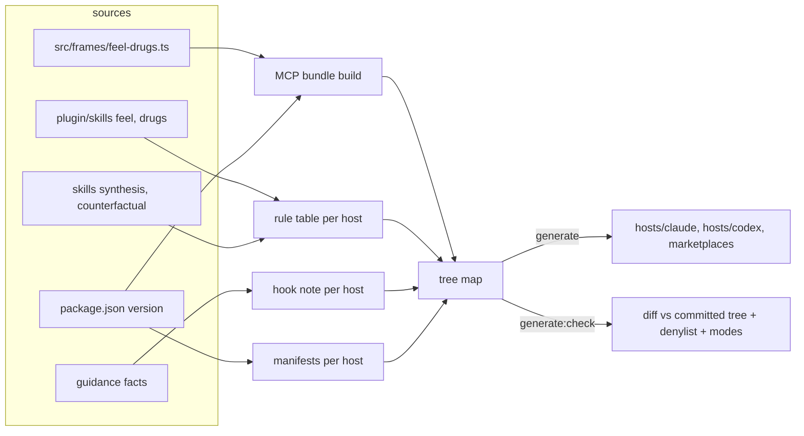

# feat: Claude Code and Codex plugin packages

## Overview

Generate a Claude Code plugin and an experimental Codex plugin from this repository's sources, commit them, and serve both from this repository's marketplaces. Each package carries the `feel` and `drugs` tools through one shared stdio MCP server bundle, per-host renderings of the four skills, and a factual session-start note that can be switched off. The OpenCode npm plugin is unchanged.

## Problem Frame

metacogs ships only as an OpenCode plugin. On Claude Code and Codex the only install is copying the two method skills, which gives no tools, no `feel` or `drugs` skill and no guidance. Neither host lets a plugin register a native tool, so the tools reach both through MCP. The owner uses neither host daily, so the packages must stay cheap to keep current (see origin: docs/brainstorms/2026-10-27-multi-host-packaging-requirements.md).

## Requirements Trace

All 22 origin requirements apply. Grouped:

- Tools: R1 shared stdio MCP server with the adapted frames; R2 Node 22 prerequisite, no I/O; R3 read-only annotations; R4 spike server untouched.
- Skills and invocation: R5 all four skills from the shared sources; R6 per-host rewrites; R7 `/metacogs:feel` on Claude; R8 `$metacogs:feel` on Codex; R9 record helper from the installed location, sandbox denial reported as unrecorded.
- Guidance: R10 factual per-host note; R11 no instructions or authority claims; R12 `METACOGS_GUIDANCE=off`; R13 no forced output style.
- Packaging and release: R14 generated, committed, drift-checked; R15 this repository is both marketplaces; R16 one version from `package.json`; R17 users update through their host's marketplace.
- Verification: R18 bundle protocol tests on Node 22; R19 `claude plugin validate --strict --json`; R20 Codex schema validation; R21 matrix records both host plugins as untested.
- Docs: R22 per-host install, prerequisites, invocation, off switch, approvals, sandbox.

Acceptance examples AE1–AE7 map to the test scenarios below.

## Scope Boundaries

- Install-and-invoke smoke tests on either host (origin scope boundary).
- A shell `bin/` fallback, Claude "mods" tools, other hosts, Codex public-directory listing.
- Any change to OpenCode plugin behaviour or wording, including `plugin/guidance.md` and `plugin/skills/**`.
- Any edit to `skills/**` skill text. Edits there are epoch changes under the Fro Bot rule and `enforcePrereg`; per-host text is generated elsewhere.
- Pinning marketplaces to release refs. Installs track `main` (owner decision, see Key Technical Decisions).

### Deferred to Separate Tasks

- Credentialed install-and-invoke smoke tests (`claude -p --bare --plugin-dir`, `codex exec --dangerously-bypass-hook-trust`): a later PR once the owner wants them.
- Pre-approving the record helper through skill `allowed-tools`: after `${CLAUDE_SKILL_DIR}` interpolation in frontmatter is verified.

## Context & Research

### Relevant Code and Patterns

- `src/generate/bundle-helpers.ts` (`buildHelper`, `generate`), `src/generate/check.ts` (`checkHelpers`), `src/generate/marker.ts` (`helperBanner`, `readHelperVersion`): today's generate-and-drift pattern. It checks one file per skill.
- `package.json` scripts `generate`, `generate:check`, `version` (`changeset version && bun run generate`). Renovate `postUpgradeTasks` runs `bun run generate`.
- `src/frames/feel-drugs.ts`: import-free adapted frame text and field lists. `src/plugin/index.ts` shows the tool wiring over it.
- `src/spike/feel-drugs/server.ts`: the stdio `McpServer` pattern (SDK 1.32.2, zod 4). It uses Bun-only `import.meta.main` and serves verbatim upstream text, so it is a pattern, not a dependency.
- `src/plugin/build.ts` and `src/plugin/package.test.ts`: deterministic `Bun.build` and the import-specifier allowlist test to mirror for the MCP bundle.
- `src/plugin/names.test.ts`, `src/plugin/skills.test.ts`: pin the shared SKILL text, so the shared sources stay byte-identical.
- `src/matrix/check.ts`: `plugin` is one closed OpenCode entry. `src/scan/secrets.ts` `SCAN_TARGETS`.
- `.github/workflows/ci.yml` (Bun only, no `setup-node`), `.github/workflows/renovate-changesets.yaml` (scope prefixes `skills/`, `dist/`, `plugin/`), `.github/workflows/fro-bot.yaml` (autoheal never-change list), `.github/PULL_REQUEST_TEMPLATE.md`.

### Institutional Learnings

- Verify installed or relocated artifacts, not only build gates: systematic shipped fake versions, broken relocated links and wrong host identifiers past green gates (systematic `docs/solutions/workflow-issues/verify-installed-artifacts-not-just-build-gates-2026-07-18.md`).
- Imperative SessionStart text was refused as prompt injection; factual text was honoured (same doc).
- Executable bits get lost; make modes part of generation and the drift check (systematic `docs/solutions/workflow-issues/merge-order-dependencies-must-be-structural-2026-08-25.md`).
- Narrow bundle entry points with a tested dependency closure (systematic `docs/solutions/best-practices/entry-point-scope-decides-what-a-plugin-can-ship-2026-08-24.md`).
- Keep the release script ordering and introducing-commit targeting intact (`docs/solutions/best-practices/changesets-release-script-before-action-targets-introducing-commit-2026-10-24.md`).

### External References

Checked 2026-10-27; neither CLI was run.

- Claude Code: marketplace at `.claude-plugin/marketplace.json` with `source: "./<subdir>"`; plugin manifest `.claude-plugin/plugin.json`, whose `version` controls update detection; defaults `skills/`, `hooks/hooks.json`, `.mcp.json`; `${CLAUDE_PLUGIN_ROOT}` in MCP `command`/`args` and hook commands; tool name `mcp__plugin_<plugin>_<server>__<tool>`; `${CLAUDE_SKILL_DIR}` substituted in skill text only; hook stdout becomes context, capped at 10,000 characters, written as facts. https://code.claude.com/docs/en/plugins/marketplace-reference, https://code.claude.com/docs/en/plugins/manifest-reference, https://code.claude.com/docs/en/hooks, https://code.claude.com/docs/en/mcp, https://code.claude.com/docs/en/skills.
- Codex: marketplace at `.agents/plugins/marketplace.json` (entries with `source`, `policy`, `category`); root `plugin.json` and `mcp.json` per agent-plugins.org 1.0.0 (hooks under `extensions.com.openai`); `${PLUGIN_ROOT}` substituted in `mcp.json`; tool `mcp__metacogs__feel`; skills `$metacogs:feel` with the model given each skill's path; plugin hooks run only after `/hooks` trust, pinned to a hash; hook stdout capped near 2,500 tokens; Git marketplaces auto-upgrade at startup; no CLI validator. https://developers.openai.com/codex/plugins/build, https://learn.chatgpt.com/docs/hooks, `openai/codex@4d3ed3f3` (`codex-rs/codex-mcp/src/agent_plugin_config.rs`, `codex-rs/codex-mcp/src/tools.rs`, `codex-rs/ext/skills/src/loader/environment.rs`, `codex-rs/cli/src/plugin_cmd.rs`).
- Both hosts pass the user's environment to hook commands (Claude docs: hooks run "with Claude Code's environment"; Codex `hooks/src/registry.rs` snapshots `std::env::vars_os()`). Claude also exports each plugin `userConfig` option as `CLAUDE_PLUGIN_OPTION_<KEY>`.
- Prior art: EveryInc/compound-engineering-plugin keeps separate per-host metadata with shared skills; pbakaus/impeccable generates host trees and commits them.

## Prior-Art Survey

```json
{
  "schema_version": 2,
  "verdict": "extend",
  "scope": "metacogs root package: src/, package.json, .github/, plugin/, skills/, matrix.json (single workspace)",
  "freshness": {
    "vcs_reference": "4f8b5db"
  },
  "budget": {
    "max_search_passes": 3,
    "max_candidate_inspections": 12,
    "exhausted": false
  },
  "candidates": [
    {
      "path_or_symbol": "src/generate/bundle-helpers.ts#generate",
      "description": "Writes skills/<name>/scripts/record.mjs for each skill via buildHelper(), stamped with the package version; mirrors skills into gitignored .agents/skills",
      "disposition": "extend"
    },
    {
      "path_or_symbol": "src/generate/check.ts#checkHelpers",
      "description": "Drift detection that rebuilds the helper in memory and string-compares it to each committed record.mjs",
      "disposition": "extend"
    },
    {
      "path_or_symbol": "package.json scripts.version / scripts.generate / scripts.generate:check",
      "description": "Generation runs in the Changesets version commit, in CI and in Renovate postUpgradeTasks",
      "disposition": "reuse"
    },
    {
      "path_or_symbol": "src/frames/feel-drugs.ts",
      "description": "Import-free adapted feel/drugs descriptions, field descriptions and result text",
      "disposition": "reuse"
    },
    {
      "path_or_symbol": "src/plugin/build.ts#buildPlugin",
      "description": "Deterministic Bun.build with externals and an import-allowlist test",
      "disposition": "extend"
    },
    {
      "path_or_symbol": "src/spike/feel-drugs/server.ts#createServer",
      "description": "Stdio McpServer over zod shapes serving verbatim upstream text, Bun-only entry; used as a pattern only, never imported (origin R4)",
      "disposition": "insufficient",
      "insufficiency_reason": "Serves the verbatim upstream text and starts only under Bun; the production server is new code over the adapted frames."
    },
    {
      "path_or_symbol": "src/generate/marker.ts#helperBanner",
      "description": "Comment banner and version stamp for generated JS",
      "disposition": "insufficient",
      "insufficiency_reason": "A comment banner cannot stamp JSON manifests; manifest versions must be literal fields."
    },
    {
      "path_or_symbol": "src/generate/bundle-helpers.ts .agents/skills mirror",
      "description": "Plain gitignored copy of each skill directory",
      "disposition": "insufficient",
      "insufficiency_reason": "No per-host rewrite, not committed, not drift-checked."
    },
    {
      "path_or_symbol": "src/plugin/config.ts#applyConfig",
      "description": "OpenCode config hook registering skills.paths",
      "disposition": "insufficient",
      "insufficiency_reason": "OpenCode-only; Claude and Codex register through manifests and marketplaces."
    },
    {
      "path_or_symbol": "src/matrix/check.ts#parsePlugin",
      "description": "Single closed plugin entry for OpenCode",
      "disposition": "insufficient",
      "insufficiency_reason": "Cannot record two more host plugins without a schema change."
    },
    {
      "path_or_symbol": "src/release/release.ts#introducingCommit",
      "description": "Targets the GitHub Release at the commit that introduced the version",
      "disposition": "reuse"
    }
  ]
}
```

## Key Technical Decisions

- **Installs track `main`, guarded by a changeset gate.** Both marketplaces serve the default branch, so host-package changes reach Codex users (auto-upgrade) and fresh Claude installs at feature merge. A CI check fails any pull request that changes the host packages or their generator without adding a changeset, whatever the version field says, so the version, and Claude's update signal, always moves with the content. The Changesets version PR is recognised by its branch, `changeset-release/main`. Owner decision; matches CEP and Impeccable.
- **`package.json` is the one version source.** Each plugin manifest copies it at generation time. The Claude marketplace entry stays unversioned, since `plugin.json` wins and a stale marketplace version would block updates.
- **Separate self-contained host directories, `hosts/claude/` and `hosts/codex/`.** Both hosts discover `skills/`, so one shared directory cannot carry per-host skill text, and Claude copies the plugin into its cache, so nothing may live outside the directory. Each carries its own byte-identical copy of the MCP bundle and the record helper. The parent is not named `plugins/` to avoid confusion with `plugin/`. The host directories stay out of the npm `files` allowlist.
- **One tree-map builder for write and check.** A builder returns every generated path with its bytes and mode. The owned roots are exactly `hosts/claude/`, `hosts/codex/`, `.claude-plugin/` and `.agents/plugins/`: `generate` clears them and writes the map, and `generate:check` diffs the map against a walk of each and reports missing, extra, changed and mode-changed files. `skills/*/scripts/record.mjs` lives beside hand-written `SKILL.md`, so it stays a per-file output that is written and checked but never cleared. The gitignored `.agents/skills` dev mirror keeps today's behaviour. Today's helper generation moves onto the same builder with identical output.
- **Rewrites are an exact-string rule table with match counts.** Each rule names the source string, its per-host replacement and how many times it must match, so an upstream wording edit fails generation instead of passing through. A denylist then runs over the generated trees for OpenCode leftovers, plus a positive check for each host's tokens. The Claude tool prefix is derived from the plugin and server names, not hardcoded.
- **Method-skill renders are labelled as not the evaluated text.** The rule table's match counts bound what changes, and the docs and matrix say the renders are host-adapted and untested.
- **Production MCP server is new code over `src/frames/feel-drugs.ts`.** One Node entry always starts the server, uses stdio-only SDK imports, declares read-only annotations, and gets its version through a build-time define plus `helperBanner`, so the drift check covers the version. `buildPlugin` in `src/plugin/build.ts` is extended to build it. There is no Node-version preamble, because the bundled SDK code would run before it; the docs state the Node 22 prerequisite and the skills fall back to plain text when the tool is missing.
- **The session-start hook is a small Node script that prints plain text.** The note comes from one factual template filled per host with that host's names and invocation, under 3,000 characters to fit Codex's cap, and never starts with `{` or `[` (Codex treats such output as JSON and fails the hook when it does not parse). Codex pins hook trust to a hash of the whole plugin directory (`codex-rs/hooks/src/engine/plugin_fingerprint.rs`), so any release may ask the user to re-trust the hook in `/hooks`; the docs say so, and the tools and skills work without it.
- **Off switch in three layers.** The hook stays silent when `METACOGS_GUIDANCE=off` is set, when `${XDG_CONFIG_HOME:-~/.config}/metacogs/guidance-off` exists, or (Claude only) when the plugin's `guidance` option is false-like in `CLAUDE_PLUGIN_OPTION_GUIDANCE`. Both hosts pass the user's environment to hooks, so the variable is the primary switch; the file and the option cover hosts started from a different environment. Owner decision. The option declares `type`, `title` and `description`, and the hook reads only the environment variable, never `${user_config.*}` in a shell command.
- **Record helper path per host.** Claude renders use `${CLAUDE_SKILL_DIR}/scripts/record.mjs`. Codex renders tell the model to use the directory of the SKILL.md path it was given, quoted. No `allowed-tools` pre-approval yet.
- **Skill renders add one fallback line.** If the tool is unavailable (for example Node is missing), the skill says to continue in plain text and say so. This only appears in host renders; shared sources stay byte-identical.
- **Validators.** Claude: the pinned Claude CLI (2.1.312) runs `claude plugin validate --strict --json` on the repository root and again on `hosts/claude/`, because the root run checks only the marketplace and `plugin.json` while the directory run also checks `hooks.json`, `.mcp.json` and skill frontmatter. It needs no login or network. Under `--strict` the marketplace needs `metadata.description` and `plugin.json` needs `author`. CI installs the package and runs its `install.cjs` (npm 12 blocks the postinstall), with `DISABLE_TELEMETRY=1` and `CLAUDE_CODE_DISABLE_NONESSENTIAL_TRAFFIC=1`. Codex: the generated `plugin.json` and `mcp.json` validate against vendored, unmodified copies of the agent-plugins.org 1.0.0 schemas (draft 2020-12), converted with `z.fromJSONSchema()` from the existing `zod` devDependency (owner preference: no new dependency). Zod cannot convert one keyword, `$defs.stdioServer.properties.env.propertyNames` (a `not` that bans `PLUGIN_ROOT` and `PLUGIN_DATA` as `env` keys), so the validator drops that keyword at load time and checks the two reserved names directly. The Claude validator runs only when `METACOGS_HOST_VALIDATE=1`, which only a dedicated `ci.yml` step sets; the release job's `prepublishOnly` test run skips it. The Codex schema check needs no CLI or network, so it runs in the normal test suite.
- **Matrix schema 2.** `plugin` becomes a `plugins` map keyed by host, each entry with a status. OpenCode keeps its verified entry; Claude and Codex start untested, with `docs/install.md#` evidence refs allowed. Codex is labelled experimental.

## Open Questions

### Resolved During Planning

- Where do host packages live: `hosts/claude/` and `hosts/codex/`, self-contained (flow analysis; Claude cache copy).
- How do users get updates: installs track `main`; the changeset gate keeps versions moving (owner).
- How is guidance turned off without env inheritance: env var, config-file marker, Claude plugin option (owner).
- `.github` edits: approved as a batch by the owner (CI Node 22 and validator steps, changeset gate, Renovate scope, Fro Bot never-change list, PR template).

Settled by the Unit 0 spike (2026-10-27; `openai/codex@4d3ed3f3`, Claude Code 2.1.312, Node 22.11 and 22.14):

- The SDK bundles with `Bun.build` into one self-contained ESM file (about 730 KB, ajv inlined) whose only import is `node:process`. It runs under Node 22 from a directory with no `node_modules`, and builds are byte-identical across checkouts when `root` is the repository root. The hand-written stdio fallback is dropped.
- Invalid arguments and unknown tools return a result with `isError: true` and an `MCP error -32602` message; an unknown method returns a JSON-RPC `-32601` error; stdin EOF exits 0. Responses can arrive out of order.
- Codex SessionStart takes plain stdout as context (JSON `additionalContext` also works); stdout that looks like JSON but does not parse fails the hook; output over about 2,500 tokens is spilled to a file. Trust covers the hook declaration and every file in the plugin root.
- Codex reads only the first marketplace file it finds, `.agents/plugins/marketplace.json` before `.claude-plugin/marketplace.json`, so committing both shows one catalog to Codex.
- `claude plugin validate --strict --json` needs no login or network on 2.1.289 and 2.1.312, and accepts `userConfig` options that declare `type`, `title` and `description`.
- `z.fromJSONSchema()` converts `plugin.schema.json` faithfully; `mcp.schema.json` converts once its one `env.propertyNames` keyword is dropped, and then matches an Ajv 2020 oracle on 34 cases.

### Deferred to Implementation

- Exact rule-table entries, after reading each SKILL.md section by section.
- Whether Codex resolves a bare `$feel` for a plugin skill, and whether text after the mention reaches the model unchanged (origin). AE2's render check covers the documented form.
- The string Claude puts in `CLAUDE_PLUGIN_OPTION_GUIDANCE` for a boolean option is undocumented; the hook treats only an explicit false-like value as off.
- The Node 22 patch version pinned in CI.

## Output Structure

    .claude-plugin/
      marketplace.json
    .agents/plugins/
      marketplace.json
    hosts/
      claude/
        .claude-plugin/plugin.json
        .mcp.json
        hooks/hooks.json
        hooks/session-start.mjs
        mcp/server.mjs
        skills/{feel,drugs,synthesis,counterfactual}/SKILL.md
        skills/{synthesis,counterfactual}/scripts/record.mjs
      codex/
        plugin.json
        mcp.json
        hooks/hooks.json
        hooks/session-start.mjs
        mcp/server.mjs
        skills/{feel,drugs,synthesis,counterfactual}/SKILL.md
        skills/{synthesis,counterfactual}/scripts/record.mjs
    src/
      mcp/            (production server and Node entry)
      hosts/          (rule table, guidance renderer, hook source, manifests)
      generate/       (tree-map builder, write and check)

The layout is a scope declaration; per-unit file lists are authoritative.

## High-Level Technical Design

> *This illustrates the intended approach and is directional guidance for review, not implementation specification. The implementing agent should treat it as context, not code to reproduce.*



## Implementation Units

- [x] **Unit 0: Spike (not merged)**

**Goal:** Settle the four unknowns that could change the plan before committing code.

**Requirements:** R2, R10, R12, R18, R19.

**Dependencies:** None.

**Files:** Scratch only, outside the repository or in a throwaway branch. Results are recorded in this plan's Open Questions.

**Approach:**
- Bundle a minimal MCP entry over the SDK with `Bun.build`, run it under Node 22 from a temp directory with no `node_modules`, and list its import specifiers.
- Read the Codex hook loading and trust-hash code at the pinned commit and record the SessionStart output contract.
- Run `claude plugin validate --strict --json` on a throwaway marketplace plus plugin with no login and no network, including a `userConfig` option, and record what it needs.
- Convert the agent-plugins.org 1.0.0 schemas with `z.fromJSONSchema()` and check that known-bad manifests are rejected.
- If a host CLI is available without paid model turns, check whether a SessionStart hook sees a user env var.

**Test expectation:** none -- spike; findings are written into the plan before Unit 1.

**Verification:** Each deferred question above has an answer or a recorded fallback.

- [x] **Unit 1: Tree-map builder, whole-tree drift check, changeset gate**

**Goal:** One builder for all generated output, a check that covers whole trees and modes, and a CI gate that keeps versions moving.

**Requirements:** R14, R16, R17.

**Dependencies:** Unit 0.

**Files:**
- Create: `src/generate/tree.ts`, `src/generate/tree.test.ts`, `src/release/changeset-gate.ts`, `src/release/changeset-gate.test.ts`
- Modify: `src/generate/bundle-helpers.ts`, `src/generate/check.ts`, `src/generate/check.test.ts`, `package.json` (scripts), `.github/workflows/ci.yml`

**Approach:**
- The builder returns a map of repo-relative path to bytes and mode. Helpers move onto it first with byte-identical `record.mjs` output.
- `generate` clears each owned output directory, then writes the map. `generate:check` walks each owned directory and reports missing, extra, changed and mode-changed files, with the existing `--root` test seam.
- The changeset gate runs only on `pull_request`, diffs against the event's base SHA (fetched explicitly, since CI checks out shallow), and fails when the PR changes an owned root, `src/generate/**`, `src/hosts/**` or `src/mcp/**` and adds no `.changeset/*.md`. It passes the version PR by its branch name when the head repository is this repository, so a fork cannot borrow the name.

**Patterns to follow:** `src/generate/check.ts` and its fixture tests; `src/release/release.ts` for git reads.

**Test scenarios:**
- Happy path: helpers regenerate byte-identical to today's committed `record.mjs`.
- Edge case: an extra file in an owned directory is reported; a missing file is reported; a mode change is reported.
- Edge case: `generate` on a clean checkout is idempotent (second run changes nothing).
- Edge case: a hand-written `skills/<name>/SKILL.md` survives `generate` and is not reported by `generate:check`.
- Gate: host-output change without a changeset fails, even with a hand-bumped version; with a changeset passes; the `changeset-release/main` branch passes; a change outside owned paths passes.

**Verification:** `generate:check` passes on main with no behaviour change; the gate runs in CI.

- [x] **Unit 2: Production MCP server and bundle**

**Goal:** A Node 22 stdio MCP server over the adapted frames, bundled self-contained and generated into each host directory.

**Requirements:** R1, R2, R3, R4, R18.

**Dependencies:** Units 0, 1.

**Files:**
- Create: `src/mcp/server.ts`, `src/mcp/server.test.ts`
- Modify: `src/plugin/build.ts` (MCP entry), `src/generate/tree.ts` (emit `hosts/*/mcp/server.mjs`), `.github/workflows/ci.yml` (pinned Node 22 step)

**Approach:**
- Server registers `feel` and `drugs` from `src/frames/feel-drugs.ts` field lists and text, with read-only annotations and the package version as server version.
- The entry always starts the server. Stdout carries JSON-RPC only.
- Build through the extended `buildPlugin`, banner from `helperBanner`, version through a define. The spike server is not imported.

**Execution note:** Start with a failing protocol test that spawns the bundle under `node`.

**Patterns to follow:** `src/plugin/index.ts` (tool wiring), `src/plugin/package.test.ts` (import allowlist, determinism), `src/spike/feel-drugs/server.test.ts` (stdio client).

**Test scenarios:**
- Happy path: build the bundle in memory, spawn it under `node`, initialize, list tools (both, with the expected input schemas and read-only annotations), call `feel` and `drugs` and get the exact adapted text pinned in `src/plugin/frames-text.test.ts`.
- Error path: a missing required field, a wrong-typed field and an unknown tool each return a result with `isError: true`; an unknown method returns a JSON-RPC error. Responses are matched by `id`.
- Edge case: stdin EOF exits 0; nothing but JSON-RPC on stdout.
- Static: the bundle's only import is `node:process` (ajv codegen strings that mention `require` are expected); two builds are byte-identical.

**Verification:** The bundle passes its protocol tests under Node 22 in CI.

- [x] **Unit 3: Host rewrite engine, guidance hook, Claude package**

**Goal:** Generate `hosts/claude/` and the Claude marketplace, with per-host skill text, the factual note and the off switch.

**Requirements:** R5, R6, R7, R9, R10, R11, R12, R13, R15, R16, R19, R22 (Claude part).

**Dependencies:** Units 1, 2.

**Files:**
- Create: `src/hosts/rules.ts`, `src/hosts/rules.test.ts`, `src/hosts/guidance.md` (factual note template), `src/hosts/session-start.ts`, `src/hosts/session-start.test.ts`, `src/hosts/claude.ts`, `src/hosts/claude.test.ts`
- Generated: `.claude-plugin/marketplace.json`, `hosts/claude/**`
- Modify: `src/generate/tree.ts`, `.github/workflows/ci.yml` (pinned Claude CLI and validate step)

**Approach:**
- Rule table per host: exact source strings, replacements, expected match counts. Claude replacements: tool names with the derived `mcp__plugin_metacogs_metacogs__` prefix, `/metacogs:feel` invocation and `$ARGUMENTS` handling, `${CLAUDE_SKILL_DIR}/scripts/record.mjs`, the tool-unavailable fallback line.
- A factual note template carries the content of `plugin/guidance.md` as statements (what exists, when each fits, how to invoke), filled with each host's names. `plugin/guidance.md` itself is unchanged.
- Session-start script prints the note unless an off signal is present. `hooks.json` runs it with `node` from `${CLAUDE_PLUGIN_ROOT}`; the plugin manifest declares a boolean `guidance` user option with `title` and `description`, plus `author`; the marketplace carries `metadata.description`.
- Manifests carry the package version; the marketplace entry has no version.

**Execution note:** Write the denylist test first and confirm it fails on the unrewritten sources.

**Patterns to follow:** systematic `scripts/build-claude-code-plugin.ts` (identifier translation, factual hook); `src/generate/bundle-helpers.ts`.

**Test scenarios:**
- Happy path: each rule matches its expected count; a changed source string fails generation with the rule named.
- Denylist: the generated tree contains no `<skill-base-dir>`, no "base directory the host reported", no bare `/feel` or `/drugs`, no "the `skill` tool", no OpenCode argument wording; the same scan fails on the source text.
- Positive: each Claude render names `mcp__plugin_metacogs_metacogs__feel` or `__drugs` and `/metacogs:` where expected.
- Guidance: the note has no imperative "call"/"use"/"must" sentences, names only tools and skills the package ships, and stays under 3,000 characters.
- Off switch (AE3): each signal (env var, marker file, plugin option) silences the note; with none set the note prints; malformed values print the note.
- AE1 (static part): the drugs skill render maps the user's argument to `substance` and names the Claude tool.
- AE5 (static part): the method renders invoke `${CLAUDE_SKILL_DIR}/scripts/record.mjs`.
- AE4: after a simulated version bump, both host manifests carry the new version and `generate:check` passes.
- Hook output never begins with `{` or `[`.
- Validator: `claude plugin validate --strict --json` passes on the repository root and on `hosts/claude/` in CI.

**Verification:** `generate:check` and the Claude validator pass; `hosts/claude/` copied to a temp directory outside the repository, with no `node_modules`, runs its hook and server from another working directory.

- [x] **Unit 4: Codex package**

**Goal:** Generate `hosts/codex/` and the Codex marketplace, schema-validated.

**Requirements:** R5, R6, R8, R9, R10, R12, R15, R16, R20, R22 (Codex part).

**Dependencies:** Unit 3.

**Files:**
- Create: `src/hosts/codex.ts`, `src/hosts/codex.test.ts`, `src/hosts/schemas/agent-plugins-1.0.0/{plugin,mcp}.schema.json`
- Generated: `.agents/plugins/marketplace.json`, `hosts/codex/**`

**Approach:**
- Codex rules: `mcp__metacogs__feel`, `$metacogs:feel` invocation with arguments as text after the mention, helper path from the directory of the given SKILL.md path, the fallback line.
- `plugin.json` declares the 1.0.0 schema, version, description and hooks as a nested `extensions: {"com.openai": {hooks: "./hooks/hooks.json"}}`, plus an experimental label in the description. `mcp.json` declares the server with `type: "stdio"`, `command: "node"` and `${PLUGIN_ROOT}/mcp/server.mjs` in its arguments.
- Marketplace entry: local source path, installation and authentication policy, category.
- Hook output shape follows the spike's finding.

**Patterns to follow:** Unit 3 builders; CEP `.agents/plugins/marketplace.json`.

**Test scenarios:**
- Happy path: `plugin.json` and `mcp.json` validate against the vendored schemas; marketplace entry points at an existing directory.
- Error path: the converted schemas reject a manifest with no `$schema`, a bad `name`, an unknown top-level key and an `mcpServers` entry with no `command`; the direct check rejects `PLUGIN_ROOT` and `PLUGIN_DATA` as `env` keys.
- Edge case: the vendored schemas stay byte-identical to the published files; only the in-memory copy drops the one unsupported keyword.
- Denylist and positive checks as in Unit 3, with Codex tokens.
- AE2 (static part): the feel render tells the model to pick fields from the session when no text follows the mention.
- AE6: the method renders say a denied write is reported as unrecorded.
- AE7 (static part): docs and hook note behave correctly when the hook is skipped; the tools and skills do not depend on it.
- Off switch: the Codex note is silenced by `METACOGS_GUIDANCE=off` and by the marker file.

**Verification:** Schema validation passes in CI; `generate:check` covers the Codex tree.

- [ ] **Unit 5: Matrix schema 2, docs, repository housekeeping**

**Goal:** Honest status for both host plugins, user docs, and every allowlist that must know the new directories.

**Requirements:** R21, R22, R14 (scan coverage), R17 (dependency bumps get changesets).

**Dependencies:** Units 3, 4.

**Files:**
- Modify: `matrix.json`, `src/matrix/check.ts`, `src/matrix/check.test.ts` (and the renderer), `README.md`, `docs/install.md`, `src/scan/secrets.ts`, `.github/workflows/renovate-changesets.yaml`, `.github/workflows/fro-bot.yaml`, `.github/PULL_REQUEST_TEMPLATE.md`

**Approach:**
- Matrix `plugins` map: OpenCode verified (unchanged evidence), Claude and Codex untested with `docs/install.md#` refs; Codex marked experimental. Renderer and README check updated.
- Docs per host: one-command install, Node 22 prerequisite and the failure when it is missing, invocation forms, off switch (all three signals plus host-native fallbacks), MCP approval and the `mcp__plugin_metacogs_metacogs__*` allow rule, Codex re-trust of the hook after each release, the record-helper approval prompt with a user-level allow rule per host marked as not yet checked on a real install, Codex `/hooks` trust and possible re-trust after updates, records path, sandbox allowance or `METACOGS_RECORDS_DIR`, updates (`main` tracking; Claude third-party marketplaces may need a manual update), uninstall leaves records. The method-skill renders are stated to be host-adapted, not the evaluated text.
- Housekeeping: `SCAN_TARGETS` adds `hosts`, `.claude-plugin`, `.agents/plugins` (check the minified bundle for false positives); Renovate scope adds `hosts/`; Fro Bot never-change list and PR template add the generated directories.
- A changeset for the release.

**Test scenarios:**
- Matrix: a Claude or Codex entry marked verified without a manual-run note fails `matrix:check`; the OpenCode entry still passes; the README table matches.
- Scan: secret scan passes on the generated trees.
- Test expectation for docs and `.github` edits: none -- covered by `matrix:check`, `scan:secrets`, actionlint and review.

**Verification:** All gates pass: test, typecheck, `generate:check`, `matrix:check`, `scan:secrets`, actionlint, both validators.

## System-Wide Impact

- **Interaction graph:** `bun run version` (Changesets), Renovate `postUpgradeTasks` and CI all run the new generator through existing scripts. The release job is unchanged.
- **Error propagation:** a stale or hand-edited generated file fails `generate:check`; a host-output change without a changeset fails the gate; an upstream SKILL.md wording change fails generation by rule name.
- **State lifecycle risks:** users on Codex get `main` at startup; a broken `main` reaches them before any release. CI gates are the guard.
- **API surface parity:** the OpenCode plugin and the two host packages expose the same tools and field names; only names and invocation differ.
- **Integration coverage:** relocated-directory runs of the hook and server; host loading itself is untested until a manual run (R21).
- **Unchanged invariants:** `plugin/**`, `skills/**` skill text, the npm `files` allowlist, the OpenCode plugin's tests and behaviour, and the release workflow.

## Risks & Dependencies

| Risk | Mitigation |
|------|------------|
| A host started from a different environment misses `METACOGS_GUIDANCE` | Config-file marker and Claude plugin option |
| Codex re-asks hook trust after every release | Docs say so; tools and skills work without the hook |
| Rewritten method skills drift from evaluated text | Rule match counts; docs and matrix say host-adapted and untested |
| Minified bundle trips the secret scan | Check in Unit 5; narrow allowlist if needed |
| A future schema version adds keywords zod cannot convert | The validator fails loudly on conversion; a validator dependency goes back to the owner |

## Documentation / Operational Notes

- README and `docs/install.md` gain Claude Code and Codex plugin sections; the existing copy-install sections stay as the no-tools option.
- Release flow is unchanged; the version commit regenerates all manifests.
- Owner prerequisites: none. Both validators run without credentials.

## Sources & References

- **Origin document:** [docs/brainstorms/2026-10-27-multi-host-packaging-requirements.md](../brainstorms/2026-10-27-multi-host-packaging-requirements.md) (untracked until the implementation PR; it lands with this plan).
- Related code: `src/generate/`, `src/plugin/`, `src/frames/feel-drugs.ts`, `src/spike/feel-drugs/server.ts`, `src/matrix/check.ts`, `.github/workflows/`.
- Related plans: `docs/plans/2026-10-25-002-feat-opencode-plugin-plan.md`.
- External docs: listed under External References.
