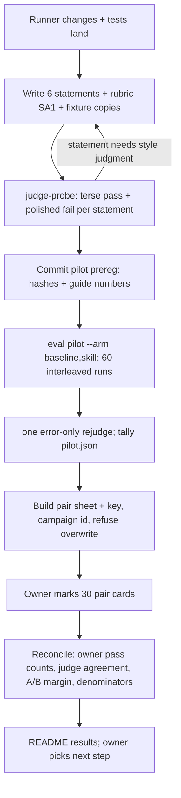

# feat: Pilot the one-outcome scoring contract on synthesis

## Overview

Run the scoring redesign from the origin memo (Option 1 plus pairwise reporting) as a dev-only pilot on `synthesis`. Each of the six dev fixtures gets one falsifiable acceptance statement. One campaign runs baseline and skill, 5 runs each per fixture. The owner marks one blind pair sheet: for each pair, pass or fail per answer against the statement, plus a preference. The judge scores the same text and is the instrument under test.

## Problem Frame

The v0.1 synthesis GREEN sheet could not be reviewed with confidence. SY2–SY5 asked for broad reasoning standards. Agreement was 0.61–0.77 with κ 0.03–0.31, and 10 of 39 runs flipped. Baseline failures were mostly missing restatements, not wrong conclusions (see origin, sections A–B). The memo recommends one decision-relevant outcome per fixture, which the owner can explain in one sentence, plus a blind preference read. This pilot checks whether that contract can be reviewed and whether it still separates skill from baseline, before any new epoch, held-out set or counterfactual work.

## Requirements Trace

- R1. Each dev fixture has exactly one acceptance statement, kept as evaluator-only custody and hashed in a committed pilot prereg.
- R2. The judge and the owner see identical evidence: the prompt, the statement and the judged answer text. Records never reach either, and cannot rescue a score.
- R3. Every statement is probed before the prereg commit with a hand-written terse passing answer and a polished failing answer. A statement that needs style judgment or inferred intent is rewritten.
- R4. One dev campaign runs baseline and skill, interleaved, 5 runs per fixture per arm, on the epoch-3 models.
- R5. One blind pair sheet. Each card shows the prompt and statement once, then two anonymised answers. The owner marks pass or fail for each answer and X, Y or same.
- R6. The reconcile step reports:
  - the owner's pass counts per arm and fixture;
  - a four-cell judge-by-owner table;
  - preference wins, losses and ties;
  - review time and which marks needed interpretation;
  - the denominators.
- R7. Guide numbers are written in the pilot prereg. They inform the owner's next-step decision and do not make it.
- R8. The epoch-3 synthesis prereg, rubric, fixtures, reports and `skills/synthesis/**` stay byte-identical.

## Scope Boundaries

- No held-out fixtures, new epoch of the shipped method, GREEN read or matrix change. The pilot's own prereg is epoch 1 of the synthesis pilot, committed before the scoring it binds.
- No `counterfactual` work.
- No skill-text change.
- No rewrite of `src/runner/review.ts` or `src/runner/human-review.ts`. The v0.1 sheet path stays as it is for shipped-method reports.
- No extraction of `src/spike/feel-drugs/blind.ts`. This is its second use, so the needed pieces are copied.
- No build-time side-leak lint, no "which is skill?" guess column, and no answer normalization. The report states that the sheet is only partly blind.
- No tally redesign. Load, missingness and check-failure summaries go in `pair-summary.json`. `PilotTally` and its schema version are unchanged.

### Deferred to Separate Tasks

- Extending to counterfactual, or to a real synthesis epoch with fresh held-out fixtures, is decided by the owner after the pilot.
- If the pilot passes, replacing the v0.1 review path with the pair sheet.

## Context & Research

### Relevant Code and Patterns

- Tether expectation machinery is reused:
  - `src/runner/prereg.ts`: `expectation_hashes`, `verifyExpectations`, `verifyPreregContent`, `enforcePrereg`, `preregCommitViolation`.
  - `src/runner/judge.ts`: `parseDeclarations` and `expectation: true`, the EXPECTATION block in `buildUserMessage`, and `createJudge`, which omits RECORD.
  - `src/runner/events.ts`: `allAssistantText` and `finalAnswerText`.
- The pilot mode lives in `src/runner/pilot.ts` (`planPilot`, `tallyPilotCampaign`, `writePilotTally`), `src/runner/manifest.ts` (`PILOT_ARMS`) and `src/runner/cli.ts` (`eval pilot`, the `--prereg` refusal, `pilotCampaignRefusal`). It is baseline-only today, with the arm hard-coded at `cli.ts:158` and `pilot.ts:44`.
- These five sites hard-wire `evals/<method>`: `prereg.ts:527`, `judge.ts:498`, `cli.ts:371`, `cli.ts:441` and `judge-probe.ts:106`.
- Record checks short-circuit the judge at `run.ts:680`. `skipReason` in `manifest.ts:185` skips the rejudge.
- The pieces to copy are in `src/spike/feel-drugs/blind.ts`: `Side`, `cryptoRng`, `parseMarks` and the refuse-overwrite key. The `~` fence comes from `src/spike/feel-drugs/sheet.ts`.
- Probing uses `src/runner/judge-probe.ts`, which takes `--task`, `--expectation` and `--answers`.
- The template for the single criterion is `evals/tether/rubric.md`, TE1 anchor.

### Institutional Learnings

- Single judge verdicts are noisy at a criterion boundary: cf-d6 CF5 flipped 4/4 on rejudge. Statements must be falsifiable and probed (`evals/reports/counterfactual/authoring.md`).
- Low κ showed that the rubric had no shared reading, not that the judge was wrong. With a ceiling, κ is undefined, so report a four-cell table instead.
- Pass anchors must be quotable from the ANSWER. Quote checks prove a quote occurs in the answer, not that it supports the verdict.
- Tether closed as not-reproduced because its bait could be refuted from the fixture. A synthesis fixture whose shared premise is plainly stated in the prompt may sit at ceiling. Ceiling fixtures stay as regression coverage and are not rewritten to fail.
- The owner had trouble with earlier sheets for three reasons: the criteria were not shown, the judge column was visible, and marks were silently dropped. The new sheet shows the statement, hides every verdict, and its parser fails hard.
- AGENTS.md requires the pilot prereg to be committed before anything it binds is used for scoring. The runner reads bars and hashes from the committed file.

## Prior-Art Survey

```json
{
  "schema_version": 2,
  "verdict": "extend",
  "scope": "src/runner/, src/spike/feel-drugs/blind.ts, evals/synthesis/, evals/tether/, evals/reports/synthesis/",
  "freshness": { "vcs_reference": "17e933ee1baa813ac73d2e1c08961fad6ec85c3e" },
  "budget": { "max_search_passes": 6, "max_candidate_inspections": 16, "exhausted": false },
  "candidates": [
    { "path_or_symbol": "src/runner/prereg.ts expectation_hashes, verifyExpectations, enforcePrereg", "description": "salted canonical sidecar hash and content contract; hard-wired to evals/<method>", "disposition": "extend" },
    { "path_or_symbol": "src/runner/judge.ts parseDeclarations, buildUserMessage, createJudge", "description": "EXPECTATION block, no record, quote-verified verdicts", "disposition": "reuse" },
    { "path_or_symbol": "src/runner/run.ts runCampaign", "description": "run lifecycle; record checks short-circuit the judge", "disposition": "extend" },
    { "path_or_symbol": "src/runner/pilot.ts, manifest.ts PILOT_ARMS", "description": "dev-only pilot campaign and tally; baseline arm only", "disposition": "extend" },
    { "path_or_symbol": "src/runner/human-review.ts reconcile, parseKey", "description": "agreement against a v0.1 key; lenient parser drops malformed marks", "disposition": "insufficient", "insufficiency_reason": "v0.1 sheet format and lenient parsing; the pair sheet needs strict per-answer and preference marks" },
    { "path_or_symbol": "src/runner/review.ts renderReviewSheets", "description": "long v0.1 sheet with annex, records, condition in heading", "disposition": "insufficient", "insufficiency_reason": "shows records and condition, refuses pilots; the pair sheet is a new small renderer" },
    { "path_or_symbol": "src/spike/feel-drugs/blind.ts Side, cryptoRng, parseMarks", "description": "side draw, strict marks parsing, refuse-overwrite key; entangled with guided-spike types", "disposition": "extend" },
    { "path_or_symbol": "src/runner/run.ts planRuns mode dev + eval green --dev-only", "description": "skill-only dev campaign bound to the epoch-3 prereg", "disposition": "insufficient", "insufficiency_reason": "no baseline arm and binds to the epoch-3 prereg and rubric" }
  ]
}
```

## Key Technical Decisions

- **The pilot content root is opt-in.** A new optional prereg field names a repo-relative content directory, `evals/synthesis/pilot/`. When the field is absent, content stays at `evals/<method>`. That keeps the tether pilot, whose content lives in `evals/tether/`, unchanged. Sidecars never land in the epoch-3 fixture dir, which would void that prereg as `extra`.
- **Pilot mode gains a skill arm; dev mode is not used.** Dev mode plans only the skill arm and binds to the epoch-3 prereg. Arms are interleaved, and the order flips each round, as in `planRuns`.
- **The sidecar is `{outcome}` only.** `excludedTopics` and `maxWords` become optional, and the word check is skipped when `maxWords` is absent. A dummy limit would fail runs on `answer_over_limit`. Tether's hashes are unchanged.
- **The statement string carries its own boundary.** The sidecar has no other field, so each statement names one passing paraphrase and one failing case inline.
- **Under `expectation: true`, record checks never block the judge, on the first pass or on rejudge.** A small allow-list of codes still blocks: `unrecognized_events` and `false_fire_*`. Three places change together: the short-circuit at `run.ts:680`, `skipReason`, and rejudge's own empty-final and retained-record refusals in `review.ts`. A skill run that never loads the skill stays a skill-arm observation (intent-to-treat). The load rate comes from `fire_basis`, which also counts direct SKILL.md reads.
- **One evidence function feeds the judge and the sheet.** The card's answer is the redacted judged text, which is all assistant text. The build rebuilds the exact judge payload (task, answer, `record: null`, canonical expectation) and asserts that its hash equals the run's `judge.redacted_input_sha256`. Under the declaration, `answer_empty` tests the same text.
- **One pair sheet with one key** (owner choice).
  - Pairs are baseline run *i* against skill run *i* per fixture, with a random side per pair.
  - Cards are grouped by fixture so the prompt and statement appear once per group, and order is shuffled within a group.
  - The sheet and key carry the campaign id. The build refuses to overwrite a key.
  - Sheet and key live under the state root at mode 0600, never under `evals/`.
  - A run with a delivered answer is shown even if its judge errored. Only a run with no answer (infra, no-output) leaves its pair incomplete, and that pair is reported, not shown.
- **The sheet asks for marks in order.** The owner marks X and Y against the statement first, then answers "which would you use for this decision?". An optional `note:` flags a mark that needed interpretation. The sheet header has a start/end time line.
- **The parser is strict.** Each card needs a `pass|fail` mark for X and for Y and one of `X|Y|same`. A missing, duplicate or invalid mark, or a card count that differs from the key, is a hard error naming the card. The parser is copied from `blind.ts` `parseMarks`.
- **The owner's marks are the primary score** (owner choice). The judge is the instrument under test. Reconcile reports a four-cell judge-by-owner table over answers that have a judge verdict, raw agreement with a Wilson interval, and the list of disagreements with notes.
- **The guide numbers are descriptive prompts for the owner** (owner choice). They are written in prereg `metadata.notes`:
  - judge–owner agreement ≥ 0.8. At about 50 judged answers the Wilson interval is roughly ±0.10, so the number is read with its interval.
  - at least 2 of 6 fixtures not at ceiling, where ceiling means the owner passes baseline 4/5 or 5/5.
  - owner pass counts per arm, pooled and per fixture. No inference.
  - preference wins, losses and ties, plus the net margin, pooled only.
  - at least 4 of 5 answered runs per arm and fixture, with no top-up runs. Complete pairs can still fall to 3.

  The notes also record two reading rules. If most fixtures sit at ceiling, separation is *uninformative*, not a pass for the instrument. A preference lean toward skill with no gate difference is *compatible with* a format or length effect, because the skill's labelled lines reveal its side, or with usefulness beyond the statement.
- **Code changes land before probing.** Runner and judge support for probing and scoring (Units 1–2) land with tests first. Redaction is settled before the prereg commit. A later bug fix is allowed if documented in the README. The runner SHA is recorded there.
- **Statements are drafted from the fixture prompts.** The dev annex in `evals/synthesis/rubric.md` is used only to cross-check factual intent. Its sketches bundle several requirements and would recreate v0.1. Statements are written without looking at any baseline output, because writing them so baseline fails would manufacture a failure.
- **One bounded rejudge.** It covers only runs that ended in `judge_error`, and it runs once. Persistent errors stay unjudged and are listed.

## Open Questions

### Resolved During Planning

- Sheet shape: one combined pair sheet.
- Primary score: the owner's marks.
- Decision rule: guide numbers, and the owner decides.
- An empty final segment: the judge and the sheet use all assistant text, and the empty count is reported.
- Where human and A/B counts live: a small allowlisted `pair-summary.json` next to `pilot.json`. `PilotTally` is not reshaped.
- A statement change after the prereg commit but before any run: commit a revised contract (the pilot's prereg stays epoch 1; the shipped method gets no new epoch). After any run, it is a separately labelled iteration and is never pooled.

### Deferred to Implementation

- The exact statement wording for each fixture. It is settled by probing.
- Whether `redact.json` for the pilot needs extra tokens such as `skill` or `helper`. It is decided from the probe answers before the prereg commit.
- The CLI verb spelling for build and reconcile, for example `eval pairs --build` and `eval pairs --reconcile`.

## High-Level Technical Design

> *This illustrates the intended approach and is directional guidance for review, not implementation specification.*



## Implementation Units

- [ ] **Unit 1: Pilot eval directory and outcome-only expectations**

**Goal:** A pilot prereg in `evals/<m>/pilot/` reads its rubric, fixtures, sidecars and redaction from that directory. Sidecars may omit `excludedTopics` and `maxWords`.

**Requirements:** R1, R8

**Dependencies:** None

**Files:**
- Modify: `src/runner/prereg.ts`, `src/runner/judge.ts`, `src/runner/cli.ts`, `src/runner/judge-probe.ts`, `src/runner/run.ts`, `src/runner/pilot.ts`
- Test: `src/runner/prereg.test.ts`, `src/runner/judge.test.ts`, `src/runner/pilot.test.ts`

**Approach:**
- Add an optional prereg content-directory field.
- Thread the resolved directory through the five hard-wired sites (`prereg.ts:527`, `judge.ts:498`, `cli.ts:371`, `cli.ts:441`, `judge-probe.ts:106`).
- When the field is absent, content stays at `evals/<method>`, so tether's content root is unchanged.
- `Expectation` gets optional `excludedTopics` and `maxWords`. Existing objects are not defaulted or rewritten, so their hashes hold. The word check and the tally's `over_limit` already skip when no limit is set.

**Patterns to follow:** How tether pilot `--prereg` is resolved, and `verifyExpectations`.

**Test scenarios:**
- Happy path: a pilot prereg with the content-directory field verifies against `evals/synthesis/pilot/`'s rubric, fixtures and sidecars.
- Regression: the tether pilot prereg, which has no field, still verifies against `evals/tether/`.
- Happy path: a `{outcome}`-only sidecar passes the shape check and hashes stably.
- Edge case: with no `maxWords`, a 5,000-word answer is not `answer_over_limit`.
- Regression: the epoch-3 synthesis, counterfactual and tether preregs still verify unchanged, and their content hashes are unchanged.
- Error path: a sidecar with `maxWords: 0` or non-string `excludedTopics` entries is still `prereg_invalid`.
- Error path: a sidecar in the pilot dir with no prereg hash is reported `extra`.

**Verification:** the existing prereg and judge tests pass, and the S1 judge-input snapshots are unchanged.

- [ ] **Unit 2: Skill arm in pilot mode and non-blocking record checks**

**Goal:** `eval pilot` runs baseline and skill interleaved. Under `expectation: true`, record checks are tallied and do not block the judge.

**Requirements:** R2, R4

**Dependencies:** Unit 1

**Files:**
- Modify: `src/runner/manifest.ts`, `src/runner/pilot.ts`, `src/runner/cli.ts`, `src/runner/run.ts`
- Test: `src/runner/pilot.test.ts`, `src/runner/run.test.ts`, `src/runner/manifest.test.ts`

**Approach:**
- `PILOT_ARMS` gains `skill`, and `--arm` accepts a comma list.
- `planPilot` takes arms, sets the condition from the arm, and flips the order by round and fixture.
- Under the declaration, the judge runs unless a blocking code is present. This applies at `run.ts:680`, in `skipReason`, and in rejudge's refusals (`review.ts:308–327`).
- Rejudge gains an error-only selector.
- The `pilot.json` shape and schema version are unchanged. Check failures and installed skill hashes already live in each manifest.

**Patterns to follow:** The order flip in `planRuns`.

**Test scenarios:**
- Happy path: `--arm baseline,skill` with 6 fixtures and 5 runs plans 60 runs with alternating first arm.
- Happy path: a skill run with a missing record is judged, and its manifest keeps the `record_missing` check failure.
- Edge case: a skill run that never loads the skill is judged and stays in the skill arm.
- Edge case: rejudge of a declared-rubric run with an empty final segment but non-empty full text is judged, not refused.
- Error path: `unrecognized_events` still blocks the judge.
- Error path: rejudge `--errors-only` touches only `judge_error` runs.
- Integration: a scripted two-arm campaign writes `pilot.json` with both arms, and the tether schema-3 tally still parses.

**Verification:** the scripted end-to-end pilot campaign covers both arms, and the existing tether pilot tests are unchanged.

- [ ] **Unit 3: Pair sheet build and reconcile**

**Goal:** Build the blind pair sheet and key from a pilot campaign. Parse the owner's marks strictly and write `pair-summary.json`.

**Requirements:** R2, R5, R6

**Dependencies:** Unit 2

**Files:**
- Create: `src/runner/pairs.ts`
- Modify: `src/runner/cli.ts`
- Test: `src/runner/pairs.test.ts`

**Approach:**
- Pair the runs.
- Rebuild the judge payload from the shared evidence function and assert its hash.
- Group by fixture and shuffle within each group.
- Assign the random side, X or Y.
- Write `sheet.md` and `key.json`, carrying the campaign id, under the campaign state dir at mode 0600, refusing to overwrite.
- Reconcile writes `pair-summary.json` with:
  - owner passes per arm and fixture;
  - the four-cell judge-by-owner table over judged answers, raw agreement with a Wilson interval, and the disagreements with notes;
  - preference wins, losses and ties, plus the net margin;
  - noted marks, review time, skill load rate from `fire_basis`, and incomplete pairs and denominators.

**Patterns to follow:** `parseMarks`, `cryptoRng` and the refuse-overwrite key in `src/spike/feel-drugs/blind.ts`, copied rather than imported. Use the existing Wilson helper in runner code.

**Test scenarios:**
- Happy path: 30 complete pairs build a sheet with no run id, condition, arm, path or verdict text, and reconcile counts match a hand-built fixture.
- Edge case: a run with an answer but a `judge_error` is shown and marked, and it is excluded only from the agreement table.
- Edge case: a pair with one side missing an answer is reported incomplete and not shown.
- Error path: rebuild over an existing key refuses.
- Error path: reconcile against a key from another campaign refuses.
- Error path: an unmarked card, a duplicate mark, or an invalid verdict fails naming the card.
- Error path: the card count differs from the key and the build fails.
- Error path: the judged-text hash differs from `judge.redacted_input_sha256` and the build fails.
- Integration: a scripted two-arm campaign builds a sheet, a marked copy reconciles, and `pair-summary.json` contains only allowlisted fields.

**Verification:** the round trip from build to marked to reconcile on scripted data. The sheet was read by eye once for leaks.

- [ ] **Unit 4: Pilot content, probes and prereg**

**Goal:** Write the statements, rubric, fixture copies and sidecars, probe them, and commit the pilot prereg.

**Requirements:** R1, R3, R7, R8

**Dependencies:** Units 1–2 landed (probe and scoring support). Unit 3 can land in parallel, and must land before Unit 5.

**Files:**
- Create:
  - `evals/synthesis/pilot/rubric.md`
  - `evals/synthesis/pilot/fixtures/dev/*.md` (copies of the six) and `*.expectation.json`
  - `evals/synthesis/pilot/redact.json`
  - `evals/synthesis/pilot/prereg.json`
  - `evals/synthesis/pilot/README.md`
- Probe answers stay outside the repo, under the state root.

**Approach:**
- Draft each statement from the fixture prompt. Cross-check factual intent only against the dev annex in `evals/synthesis/rubric.md`, and do not read any baseline answer.
- SA1 says the answer satisfies the EXPECTATION outcome. A paraphrase passes. A contradictory or absent recommendation fails.
- Probe 12 answers. Any wrong probe verdict means the statement is revised and probed again.
- The prereg sets `runs_per_condition` 5, uses the epoch-3 model pins, and carries the guide numbers in `metadata.notes`.

**Test scenarios:** Test expectation: none. This unit is content. Prereg verification and the existing committed-pilot tests cover it.

**Verification:**
- All 12 probe verdicts match their intent.
- `enforcePrereg` passes on the committed pilot prereg.
- The fixture copies are byte-identical to the originals.
- The epoch-3 files are unchanged.

- [ ] **Unit 5: Live campaign and owner read** (owner-gated paid run)

**Goal:** Run the 60-run campaign, rejudge `judge_error` runs, build the sheet, collect the owner's marks, reconcile, and record the results.

**Requirements:** R4, R5, R6, R7

**Dependencies:** Unit 4, and the owner's go-ahead for the paid run

**Files:**
- Modify: `evals/synthesis/pilot/README.md` (Results), `evals/synthesis/pilot/pilot.json`, `evals/synthesis/pilot/pair-summary.json`, `HYPOTHESES.md` (one line)

**Approach:**
- Run sequentially through cliproxy.
- Do not rerun a partial campaign.
- Run one error-only rejudge.
- The owner times the read and notes interpretive marks.
- Record the runner SHA, the denominators and the guide-number readings.
- The README states that the sheet is only partly blind (skill formatting) and that there is one agent model and one judge model.

**Test scenarios:** Test expectation: none. This unit is a live run, and its artifacts are checked by the reconcile step and `scan:secrets`.

**Verification:**
- Every cell has at least 4 of 5 graded runs, or the shortfall is reported.
- The reconcile step exits 0.
- `scan:secrets` is clean.
- The owner has the results and picks the next step.

## System-Wide Impact

- **Interaction graph:** pilot mode, judge input building, prereg verification and the rejudge tally. Report builders still refuse pilot manifests.
- **Unchanged invariants:**
  - The epoch-3 synthesis and counterfactual preregs, reports, rubrics and `skills/**`.
  - The tether pilot tally.
  - The v0.1 `review` and `reconcile` path.
  - The S1 judge-input snapshots.
- **API surface parity:** `judge-probe` and `rejudge` take the pilot directory the same way `eval pilot` does.

## Risks & Dependencies

| Risk | Mitigation |
|------|------------|
| Baseline luna passes most statements (ceiling). d2, d4 and d5 expose their decisive facts openly. | Report separation as uninformative, and do not rewrite the fixtures. Reviewability is read on its own. |
| High agreement reflects an easy, author-primed task rather than a better instrument | Statements are drafted from the prompts, not the annex. The owner's notes and review time are part of the result. |
| The skill's labelled format gives away its side on the sheet | Disclosed in the report. A preference lean with no gate difference is read as compatible with a format effect. |
| Judge noise at statement boundaries | Probing before the commit. The four-cell table and the list of disagreements go to the owner. |
| Silent misjoin between the sheet and the key | The campaign id is in both, the build refuses to overwrite, and the parser is strict. |
| Owner time | 30 pair cards, about 90 minutes, as estimated in the origin memo's A/B row. |
| Cost | About $0.05–0.08 for the agent plus 60 haiku judge calls, extrapolated rather than measured. Paid runs need the owner's go-ahead. |

## As Built

- Units 1–4 landed as planned.
- The 12 probes matched their intent on the first try. No statement changed.
- Unit 5:
  - Campaign `synthesis-pilot-2026-10-29T04-41-53-318Z`: 60 of 60 runs, no infra or judge errors.
  - The skill loaded in 30 of 30 skill runs.
  - The judge passed SA1 on every run, baseline 30/30 and skill 30/30, so all six fixtures sit at ceiling and separation is uninformative.
  - The owner skipped the pair-sheet read, so there is no `pair-summary.json`. Judge agreement and preference were not measured.
- Results are in `evals/synthesis/pilot/README.md`.
- Next: a pilot epoch with fixtures whose deciding fact must be inferred and is not stated outright.

## Sources & References

- **Origin document:** [docs/brainstorms/2026-10-23-eval-scoring-redesign.md](../brainstorms/2026-10-23-eval-scoring-redesign.md)
- Related: `evals/tether/pilot/README.md`, `evals/tether/rubric.md`, `evals/synthesis/rubric.md`, `evals/reports/counterfactual/authoring.md`
- Related code: `src/runner/{prereg,judge,run,pilot,manifest,cli,judge-probe,human-review}.ts`, `src/spike/feel-drugs/blind.ts`
