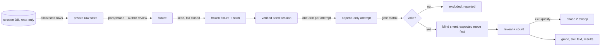

# feat: When and How to Use /feel and /drugs, From Replayed Stuck Moments

## Overview

Replay about eight real stuck moments and two or three ordinary turns from the author's OpenCode sessions, on Luna and Opus, under each command and argument arm. The author labels the next moves blind. A public guide is written from the counted results, along with any skill-text and tool-description changes the results support. Paid runs wait until a free probe shows the replay mechanism works end to end.

## Problem Frame

The author has never typed `/feel` or `/drugs` in about 225 turns, including at moments where one of them fits. Today nothing tells a person what those moments look like from the keyboard, or what an argument changes. Earlier probes used engineered seeds that models solved without help, and no one has measured what arguments do (see origin: `docs/brainstorms/2026-11-07-feel-drugs-usage-guide-requirements.md`).

## Requirements Trace

- R1–R6. Source moments, scrub and scan, extraction allowlist, private custody: Units 1–3.
- R7–R11, R14–R15. Arms, host and stack isolation, gates, recorded arguments, noise floor, budget, append-only evidence: Units 1 and 4.
- R12–R13. Blind hand labels, phase 2 selection and the stop rule: Units 5–7.
- R16–R19. Guide, skill and description edits, triage recommendation, recorded results, two-week count: Units 8–9.
- Success criteria map to Units 6, 8 and 9: counted claims, the usage count, and a plan with no invented arms or gates.

## Scope Boundaries

- No model judge, rubric, held-out set or matrix change. The eval prereg rule does not apply to plugin skills (see origin).
- No edits to `skills/` method text.
- Unprompted activation is out of scope, and no triage command is built.
- Only the author's daily OpenCode v1 harness build is used. Upstream 1.19.4 and v2 are not run.
- No new dependency. The existing scanner is extended.

### Deferred to Separate Tasks

- Building a triage command, if Unit 8 recommends one. That would be a new brainstorm.

## Context & Research

### Relevant Code and Patterns

- `src/spike/feel-drugs/guided.ts`:
  - `runOnce` handles per-run fixtures and records request bodies through the recording proxy.
  - It writes artifacts at mode 0600 and gates every write on `scanForLeaks` (`src/runner/manifest.ts`), an exact-needle check for the run's own credentials.
  - Command runs go turn 1, then `--continue --command`.
  - `runOnce` calls `rmSync` on the run directory before each run and again when a run throws, which conflicts with R15. `runOnce` and its context type are not exported.
- `src/runner/opencode.ts` (`runArgv`, `opencodeArgv`, `spawnCapture`, `debugConfig`) and `src/runner/spike/isolation.ts` (`runOpencode`, `debugCommand`) are the spawn and debug-config seams `runOnce` uses.
- `src/spike/feel-drugs/driver.ts`: `classifyStatus`, `withBackoff`, `checkFrozen`, `assertInside`, and the `NUDGE` sentence.
- `src/spike/feel-drugs/blind.ts` and `sheet.ts`:
  - The answers-only sheet with a separate key.
  - The fence-aware mark parser.
  - `reveal` refuses until every item is marked.
  - `fenced` and `redactPaths`.
- `src/runner/env.ts` (`createFixture`, `buildChildEnv`), `src/runner/workspace.ts` (`stateRoot`, `isInside`, `CustodyError`) and `src/runner/cliproxy.ts` (key fetched by name from the `infra` CLI, throwaway `auth.json`).
- `src/runner/isolation.ts`:
  - `checkDebugConfig` and the exact skill and tool sets reject a daily stack, so a new profile is needed.
  - `systemTexts` already reads three wire formats.
  - `userTexts` in `src/plugin/fixture.ts` handles chat-completions only.
- `src/runner/events.ts`: `isSkillContentLoad` covers `skill` tool calls only. A typed command delivers `<skill_content>` in the user message instead.
- `src/scan/secrets.ts`:
  - It misses `github_pat_`, `gh[ousr]_`, authorization and `x-api-key` headers, JWTs, PEM blocks and home paths.
  - It silently skips files over 2 MB, binary files, and the `node_modules`, `.git` and `runs` directories.
  - The CLI and `scanRepo` accept a root but walk only the fixed `SCAN_TARGETS` names, skipping missing ones silently, so a fixture directory can pass unscanned.
  - `RULES` is one shared list with no mode, so new rules would also change repo-mode results.
- Pinned text that must change together with any skill or description edit:
  - `src/plugin/skills.test.ts`, `src/plugin/frames-text.test.ts`, `src/mcp/server.test.ts`, `src/frames/feel-drugs.test.ts`.
  - The exact-count rewrite anchors in `src/hosts/rules.ts`.
  - `bun run generate` regenerates `hosts/*/skills/{feel,drugs}`.
  - The changeset gate covers `plugin/` and `src/frames/`.
- Public surfaces:
  - `README.md` "OpenCode plugin" and "Model notes".
  - `docs/install.md` "OpenCode plugin".
  - The spike README's `## Plugin reads`, which the matrix links to. Keep the heading.
  - The feel and drugs lines in `HYPOTHESES.md`.

### Institutional Learnings

- Isolation is shown, not assumed. Never fall back to the owner's auth store. Reports are allowlist projections (`docs/plans/2026-10-22-001-feat-metacogs-v01-foundation-plan.md`).
- Blind sheets carry answers only, with a separate key and reveal after all labels. Answers can still give away their arm, so note obvious tells (`docs/plans/2026-10-25-002-feat-opencode-plugin-plan.md`).
- Multi-word command arguments arrive JSON-quoted on v1. Plugin skills can be shadowed by same-named skills. Seed the config-dir plugin install once and run npm offline.
- Fro Bot's epoch rule covers contract files only. README and results edits need no epoch (`docs/solutions/best-practices/scope-llm-review-rules-to-protected-files-not-directory-globs-2026-10-29.md`).
- From the earlier probe sessions:
  - `--fork` runs sometimes hung after finishing.
  - A snapshot restore overwrote raw events.
  - macOS has no `setsid`.
  - Host-reported cost undercounted compared with the estimate.

### External References

- None. Every question is about local host behaviour, which Unit 1 settles by probing.

## Prior-Art Survey

```json
{
  "schema_version": 2,
  "verdict": "extend",
  "scope": "metacogs repo: src/spike/feel-drugs, src/runner, src/plugin/fixture.ts, src/scan, evals/spikes/feel-drugs, docs/solutions",
  "freshness": { "vcs_reference": "dedae02" },
  "budget": { "max_search_passes": 6, "max_candidate_inspections": 16, "exhausted": false },
  "candidates": [
    { "path_or_symbol": "src/spike/feel-drugs/guided.ts: runOnce, commandArgv, runGuided", "description": "fresh-fixture turn 1 then --continue --command turn 2, per-turn isolation, 0600 artifacts, pre-write leak scan; no history seeding", "disposition": "extend" },
    { "path_or_symbol": "src/spike/feel-drugs/driver.ts: classifyStatus, withBackoff, checkFrozen, assertInside, NUDGE", "description": "status classes, backoff, frozen-input hash, run-dir guard, nudge sentence", "disposition": "reuse" },
    { "path_or_symbol": "src/spike/feel-drugs/blind.ts: buildBlind, parseMarks, reveal", "description": "pairwise X/Y/same cells; per-arm labels with expected move and noise floor are not supported, helpers transfer", "disposition": "insufficient", "insufficiency_reason": "pairwise unit and eligibility rule do not fit per-arm direction labels" },
    { "path_or_symbol": "src/spike/feel-drugs/sheet.ts: fenced, redactPaths", "description": "fence-safe answer blocks, path redaction", "disposition": "reuse" },
    { "path_or_symbol": "src/runner/env.ts: createFixture, buildChildEnv", "description": "throwaway HOME/XDG and from-scratch child env", "disposition": "reuse" },
    { "path_or_symbol": "src/runner/isolation.ts: checkIsolation, checkDebugConfig, systemTexts", "description": "generated-config-only checks that reject a daily stack; three-wire system text reader", "disposition": "extend" },
    { "path_or_symbol": "src/runner/scripted-provider.ts: startRecordingProxy, gatewayOf, startScriptedProvider", "description": "body-recording proxy, gateway classification, scripted stub", "disposition": "reuse" },
    { "path_or_symbol": "src/runner/workspace.ts: stateRoot, isInside, CustodyError", "description": "outside-repo custody helpers", "disposition": "reuse" },
    { "path_or_symbol": "src/runner/cliproxy.ts", "description": "CLIProxyAPI key by name, throwaway auth file", "disposition": "reuse" },
    { "path_or_symbol": "src/scan/secrets.ts: scanText, scanRepo, RULES", "description": "pattern scanner without match output; missing token rules, silent skips, fixed SCAN_TARGETS walk, no mode", "disposition": "extend" },
    { "path_or_symbol": "src/runner/manifest.ts: scanForLeaks, CredentialLeakError", "description": "exact-needle pre-write gate for the run's own credentials", "disposition": "reuse" },
    { "path_or_symbol": "src/runner/opencode.ts: runArgv, opencodeArgv, spawnCapture, debugConfig; src/runner/spike/isolation.ts: runOpencode, debugCommand", "description": "host spawn, argv and debug-config seams used by runOnce", "disposition": "reuse" },
    { "path_or_symbol": "src/runner/events.ts: analyzeEvents, isSkillContentLoad", "description": "event parsing; skill-load detection covers skill tool calls only", "disposition": "extend" }
  ]
}
```

## Key Technical Decisions

- **Host.** Replays use the author's daily harness build, currently `1.19.5+harness.bf7f7dfe`, and record its version on every run. That is where the guide will be used, and the other plugins in the stack are untested on upstream 1.19.4.
- **Provider.** Both models go through CLIProxyAPI, using the existing `src/runner/cliproxy.ts` key flow and a throwaway credential file in each fixture. The ids are `openai/gpt-6-luna` and `anthropic/claude-opus-5-5`, both listed by the proxy (Unit 1). Every run records the model that actually answered.
- **Daily-stack isolation is a separate profile.** The stack is the owner's plugin set with the auth plugins removed. In that set:
  - magic-context's historian and dreamer are disabled;
  - remote MCPs are omitted;
  - Systematic's project sources are emptied;
  - AFT auto-update stays off;
  - slim's default agent (`orchestrator`) is used. Unit 1 showed `--model` is honoured.
  - slim's injected `context7` and `gh_grep` MCPs are disabled, along with its `council-inject` hook. The hook otherwise adds a Council Mode block to the `/drugs` arm only.
  - the author's AFT and magic-context settings are copied in, with the safety switches applied on top (`auto_update: false`, `embedding.provider: "off"`, `indexes.semantic: false`, and historian and dreamer disabled).

  The profile checks that the expected plugins loaded and that `feel` and `drugs` are offered. It records the full tool and skill list rather than demanding an exact set.
- **History replay is session import (settled by Unit 1).** Each fixture is an export-shaped session (`{ info, messages: [{ info, parts }] }`). For every attempt, a fresh fixture is cloned, the session is imported, and the arm is sent with `-s <id>`. `--fork` is rejected because it drops the source's `question: deny` rule and offers an unanswerable `question` tool. `--pure` is never used. Stdout and stderr go to files, not pipes.
- **Per-arm gate matrix.**
  - The main request is the one that offers both `task` and `feel`. Title and subagent requests use another model and are not gated on the returned model.
  - Command arms must show, in the last user message, the `# feel` or `# drugs` skill header followed by the `Base directory for this skill: …/plugin/skills/<name>` line, the tool offered, and the received argument text. Argument words are passed as separate argv elements so they arrive raw.
  - Baseline and nudge arms are recorded but not gated on a skill load.
  - Every arm must show the expected host version, agent and returned model, and no compaction.
  - A failure is an exclusion, never an outcome.
- **Append-only evidence.** Each attempt gets its own ID and directory, so a retry never deletes or overwrites an earlier attempt. The rule for which attempt counts is fixed before launch: the first terminal attempt counts.
- **Two scanners, two jobs.** `scanForLeaks` stays the pre-write gate on run artifacts for the run's own credentials. `src/scan/secrets.ts` gains a `fixture` mode, chosen through a new scan option. It adds the new rules and a whole-root walk that fails closed on any skipped or unreadable file, and leaves repo mode unchanged. A fixture must pass it before any provider call uses it, and every public artifact must pass it before commit, together with the author's review. Matches stay unprinted. The providers already received the original sessions, so the main leak surface is public output.
- **Moments are excluded, not reconstructed.** A moment is dropped when its deciding state can't be verified, for example a compacted key tool output or a next move made inside a subagent. If fewer than three moments qualify for phase 2, the sweep does not run (see origin).
- **The code lives in the spike.** New modules go under `src/spike/feel-drugs/replay/`. The spike already owns this evidence, and nothing in the shipped package depends on it.

## Open Questions

### Resolved During Planning

- Host: the daily harness. Opus route: CLIProxy. Missing state: exclude. Fewer than three qualifying moments: stop phase 2.
- A moment qualifies for phase 2 when, on at least one model, its two `Continue.` runs agree and at least one command arm has a counted `toward` change. Qualifiers rank by their count of counted `toward` changes.
- Skill and description edits regenerate the Claude Code and Codex copies too. The changeset says the evidence comes from OpenCode only.
- The two phase-1 substances and each moment's `somewhere` phrasing are drafted with the fixtures in Unit 3 and approved by the author before Unit 6.
- R6's public-artifact limit covers session-derived content. Unit 1's mechanism notes and Unit 9's aggregate count derive from no session text, and still pass the scanner and the author's review.
- Systematic hides no metacogs skill. The slim `orchestrator` agent sees all four. Other slim agents hide them, so replays run on `orchestrator`.

### Deferred to Implementation

- The mechanism (import or fork) and its exact invocation. Unit 1 decides.
- How the user text reads on the Responses and Anthropic wires. The probe's reader is checked against the first captured live body in Unit 6's cost probe.
- Cost per run with the full stack, from one paid run in Unit 6 before the cap is set.

## High-Level Technical Design

> *This illustrates the intended approach and is directional guidance for review, not implementation specification. The implementing agent should treat it as context, not code to reproduce.*



## Implementation Units

- [ ] **Unit 1: Free replay-mechanism probe**

**Goal:** Using only the scripted provider and the proxy's model list, show that a seeded history replays intact under the daily stack, and that the gates can read what they need. Decide the replay mechanism.

**Requirements:** R2, R7–R11

**Dependencies:** None

**Files:**
- Create: `src/spike/feel-drugs/replay/probe.test.ts`, gated on `METACOGS_HOST_PROBES=1`
- Modify: `evals/spikes/feel-drugs/README.md`, adding a short "Replay mechanism" subsection under `## Plugin reads`

**Approach:**
- Build a synthetic, non-sensitive history: user and assistant turns, a completed tool call and its result, and a subagent handoff.
- Try `import` and `-s`/`--fork`. Compare the replayed provider request with the source history.
- Load the daily stack in an isolated fixture on the harness host. Check `debug config` for `plugin_origins`, `default_agent` and the disabled historian and dreamer.
- Send `--model` and confirm the requested model reached the stub.
- Send `/feel` and `/drugs strong black coffee`. Capture where `<skill_content>` and the argument text sit in the request, on the chat-completions wire. List CLIProxy models at no cost to confirm the opencode-go route.
- Review the network egress of every plugin left in the stack and record the result. Seeds are built only in scratch fixtures, never from the live session DB.

**Execution note:** No paid call. Stop and report to the author if no mechanism passes fidelity.

**Patterns to follow:** `src/plugin/probe.test.ts` (gated host probes), `src/spike/feel-drugs/guided.ts` (recording proxy).

**Test scenarios:**
- Integration: a seeded history with a tool call replays with the same message and part count and order in the next request.
- Integration: under the daily stack, `feel` and `drugs` are offered, and the requested model reaches the stub.
- Integration: typed `/drugs strong black coffee` puts the drugs skill content and the argument text in the user message, and the probe records the argument verbatim.
- Error path: a seed whose history the host truncates or compacts is reported as failing fidelity.

**Verification:** The README subsection records the chosen mechanism, its exact host version and the request-body locations. The author sees the result before Unit 3.

---

- [ ] **Unit 2: Fixture-mode secret scanner**

**Goal:** A scanner that can block fixture and public-artifact writes.

**Requirements:** R4, R5, R16

**Dependencies:** None

**Files:**
- Modify: `src/scan/secrets.ts`
- Test: `src/scan/secrets.test.ts`

**Approach:**
- Add a `mode` scan option, `repo` (the default) or `fixture`.
- Fixture mode adds rules for `github_pat_` and `gh[ousr]_` tokens, Anthropic key prefixes, authorization and `x-api-key` header values, JWTs, PEM headers and home-directory paths.
- Fixture mode walks the whole root, not `SCAN_TARGETS`, and reports every skipped, oversized or unreadable file as a failure.
- Add a stamp that ties a scan result to the scanned content's hash.
- Repo-mode behaviour for `bun run scan:secrets` stays unchanged.

**Execution note:** Test-first.

**Patterns to follow:** existing `RULES` and `scanText` (never prints matched text).

**Test scenarios:**
- Happy path: each new token, header, JWT, PEM and home-path shape is flagged, and the output names the rule and the location but not the value.
- Edge case: a file over 2 MB, a file containing a NUL byte, and a `runs/` directory inside the scanned root each produce a failure, not a silent pass.
- Edge case: a clean directory passes, and its stamp matches the content hash. Editing one byte invalidates the stamp.
- Regression: repo-mode `scanRepo` uses the current rule list, and its results on the current tree are unchanged.

**Verification:** `bun run scan:secrets` still passes on the repo. The new tests pass.

---

- [ ] **Unit 3: Moment extraction and fixture store**

**Goal:** Turn the approved moments into frozen, scanned, private fixtures.

**Requirements:** R1–R6

**Dependencies:** Units 1 and 2. The author approves the moment list.

**Files:**
- Create: `src/spike/feel-drugs/replay/extract.ts`, `src/spike/feel-drugs/replay/store.ts`
- Test: `src/spike/feel-drugs/replay/extract.test.ts`, `src/spike/feel-drugs/replay/store.test.ts`

**Approach:**
- Open the session DB read-only, accounting for the WAL.
- Select only allowlisted columns from `session`, `message` and `part` for the approved session IDs, up to the cutoff message. Never read `account`, `control_account` or `credential`.
- Write raw rows to a private store under the state root (directories 0700, files 0600), refusing any path inside the repo.
- The fixture is a paraphrased history in the shape Unit 1 chose.
- For each moment, record its provenance, cutoff, exclusion check result, real-outcome reference, the author's review and the scan stamp.
- Freezing hashes the fixture. Any edit creates a new version and needs a new scan and review.
- Propose about six `/feel`-shaped and two `/drugs`-shaped moments, each with a known outcome, plus two or three ordinary turns, from the inventory. Include the two phase-1 substances and each moment's `somewhere` phrasing, and present them to the author for approval.
- Fixture hashes live in a manifest in the private store. The `checkFrozen` logic is copied, because it reads repo-relative targets.

**Patterns to follow:** `stateRoot`, `isInside` and `CustodyError` in `src/runner/workspace.ts`. The hash check in `checkFrozen` (`src/spike/feel-drugs/driver.ts`).

**Test scenarios:**
- Happy path: on a synthetic SQLite DB, extraction returns only allowlisted rows up to the cutoff, in order.
- Error path: a query touching the credential tables is impossible by construction, and a test asserts that the SQL never names them.
- Error path: a store path inside the repo throws a custody error.
- Edge case: a moment whose cutoff falls after a compacted tool output, or whose next move is in a child session, is marked excluded with a reason.
- Edge case: a frozen fixture whose bytes change fails its hash check and loses its scan approval.

**Verification:** Every approved fixture is frozen, scanned clean and reviewed. Nothing lands in the working tree (`git status` is clean apart from code).

---

- [ ] **Unit 4: Replay driver and gate matrix**

**Goal:** Run any fixture under any arm and model, append-only, gated and inside budget.

**Requirements:** R7–R11, R14, R15

**Dependencies:** Units 1 and 3

**Files:**
- Create: `src/spike/feel-drugs/replay/run.ts`, `src/spike/feel-drugs/replay/gates.ts`, `src/spike/feel-drugs/replay/cli.ts`
- Modify: `src/runner/isolation.ts` to add the daily-stack profile; `src/plugin/fixture.ts` or a shared helper for wire-aware user text; `package.json` for a `replay` script
- Test: `src/spike/feel-drugs/replay/run.test.ts`, `src/spike/feel-drugs/replay/gates.test.ts`, `src/runner/isolation.test.ts`

**Approach:**
- Each attempt is created at a fixed path (`<campaign>/<fixture>/<model>/<arm>/<attempt-id>`), and any existing directory is refused.
- The attempt seeds from the verified fixture, sends one arm message, and records the request bodies, stdout events, host version and cost.
- Arms:
  - two `Continue.` runs;
  - `/feel` with no args and with `somewhere`;
  - `/drugs` with no args and with each of the two substances;
  - "use whichever metacogs tool fits";
  - the nudge sentence with no tool named.
- Gates follow the matrix in Key Technical Decisions. A gate failure marks the attempt excluded, with the reason.
- The budget counter stops the campaign at the approved cap and records the remaining cells as not run.
- The replay permission set denies git push, `gh`, and writes outside the run's scratch store.
- Every artifact passes `scanForLeaks` before it is written.
- `runOnce` is extracted into a shared helper without either `rmSync`. A failed or excluded attempt keeps its directory.

**Patterns to follow:** `runOnce`, `classifyStatus` and `withBackoff` in the spike; `gatewayOf`; `buildChildEnv`; the spawn and debug-config seams in `src/runner/opencode.ts` and `src/runner/spike/isolation.ts`.

**Test scenarios:**
- Happy path: with the scripted provider, a fixture runs all nine arms, writes nine attempt directories, and each attempt records its arm, model, host version and received argument text.
- Edge case: rerunning a cell creates a second attempt and leaves the first untouched. The first terminal attempt is the counted one.
- Error path: an attempt that throws, or fails a gate, leaves its directory on disk with its reason.
- Error path: a command-arm attempt whose request lacks the skill content is excluded with reason `skill_not_delivered`, and is not labelled as a baseline.
- Error path: a returned model that differs from the requested one, or a compaction event in the attempt, excludes it.
- Edge case: a nudge-arm attempt that loads nothing is valid, with outcome "no tool".
- Error path: crossing the cap stops before the next provider call, and the unrun cells are listed.
- Integration: the daily-stack profile accepts the stack's extra commands and agents, and fails when `feel` or `drugs` is not offered.

**Verification:** The scripted end-to-end run passes, the isolation tests pass, and no attempt directory is ever removed.

---

- [ ] **Unit 5: Blind label sheet, reveal and count**

**Goal:** The author labels next moves blind, and the counts follow the noise-floor and selection rules.

**Requirements:** R11–R13

**Dependencies:** Unit 4

**Files:**
- Create: `src/spike/feel-drugs/replay/sheet.ts`
- Test: `src/spike/feel-drugs/replay/sheet.test.ts`

**Approach:**
- Step one is an expected-move file, which the author fills from the fixture alone before seeing any arm. It is locked by hash once filled.
- Step two is a sheet of shuffled opaque items, one per counted attempt. Each item shows the fixture's last turn and the next move, with command names, substances, tool traces and model names removed where that is possible without hiding the action.
- The key is stored separately. Labels are `same`, `toward`, `sideways`, `away` and `unclear`, and progress is saved atomically.
- Reveal refuses until every item is labelled. It then applies R11: a change counts only when it differs from both `Continue.` runs, and a moment whose `Continue.` runs differ contributes no counts.
- It ranks moments by counted `toward` changes for phase 2 and applies the fewer-than-three stop rule.
- Unavoidable tells, such as an answer that names a tool, are listed in the reveal.

**Patterns to follow:** `blind.ts` (fence-aware parse, key and sheet split, refuse to redraw) and `sheet.ts` (`fenced`, `redactPaths`).

**Test scenarios:**
- Happy path: a fixture with agreeing `Continue.` runs and a `toward` `/feel` label counts one change, and the moment ranks.
- Edge case: when the two `Continue.` runs differ, all changes on that moment are reported as uncounted.
- Edge case: a sheet saved halfway resumes with the same item IDs and order.
- Error path: reveal before all items are labelled, or before the expected-move file is locked, refuses.
- Edge case: with only two qualifying moments, the reveal reports that phase 2 does not run.
- Edge case: text that mentions `feel`, `drugs`, a substance or a model name is redacted in the item, or the item is flagged as a tell.

**Verification:** The scripted campaign from Unit 4 produces a sheet and key, and a synthetic labelling reveals the expected counts.

---

- [ ] **Unit 6: Phase 1 campaign**

**Goal:** Run phase 1 for real and collect the author's labels.

**Requirements:** R6–R15

**Dependencies:** Units 3–5. The author has approved the moments, substances and phrasings, and a small budget for one cost-probe run.

**Files:**
- Modify: `evals/spikes/feel-drugs/README.md`, adding a results subsection under `## Plugin reads` with counts only.

**Approach:**
- Announce the model each run will reach. Run one paid attempt within the probe budget to measure cost with the full stack, and report it with an estimate for the campaign. The author then approves the campaign cap.
- Run every fixture, model and arm. The author fills in the expected moves, labels the sheet and reveals.
- Record counts, exclusions and denominators.

**Test expectation:** none. This is a campaign run, covered by Units 4 and 5.

**Verification:**
- Every cell has a terminal attempt or a not-run reason.
- The results subsection carries only counts, scenario IDs and labels.
- It passes the scanner and the author's review.

---

- [ ] **Unit 7: Phase 2 sweep (conditional)**

**Goal:** Measure what arguments change on the three moments with the most counted changes toward the resolution.

**Requirements:** R13

**Dependencies:** Unit 6 shows at least three qualifying moments. The author approves the cap.

**Files:**
- Modify: `evals/spikes/feel-drugs/README.md`, results subsection

**Approach:**
- Four or five substances, three `somewhere` phrasings and the no-argument forms, with three repeats each and matched `Continue.` runs, on both models.
- The sweep reuses the same driver, sheet and reveal.
- The results are labelled exploratory, because phase 1 picked these moments for showing an effect.

**Test expectation:** none. This is a campaign run.

**Verification:** Counts are recorded per argument form, with denominators.

---

- [ ] **Unit 8: Guide, skill text and descriptions**

**Goal:** Publish what the counts support, and change only the text the counts support.

**Requirements:** R16–R18

**Dependencies:** Unit 6, and Unit 7 if it ran.

**Files:**
- Create: `docs/using-feel-and-drugs.md`
- Modify: `README.md` (link from "OpenCode plugin" and update "Model notes"), `docs/install.md` (link from "OpenCode plugin")
- Modify, only where supported: `plugin/skills/feel/SKILL.md`, `plugin/skills/drugs/SKILL.md`, `src/frames/feel-drugs.ts`
- Test, updated alongside: `src/plugin/skills.test.ts`, `src/plugin/frames-text.test.ts`, `src/mcp/server.test.ts`. The verbatim upstream pin in `src/frames/feel-drugs.test.ts` stays unchanged.
- Generated: `hosts/claude/skills/{feel,drugs}/SKILL.md`, `hosts/codex/skills/{feel,drugs}/SKILL.md`, via `bun run generate`
- Create: `.changeset/<name>.md` (patch), if `plugin/` or `src/frames/` changed. It notes that the evidence comes from OpenCode only.

**Approach:**
- The guide covers the person-side signals for each command, generic scenarios, what each argument form did (as counts), when neither command fits, and the results table.
- A scenario that could identify a private incident is merged with another or left out.
- Skill and description edits keep the activation-text rules, keep the anchors in `src/hosts/rules.ts`, and pass the banned-word checks.
- The triage recommendation compares the "whichever fits" arm with its nudge-only control. It is recorded in the spike README results, and the guide states it in one line.

**Test scenarios:**
- Happy path: the updated pinned-text tests assert the new wording, and the no-damping and banned-word checks still pass.
- Integration: `generate:check` passes, and every exact-count host rewrite rule still matches once.
- Edge case: when no change is supported, the skill and description files are unchanged, and the guide says so.

**Verification:**
- `typecheck`, `bun test`, `generate:check`, `matrix:check`, `scan:secrets` and `changeset:gate` pass.
- The guide passes the fixture-mode scan and the author's review.

---

- [ ] **Unit 9: Results record and two-week usage count**

**Goal:** Record the outcome next to the earlier spike, then check daily use.

**Requirements:** R15, R19

**Dependencies:** The usage tool lands with Unit 8. The count runs once the 14-day window after the merge has closed, tracked by a smart note.

**Files:**
- Modify: `HYPOTHESES.md` (one line under feel/drugs), `evals/spikes/feel-drugs/README.md`
- Create: `src/spike/feel-drugs/replay/usage.ts`
- Test: `src/spike/feel-drugs/replay/usage.test.ts`

**Approach:**
- A read-only count of typed `/feel` and `/drugs` in the author's main sessions. The window is the 14 days after the merge timestamp, in UTC.
- Exclude replay and test sessions. For each use, record the next human turn's paraphrase as "what it led to".
- Add the aggregate to the README and `HYPOTHESES.md` after it passes the scanner and the author's review.

**Test scenarios:**
- Happy path: a synthetic DB with two typed uses inside the window and one outside counts two.
- Edge case: a use inside a replay fixture session is excluded.
- Edge case: a window with no uses reports zero, which is distinct from inaccessible or compacted sessions.

**Verification:** After the window closes, the count is recorded with its window and exclusions.

## System-Wide Impact

- **Interaction graph:** the replays run the full daily plugin stack. The shipped plugin changes only in Unit 8.
- **Error propagation:** a gate or scanner failure stops or excludes the attempt. It never silently passes.
- **State lifecycle risks:** the live session DB is only ever read. All replay state lives in throwaway fixtures and the private store, and attempts are never deleted.
- **API surface parity:** the skill and description edits flow to the Claude Code and Codex renders through `generate`.
- **Unchanged invariants:**
  - The `skills/` method text, eval preregs, matrix statuses and the `## Plugin reads` heading.
  - The repo-mode behaviour of `scan:secrets`.

## Risks & Dependencies

| Risk | Mitigation |
|------|------------|
| No replay mechanism preserves the history | Unit 1 stops the plan before any paid run. The author decides the next step. |
| Fixtures leak private context into public text | Scanner plus author review on every public artifact. The results table carries counts and scenario IDs only. |
| A plugin in the stack sends transcript text elsewhere | magic-context historian and dreamer off, no remote MCPs, Systematic sources emptied. Confirmed via `debug config` in Unit 1. |
| Run-to-run noise reads as an effect | Two `Continue.` runs per moment, counts only above that floor, and phase 2 labelled exploratory. |
| Selected-success bias in phase 2 | Stated in the results. Phase 2 is not presented as confirmation. |
| Cost overruns | Measured per-run cost, an approved cap per phase, and a hard stop at the cap. |
| A hung run (`--fork` hangs were seen before) | A per-attempt timeout kills the process group. The attempt is recorded as `timeout`. |

## Documentation / Operational Notes

- The fixtures, raw store and sheets live under the metacogs state root, outside the repo. Before Unit 8 lands, the author decides whether to keep them or purge them.
- Any `evals/spikes/feel-drugs/README.md` edit is a results edit, so no epoch line is needed.

## Sources & References

- **Origin document:** [docs/brainstorms/2026-11-07-feel-drugs-usage-guide-requirements.md](../brainstorms/2026-11-07-feel-drugs-usage-guide-requirements.md). It is untracked until the implementation PR.
- Related past work: `docs/plans/2026-10-25-001-feat-feel-drugs-spike-plan.md`, recorded as active. It ran engineered prompts. This plan replays real moments and varies arguments.
- Related past work: `evals/spikes/feel-drugs/README.md` activation and reminder probes, recorded as closed. Those were about unprompted activation. This plan covers typed commands.
- Related code: `src/spike/feel-drugs/`, `src/runner/`, `src/scan/secrets.ts`.

## As Built

- **What phase 1 became.** The paraphrased-fixture phase 1 ran 188 attempts but became a dry run of the mechanics. The fixtures had no repository behind them, so most answers were spent on failed `git`/`gh` calls, and three fixtures stopped before their stuck point.
- **What replaced it.** A real-world mode (`replay campaign --world real`). Each attempt imports the session's real history up to the cutoff into a sandboxed clone of the real repository at that moment. The daily plugin stack is loaded, `gh` reads are allowed, and outward actions are denied.
- **Arms.** Trimmed to `Continue.` ×2, `/feel`, `/feel <where>`, `/drugs` and `/drugs <substance>`.
- **Judging.** The hand-marked blind sheet (Unit 5) was replaced by an automated judge (`replay judge`, `opencode-go/glm-5.3`). The judge compares each arm's first move with both baseline runs and with the private outcome reference. A seeded spot-check list replaces full marking.
- **Phase 2.** The argument sweep was folded into the single real-world campaign.
- **Results and guide.** Results are in `evals/spikes/feel-drugs/README.md` (Real-world replay results). The guide is `docs/using-feel-and-drugs.md`. Both bare-command paragraphs in `plugin/skills/{feel,drugs}` now steer toward a concrete target.
